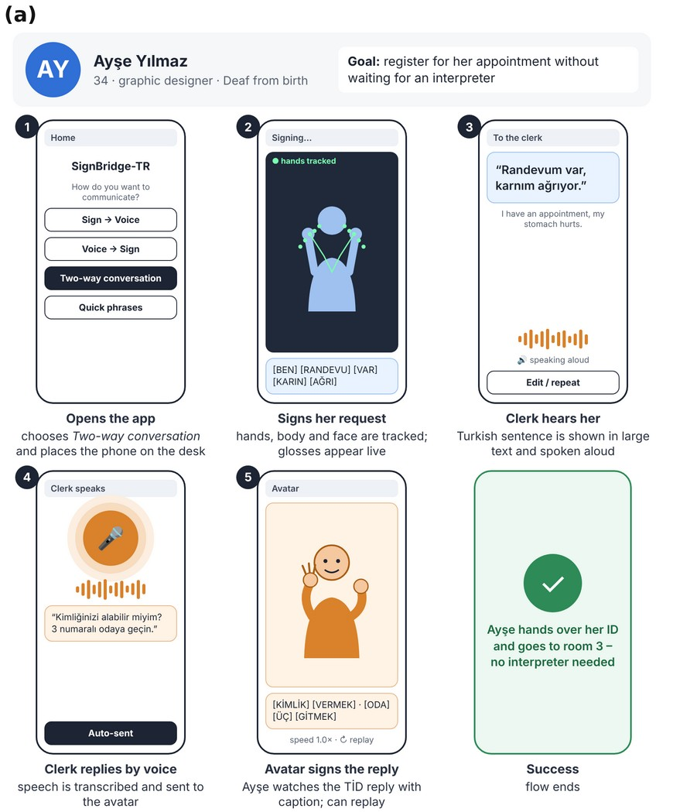
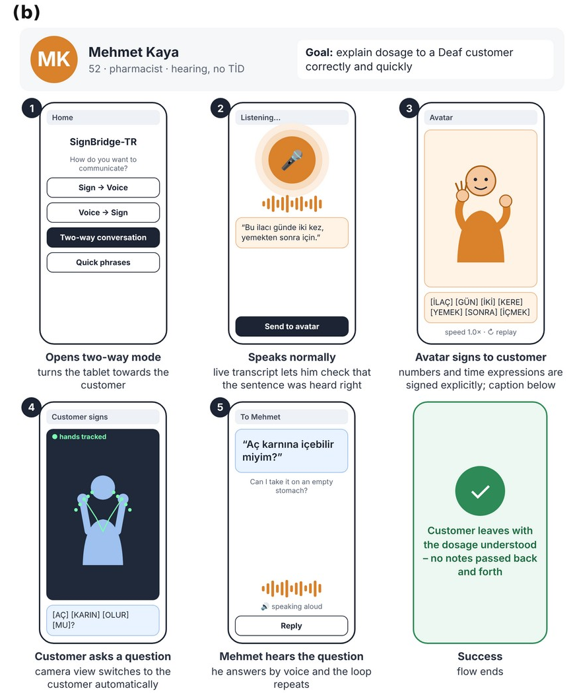
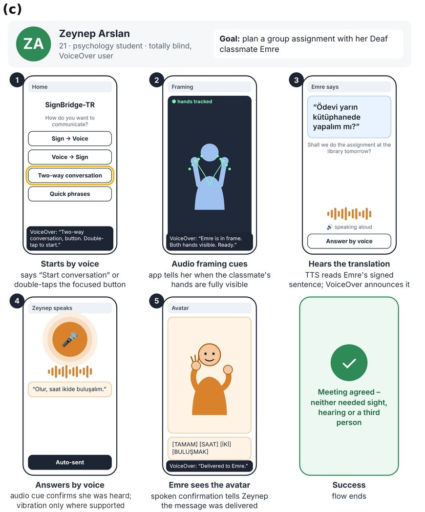
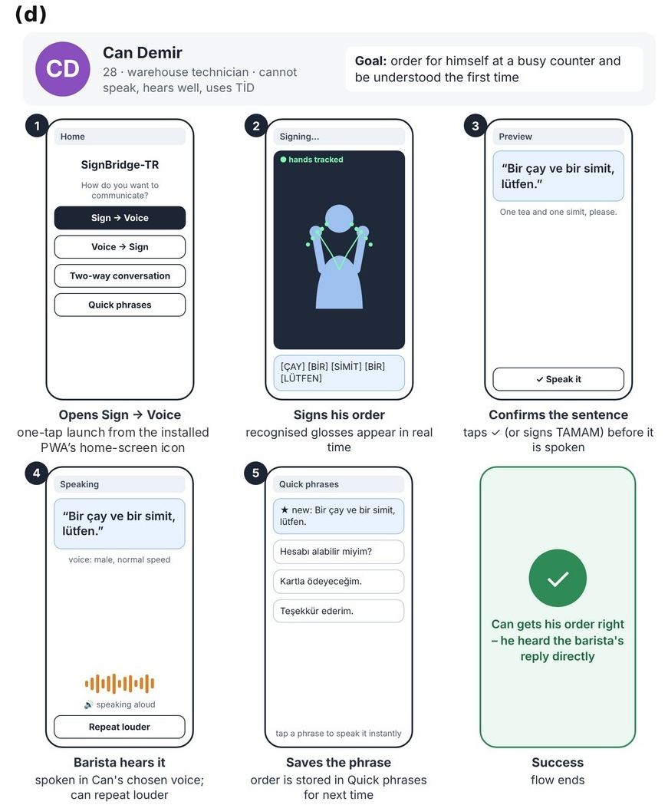

**Status.** These notes add detail to the revised proposal (v1.1). They are a draft for team review. They are **not** the Statement of Work, have not been approved by the advisor, and report **no measurement results**: every number below is either a target already in the proposal or a clearly labelled assumption. The proposal can be read without these notes; where the two differ, the proposal applies.

# 1. Feasibility check (before the Statement of Work, 13 November 2026)

Planned for late October – early November 2026. Only the supplied sample files have been checked (see the AUTSL status below); none of the checks in the table has been completed for the full Dataset.

| Check | What is recorded | Output |
|---|---|---|
| Download and extraction | Full download of the training, validation and test archives; extraction with the instructions provided; file counts and integrity against the class-mapping file; terms of use | Verified / not verified, with problems found |
| Class list and gloss mapping | Each Dataset class mapped by hand to a gloss and its Turkish equivalents | Mapping table |
| Scenario coverage audit | See §1.1 | Coverage per scenario |
| Landmark quality | On sample clips: share of frames with missing or occluded hands; effect of lighting and fast movement | Quality summary |
| Preprocessing time | Landmark extraction time per clip on the extraction machine | Time per clip and estimate for the Dataset |
| First device benchmark | See §3 | Benchmark records |
| Offline vs browser | The same sample clips run through the offline extraction and the browser pipeline; landmarks compared | Difference summary |

Decision thresholds (for example, what coverage is enough) are agreed with the advisor and are not set here.

**AUTSL status.** Access instructions were provided on 21 October 2026. A team member subsequently reported downloading the data. Decoding and label matching were verified for the supplied sample files; completeness and integrity of the full dataset remain to be checked. No permission to redistribute the data, derived landmarks or animations is assumed. BosphorusSign22k is the alternative if AUTSL cannot be downloaded or used under its terms.

**What the sample check covered.** No video, frame, link or password from the Dataset is included in these notes.

| Item | Result of the sample check |
|---|---|
| Sample videos | 6 MP4 files for 4 sample IDs (RGB and depth); all decoded without errors; 512×512 pixels, 30 fps |
| RGB–depth pairing | The RGB and depth files of the same sample ID can be paired; files of different IDs are different samples (e.g. sample 1000 and sample 1 of the same signer) |
| Label matching | All 4 sample IDs found in the label files (one in test, two in training, one in validation) |
| Class list | 226 classes, IDs 0–225, with Turkish and English names |
| Release | Label files list 28,142 / 4,418 / 3,742 training / validation / test samples (36,302 in total) from 31 / 6 / 6 signers with no signer in two splits; this matches the challenge release [7], not the 38,336 samples reported in the original AUTSL paper |
| Not checked | Completeness and integrity of the full download; MediaPipe extraction; landmark quality; browser frame rate; any accuracy |

The 30 fps of the source videos says nothing about the frame rate the app will reach. Only RGB videos are used, through MediaPipe; the Dataset’s Kinect skeleton data and an RGB-D model are out of scope. Training, validation and test splits are kept separate, and no choice is made on test results.

## 1.1 Scenario coverage audit

For each persona scenario (Ayşe, Mehmet, Zeynep, Can), the team lists the glosses that the scenario dialogue needs.

- *Required glosses (denominator):* every distinct sign the scenario needs to be recognised in Direction A. Fingerspelled words (names, unknown words) are listed separately and **not** counted as covered.
- Each required gloss is marked *exact match* (a Dataset class with the same meaning), *uncertain match* (similar name or meaning; sign identity still to be checked) or *missing*.
- *Coverage (numerator):* exact matches only. *Coverage* = exact matches ÷ required glosses, reported per scenario with the lists of uncertain and missing glosses. No coverage value has been computed yet.

Scenario dialogues are then fixed using the covered vocabulary; user profiles are kept, and dialogue content that is not covered is narrowed. Vocabulary must **not** be assumed to be in the Dataset. A name check against the class list shows, for example, that hastane (hospital), doktor (doctor), ilaç (medicine), eczane (pharmacy), saat (hour), yardım (help) and yarın (tomorrow) are classes, while randevu (appointment), karın (stomach), ağrı (pain) and gitmek (go) are not; absent words are not shown as recognisable. The single saat class does not cover numbers or clock times. The recognition vocabulary (Dataset classes, Direction A) is separate from the avatar clip vocabulary (Direction B).

The 12 entries in the SB-14 lexicon report (e.g. OKUL, HASTANE, DOKTOR, İLAÇ, RANDEVU, ECZANE) are marked there as illustrative and unverified. A comparison by class name only gives 8 of 12 found (OKUL, HASTANE, DOKTOR, İLAÇ, YARDIM, YARIN, ECZANE, TEŞEKKÜR) and 4 not found (SU, RANDEVU, BUGÜN, GİTMEK). This is a name match, not a check that the Dataset sign is the intended TİD sign. A missing class is a vocabulary gap for the scenarios, not a sign of an incomplete or damaged download; completeness is checked separately.

# 2. MediaPipe versions and point schema

- The legacy MediaPipe Holistic solution outputs 543 landmarks: 33 pose, 468 face and 21 per hand [1].
- The current Holistic Landmarker outputs 553 landmarks: 33 pose, 478 face (including 10 iris points) and 21 per hand [2]. Its guide gives no frame-rate or hardware figures [2].
- The version is **not chosen yet**. Training-data extraction and the browser must use the same version and the same selected points (hands 2 × 21, upper body, selected face points), pinned before training. Using the same version is necessary but does not prove equivalence; the offline-versus-browser comparison (§1) checks it.
- Landmarks extracted with MediaPipe from the Dataset videos are not the same as the Dataset’s own Kinect skeleton data; the pipeline uses the MediaPipe landmarks.

# 3. Device benchmark record

One record per device and configuration:

| Field | Content |
|---|---|
| Device | Model; CPU/GPU; RAM; operating system and version |
| Browser | Name and version |
| Model | Model file size; format (ONNX / TF.js) |
| Conditions | Camera resolution; MediaPipe settings; lighting; power mode |
| Camera fps | Frames per second delivered by the browser |
| Landmark fps | Frames per second completed by MediaPipe |
| Classification time | Per 32–64-frame window |
| End-to-end latency | As defined in §4 |
| Robustness | Missing or occluded hands and dropped frames during fast movement |

Minimum supported devices are derived from these records. If landmark processing misses the target, lighter MediaPipe settings and lower resolutions are tried; if it still misses it, the device is not supported. Server-assisted classification reduces only the classification cost, because landmark extraction still runs on the device. No RAM, storage or bandwidth limit is stated before measurement.

# 4. Latency events (O5)

| Event | Definition |
|---|---|
| Sign end | Automatic mode: last frame of the final sign before the rest pose or pause, taken from the landmark stream |
| Pause detected | The moment the system decides that the hands are at rest or still |
| Capture window end (manual fallback, only if offered) | The user ends the capture window for one sign; processing of that sign starts here |
| Input complete | The user’s accessible “done / finish input” control (or a longer pause): the whole sign sequence is complete; not a single sign boundary |
| Sentence confirmed | The user confirms or edits the generated sentence before it is spoken; separate from input completion |
| Spoken output start | First audio sample of the TTS output |
| Speech end | End of voice activity in the microphone input |
| Avatar start | First rendered frame of the first clip |

**Sign boundaries (proposed; nothing implemented or validated).** A single short pause is not taken as a sign end, because some signs contain internal holds. Automatic segmentation would combine hand motion (landmark velocity), return to a rest pose and pause duration; the combination and its thresholds are set in pilot tests. No duration or success rate has been measured.

**Manual single-sign fallback (possible, not adopted).** If automatic segmentation is not reliable enough, an accessible manual mode in which the user starts and ends the capture window for one sign may be offered. Capture here is a temporary on-device processing window: no video file is saved, nothing is sent to a server and no training data is collected. Whether the mode is offered depends on the feasibility results and a scope review with the advisor (D-21).

**Controls.** The “done / finish input” control marks the end of the whole sign sequence, not of one sign, and is separate from the confirm/edit step before speaking. All controls are buttons with screen-reader labels and keyboard shortcuts; a voice command is only an alternative, never the only way.

The O5 sign-language budget runs from *sign end* to *spoken output start* in automatic mode, so pause detection is included. In the manual fallback, system time is counted from *capture window end*, and the user’s interaction time (sign end to capture window end, where it can be measured) is reported separately; manual-mode results are reported separately from automatic-mode results and are not used on their own to claim O5. How O5 applies to the manual mode is an advisor decision (D-22); the ≤2.0 s and ≤2.5 s targets are unchanged. Where the user confirms the sentence first, the time between the sentence being shown and the user’s confirmation is excluded and reported separately; system time before and after the confirmation is counted. Stage times are measured separately: landmark extraction, pause detection, classification, LLM and TTS for Direction A; chunked speech-to-text with voice-activity detection, LLM and clip loading for Direction B. Whisper-class models do not stream natively; chunking adds delay, which is part of the measurement. No stage time has been measured yet.

# 5. Bandwidth estimate for server-assisted classification

Only relevant if server-assisted classification is chosen (not decided).

**Formula.** upload (bytes/s) ≈ N_selected × coordinates_per_point × bytes_per_coordinate × fps, plus, counted separately: confidence values (if sent), a timestamp per frame, and message and protocol overhead.

**Illustration only.** With 75 points (33 pose + 2 × 21 hand points; **no face points**, because they are not selected yet), 3 coordinates, 4 bytes per coordinate and 30 fps: 75 × 3 × 4 × 30 = 27,000 bytes/s ≈ 0.22 Mbit/s before the additions above and before compression. Uncompressed 16 kHz, 16-bit mono audio for a server-side speech service is 256 kbit/s. These are assumptions, not measurements.

# 6. Language evaluation

## 6.1 Gloss → Turkish (O2)

- *Test set:* 100 gloss sequences fixed before testing; separate from the examples used to develop prompts and rules, which are never reused for testing. Varied by domain (health, pharmacy, public services, daily conversation), sentence type (statements, questions, negation, numbers, times) and phrasing not seen in development. These sequences are not training data for the recognition model.
- *Rubric:* meaning is correct if all content of the gloss sequence is kept and nothing is added; grammar is correct if the sentence is well-formed Turkish. An output passes only if both are correct.
- *Agreement:* two native Turkish speakers rate independently. Cohen’s κ [3] and percent agreement are computed on these independent ratings **before** discussion. Disagreements are then resolved, and the **agreed** ratings give the success rate.
- *Target and uncertainty:* the ≥80% target applies to the point estimate; the 95% Wilson interval [4] is reported alongside (for example, 80 of 100 gives about 71–87%). The lower bound is not a success condition. The rate describes this test set; it is not a failure rate per user, and user task success is measured separately in O7.

## 6.2 Turkish → gloss (Direction B, RQ2)

- *Unit:* one Turkish sentence and its generated gloss sequence; a separate held-out set from the four domains.
- *References:* a reference gloss sequence per sentence with listed acceptable alternatives. Written by a TİD interpreter or fluent signer if available; otherwise by the team from the Current TİD Dictionary and reported as not expert-validated.
- *Criteria:* preserved meaning, numbers, times, questions and negation; linguistic acceptability. Exact match with one reference, or word order alone, is not proof of correct TİD.
- *Size and threshold:* to be agreed with the advisor; no threshold is set.

## 6.3 Hypothesis 2

The LLM alone and the LLM with the rule layer convert the same held-out sentences, with the model version, prompts and generation settings fixed and recorded. Each output is rated meaning-preserving or not, giving paired binary results; these are compared with McNemar’s test [5], and the difference in proportions is reported with its uncertainty. No result is claimed.

# 7. Speech recognition (O3)

- Planned controlled test: 200 sentences in a quiet room; the ≤15% WER target applies to this condition only. Nothing has been measured.
- Robustness: WER reported separately for different speakers, devices, distances and background noise, without a target.
- Audio source (open decision): an existing licensed Turkish speech corpus whose terms allow this use, or recordings made only within the approved ethics process. No new voice recording is committed to.

# 8. Avatar evaluation (O4)

Three kinds of evidence are kept apart; none replaces another.

1. **Sign recognition by Deaf TİD users.** Each clip is shown without a caption or other cue to its meaning. The participant gives the meaning in their preferred way (in TİD with an interpreter, or in Turkish); Turkish reading or writing skill is not treated as TİD comprehension. Answers are scored against a key of acceptable meanings and variants prepared before testing. Rate = correct clip–participant answers ÷ all valid clip–participant answers. O4’s “≥75% of signs” is computed as this answer-level rate; a per-sign counting rule instead is an advisor decision (D-19). Rules for replays, missing answers and which clips each participant sees are fixed before testing. No participant or sample number is set here beyond the proposal’s targets.
2. **Reference conformance.** Two reviewers independently rate each clip against its Current TİD Dictionary video on handshape, orientation, location, movement and applicable non-manual features; a clip passes only if all applicable components match. Disagreements go to a third reviewer where possible, otherwise to discussion. Reviews by the team members who made the clips are not independent expert or user evidence, and this check does not measure comprehension; it is reported separately and does not replace measures 1 and 3, which are reported as **not measured** if suitable TİD users cannot be reached.
3. **Sentence comprehension.** The 50 test sentences are shown without the Turkish text. The meaning reported by the participant is compared with a prepared meaning key; it counts as understood if the key content (who, what, when, numbers) is correct and nothing contradicts the sentence. Rate = understood answers ÷ all valid sentence–participant answers. If no suitable TİD users can be reached, this is reported as **not measured**, and the corresponding O4 criterion is not verified.

The O4 target group for comprehension is Deaf TİD users; including other fluent TİD users is a decision for the advisor. κ and percent agreement are computed on independent ratings before discussion; agreed ratings give the rates.

# 9. Data flow and services

| Data | Processed | May leave the device | Processed by | Retention | Open decision |
|---|---|---|---|---|---|
| Camera video | On the device (MediaPipe) | Never | — | Not stored | — |
| Microphone audio | Speech-to-text; browser voice commands | If an external speech service is used; browser speech recognition is server-based by default unless on-device processing is available [6] | Speech provider or browser vendor | Not stored by the app | Local or external; provider |
| Landmark sequences | On the device | Only if server-assisted classification is chosen | Own back-end | Not stored | Whether sent |
| Glosses and Turkish text | Back-end, LLM, TTS | For sentence generation, Turkish → gloss and speech output | Own back-end; local or external LLM/TTS | To be set before the evaluation | Local or external; retention |

No provider has been selected. Before a provider is chosen, its data-processing terms are assessed against KVKK; no provider name, retention period, exclusion from model training or legal guarantee is assumed. Voice commands always have keyboard and touch alternatives. Local Whisper or an open-source LLM are candidates, not measured defaults. The proposed test protocol uses scripted, fictional service scenarios and no real patient data; the team still has to confirm it.

# 10. Ethics and consent alignment

- **Training data.** The current training plan prioritises existing datasets, starting with AUTSL and considering BosphorusSign22k where suitable and permitted. If the coverage audit identifies gaps that cannot be addressed through these datasets or reasonable scope adjustments, supplementary sign recordings may be considered. Any new data collection will require advisor agreement on the revised scope, workload and schedule, together with the necessary ethics approval, participant consent and data-use arrangements before collection begins. This is a team revision proposal (23 October 2026) to the advisor, not an approved change; no collection is planned, and the earlier ≥150-sign / ≥10-person recording targets are not restored. Any supplementary recordings would keep the signer-independent split (no signer in two of training, validation and test) and would not be chosen on test results.
- Evaluation data from participants are research data, covered by the ethics application, and are not used as training data. Supplementary sign recordings would be a separate collection with its own approval, consent and data-use terms.
- Whether evaluation sessions are recorded on video or audio is **not decided**. The draft consent forms in the repository (`docs/consent/consent-form-EN.md`, `docs/consent/onam-formu-TR.md`) currently list video and audio recording and their deletion; `docs/ETHICS.md` also states that only anonymous keypoints and text leave the device. Both must be aligned with the recording decision and with the data-flow table (landmarks are treated as personal data, not as anonymous).
- No test with participants – simulated-condition pre-tests included – begins before ethics committee approval; the review may take two to three months.

# 11. Participants and outreach

Initial contact has been made; a response is pending. No institution, date or expert support is stated or assumed. The SB-20 plan lists at least three institutions and contacts at least two, with follow-up; participant numbers are agreed with the advisor before testing.

**Two-stage evaluation (team decision, 23 October 2026; not yet reviewed by the advisor).** (1) Pre-tests under simulated conditions in the defined service scenarios examine system behaviour and interface problems. (2) If suitable volunteers can be reached, an additional evaluation is held with target users: Deaf/hard-of-hearing TİD users, blind users and hearing people who do not know TİD. The earlier fixed quotas (≥12 participants; ≥5 / ≥3 / ≥4) were removed and no new numbers are set: participant numbers, distribution and sampling are agreed with the advisor for each stage before testing, according to the purpose of the evaluation and access. Participant numbers and scenario numbers are different things (the four persona scenarios stay). Results are reported per stage and group with actual numbers and limitations; ≥80% task completion and mean SUS ≥70 apply within each stage and group and are not pooled across groups. Simulated conditions are not equivalent to lived disability experience, so simulated results alone do not verify usability for target users, and small samples are not generalised. If suitable TİD users cannot be reached, the O4 user measures are reported as **not measured** and the reference-conformance check does not replace them. Simulated pre-tests with participants are not exempt from ethics approval and consent.

# 12. Avatar approach research (SB-25) – checklist

For the 300-sign library (target unchanged): clip source and its usage, derivation and redistribution terms; candidate production methods (for example manual animation in Blender, or retargeting MediaPipe landmarks from Dataset videos – candidates only; landmark coordinates do not by themselves guarantee good animation); effort per clip in a small pilot; finger, face and motion quality (jitter, hand overlap); access to TİD experts or participants for review; schedule and total effort. Any change to the target is an advisor decision.

# References

[1] Google, “MediaPipe Holistic” (legacy solution), MediaPipe documentation. https://github.com/google-ai-edge/mediapipe/blob/master/docs/solutions/holistic.md (accessed Oct. 21, 2026).

[2] Google AI Edge, “Holistic landmarks detection task guide,” MediaPipe Solutions. https://developers.google.com/edge/mediapipe/solutions/vision/holistic_landmarker (accessed Oct. 21, 2026).

[3] J. Cohen, “A coefficient of agreement for nominal scales,” *Educational and Psychological Measurement*, vol. 20, no. 1, pp. 37–46, 1960.

[4] E. B. Wilson, “Probable inference, the law of succession, and statistical inference,” *J. Amer. Statist. Assoc.*, vol. 22, no. 158, pp. 209–212, 1927.

[5] Q. McNemar, “Note on the sampling error of the difference between correlated proportions or percentages,” *Psychometrika*, vol. 12, no. 2, pp. 153–157, 1947.

[6] Mozilla, “Using the Web Speech API,” MDN Web Docs. https://developer.mozilla.org/en-US/docs/Web/API/Web_Speech_API/Using_the_Web_Speech_API (accessed Oct. 21, 2026).

[7] O. M. Sincan, J. C. S. Jacques Junior, S. Escalera, and H. Y. Keleş, “ChaLearn LAP large scale signer independent isolated sign language recognition challenge: Design, results and future research,” in *Proc. IEEE/CVF Conf. Comput. Vis. Pattern Recognit. Workshops (CVPRW)*, 2021.

# Appendix – Figure 2: happy-path wireframes (corrected)

Moved from the proposal so that the wireframes are readable. Wireframe (c) shows the proposed independent blind-user path; it awaits the open team/advisor scope decision (matrix D-23) and is not an agreed MVP commitment. Two captions were corrected: (c) step 4 now reads “audio cue confirms she was heard; vibration only where supported”, and (d) step 1 reads “one-tap launch from the installed PWA’s home-screen icon” (a PWA has no lock-screen widget). Labels are in English for readability; the final interface will be in Turkish. Gloss examples are illustrative and unverified; several wireframe glosses (e.g. SİMİT, BİR, KARIN) are not Dataset classes, so the wireframes do not show the recognisable vocabulary.

{width=5.6in}

{width=5.6in}

{width=5.6in}

{width=5.6in}

