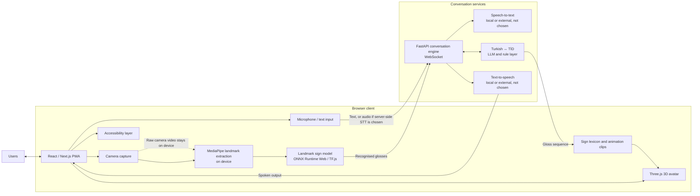

# SB-8: Project Proposal and Scope

**Project:** SignBridge-TR (İşaret Köprüsü)  
**Jira:** [SB-8 — Project Proposal and Scope Statement Finalization](https://el-dili.atlassian.net/browse/SB-8)  
**Source proposal:** [SignBridge-TR Project Proposal (PDF)](./SignBridge-TR_Project_Proposal.pdf)  
**Related:** [List of changes](./SB-18_Proposal_List_of_Changes.md) · [Supporting Technical Notes](./SB-18_Supporting_Technical_Notes.md) · [Instructor Feedback and Team Review Matrix](./SB-18_Instructor_Feedback_Matrix.md)

This scope companion summarises the proposal’s scope, architecture, requirements, users and risks. The PDF is the complete proposal. SB-8 was completed in Sprint 1 with proposal v1.0 (9 October 2026). The revised v1.1 draft (SB-18, prepared 20–23 October 2026) is awaiting team review and resubmission to the advisor (due 23 October 2026); this companion matches that draft.

## Aim and scope

SignBridge-TR is a browser application (PWA) for communication between Turkish Sign Language (TİD) users and people who do not know TİD, including blind and low-vision users, in two directions: (A) TİD signs → Turkish text and speech; (B) Turkish speech or text → TİD signs performed by a 3D avatar. The MVP (minimum viable product) recognises isolated TİD signs separated by user pauses and supports constrained conversion between gloss sequences and Turkish sentences within the selected vocabulary and scenarios. Turkish-to-sign output uses a predefined avatar animation library. Recognition and translation of unrestricted continuous TİD signing are outside its scope.

## Data, model and feasibility

- **Training data:** the model is trained on the Dataset: AUTSL, or BosphorusSign22k if AUTSL cannot be downloaded or used under its terms. The current training plan prioritises existing datasets, starting with AUTSL and considering BosphorusSign22k where suitable and permitted. If the coverage audit identifies gaps that cannot be addressed through these datasets or reasonable scope adjustments, supplementary sign recordings may be considered. Any new data collection will require advisor agreement on the revised scope, workload and schedule, together with the necessary ethics approval, participant consent and data-use arrangements before collection begins. (Team revision proposal of 23 October 2026; not approved by the advisor; no collection planned.) AUTSL access was requested on 20 October 2026, and an AUTSL author replied. Access instructions were provided on 21 October 2026. A team member subsequently reported downloading the data. Decoding and label matching were verified for the supplied sample files; completeness and integrity of the full dataset remain to be checked. The label files match the AUTSL challenge release (36,302 samples, 226 classes, 31 / 6 / 6 signers in training / validation / test, no shared signers), not the 38,336 samples of the original paper. No right to redistribute the data, derived landmarks or animations is assumed.
- **Pipeline:** RGB videos → MediaPipe landmarks (not the Dataset’s Kinect skeleton data; no RGB-D model) → class labels → gloss/lexicon mapping → recognition model. Training and browser use the same MediaPipe version and point schema; the version (legacy Holistic, 543 landmarks, or Holistic Landmarker, 553) is not chosen yet.
- **Model:** simple baselines, a Transformer encoder and a graph network trained from scratch, and fine-tuning of a pose-based pretrained model only if its format, licence and browser export fit, are compared on the signer-independent split. Vocabulary and model are chosen on training/validation data; the test split is used once.
- **Feasibility check (late October – early November 2026, before the SoW scope is fixed on 13 November):** download/extraction/terms; class and gloss mapping; scenario coverage audit (each required gloss marked exact, uncertain or missing; coverage = exact matches ÷ required glosses per persona scenario; fingerspelling not counted; no value computed yet); landmark quality and preprocessing time; first MediaPipe web device benchmark; offline-versus-browser landmark comparison. Thresholds are agreed with the advisor.

## Data flow (privacy)

| Data | Processed | May leave the device | Processed by | Retention | Open decision |
|---|---|---|---|---|---|
| Camera video | On the device (MediaPipe) | Never | — | Not stored | — |
| Microphone audio | Speech-to-text; browser voice commands | If an external speech service is used; browser speech recognition is server-based by default unless on-device processing is available [25] | Speech provider or browser vendor | Not stored by the app | Local or external; provider |
| Landmark sequences | On the device | Only if server-assisted classification is chosen | Own back-end | Not stored | Whether sent |
| Glosses and Turkish text | Back-end, LLM, TTS | For sentence generation, Turkish → gloss and speech output | Own back-end; local or external LLM/TTS | To be set before the evaluation | Local or external; retention |

Raw camera video never leaves the device. Before any external speech-to-text, LLM or TTS service is chosen, its data-processing terms are assessed against KVKK; no provider or retention guarantee is assumed. Voice commands have keyboard and touch alternatives. A fictional-scenario test protocol without real patient data is proposed but not yet agreed.

## System architecture

In the configuration shown, landmarks stay on the device and only recognised glosses and text are sent. Sending landmark sequences (server-assisted classification) is an option only if classification is the bottleneck; it is not decided.

## Requirements

### Functional requirements

1. Four PWA modes: Sign → Voice, Voice → Sign, Two-way conversation, Quick phrases.
2. On-device landmark extraction and recognition of individual TİD signs; sign boundaries by automatic segmentation (proposed; thresholds from pilot tests), with a manual single-sign capture window only as a possible fallback (on-device, nothing saved or sent; not adopted).
3. Turkish text and speech from recognised glosses; an accessible “done / finish input” control ends the sign sequence, and a separate confirmation step comes before speaking.
4. Speech/text input converted to TİD gloss sequences.
5. Avatar playback of prepared clips with captions and adjustable speed; fingerspelling for words not in the library.
6. Screen-reader output, voice control with keyboard/touch alternatives, spoken framing guidance and delivery confirmation.
7. Saved quick phrases.

### Non-functional requirements and success measures

| Area | Requirement / measure |
|---|---|
| Recognition (O1) | MVP vocabulary selected from the Dataset’s sign classes (AUTSL: 226; BosphorusSign22k: 744), with priority for health, pharmacy, public services and daily conversation, fixed after the coverage audit using training and validation data only. ≥85% top-1 and ≥95% top-5 accuracy on the Dataset’s signer-independent test split; ≥15 frames per second (fps) of landmark processing in the browser on a mid-range laptop (a laptop target, not evidence for phones). These are benchmark results; live-webcam accuracy is reported separately. |
| Gloss → Turkish (O2) | ≥80% (point estimate, with its 95% interval) of a held-out MVP test set of 100 gloss sequences, separate from the development examples, judged “correct meaning and correct grammar” by two native Turkish speakers with a written rubric; BLEU/chrF reported against reference sentences. The result covers this test set only. |
| Turkish → gloss (Direction B) | Separate held-out set rated for preserved meaning, numbers, times, questions, negation and acceptability against references with alternatives; set size and threshold to be agreed with the advisor. |
| Speech (O3) | Planned controlled test: word error rate ≤15% on 200 sentences recorded in a quiet room (audio source not yet chosen; Methods 5); WER for other speakers, devices, distances and background noise reported separately, without a target. |
| Avatar (O4) | Animation library of ≥300 signs plus the full Turkish fingerspelling alphabet; ≥75% of signs correctly recognised and ≥70% of 50 test sentences understood by Deaf TİD users. A reference-conformance check against the Current TİD Dictionary video (≥75% of signs passing) is reported separately and does not replace these user measures; without suitable TİD users they are reported as not measured and those O4 criteria are not verified (Methods 5). |
| Latency (O5) | Median system time from the end of the last sign (including pause detection) to the start of spoken output ≤2.0 s; median time from the end of speech to the avatar starting to sign ≤2.5 s. Time a user spends confirming a sentence, and manual-mode interaction time, are excluded and reported separately (event definitions in Methods 4). |
| Devices | ≥15 fps is a laptop target. Camera fps, landmark-processing fps, classification time and end-to-end latency are measured per device; no device is supported until tested. Server-assisted classification does not fix slow landmark extraction. |
| Accessibility (O6) | WCAG 2.2 AA (axe-core and manual checks); all four persona flows with VoiceOver/TalkBack and keyboard only. |
| Usability (O7) | (1) Pre-tests under simulated conditions in the defined service scenarios (system behaviour, interface problems); (2) if suitable volunteers can be reached, an additional evaluation with target users: Deaf/hard-of-hearing TİD users, blind users and hearing non-signers. Participant numbers, distribution and sampling are agreed with the advisor before testing. ≥80% task completion and a mean SUS score ≥70 [17], reported per stage and group with actual numbers and limitations. |
| Privacy (O8) | Raw camera video never leaves the device (checked by code review and network-traffic inspection); audio, landmarks and text leave it only as set out in the data-flow table (Methods 6); written, explicit consent from every evaluation participant, collected only after ethics committee approval. |

## Target users and scenarios

| User profile | Scenario |
|---|---|
| Deaf or hard-of-hearing TİD user (Ayşe) | Hospital desk: signs a question, sees the clerk’s answer signed by the avatar. |
| Hearing person without TİD (Mehmet) | Pharmacy: speaks directions, including numbers and times, shown as signs. |
| Blind person (Zeynep) | Uses a small set of in-app voice commands, VoiceOver and keyboard controls; audio framing cues; vibration only where supported. |
| Speech-impaired TİD user (Can) | Signs an order, confirms it before it is spoken, saves a quick phrase; launches the PWA from its home-screen icon. |

Scenario dialogues are fixed after the coverage audit; no vocabulary is assumed to be in the Dataset, and a missing class is a vocabulary gap, not an incomplete download. For example, hastane, doktor, ilaç, eczane, saat, yardım and yarın are classes, while randevu, karın, ağrı and gitmek are not, and the single saat class does not cover numbers or clock times. The recognition vocabulary (Direction A) is separate from the avatar clip vocabulary (Direction B). The wireframes are in the Supporting Technical Notes.

## Evaluation plan

**Two-stage evaluation (team decision, 23 October 2026; not yet reviewed by the advisor).** (1) Pre-tests under simulated conditions in the defined service scenarios examine system behaviour and interface problems. (2) If suitable volunteers can be reached, an additional evaluation is held with target users: Deaf/hard-of-hearing TİD users, blind users and hearing people who do not know TİD. The earlier fixed quotas (≥12 participants; ≥5 / ≥3 / ≥4) were removed and no new numbers are set: participant numbers, distribution and sampling are agreed with the advisor for each stage before testing, according to the purpose of the evaluation and access. Participant numbers and scenario numbers are different things (the four persona scenarios stay). Results are reported per stage and group with actual numbers and limitations; ≥80% task completion and mean SUS ≥70 apply within each stage and group and are not pooled across groups. Simulated conditions are not equivalent to lived disability experience, so simulated results alone do not verify usability for target users, and small samples are not generalised. If suitable TİD users cannot be reached, the O4 user measures are reported as **not measured** and the reference-conformance check does not replace them. Simulated pre-tests with participants are not exempt from ethics approval and consent.

## Ethics

Evaluation data are research data and are not used as training data; any supplementary sign recording would be a separate collection with its own approval, consent and data-use terms. Evaluation with participants needs ethics committee approval (review may take 2–3 months); no test with participants, simulated-condition pre-tests included, begins before approval. Whether sessions are recorded on video or audio is an open decision; the draft consent forms currently assume recording and must follow the decision.

## Open decisions

See section 2 of the [Instructor Feedback and Team Review Matrix](./SB-18_Instructor_Feedback_Matrix.md) (avatar method and effort, O4 reference-conformance status, recording, speech/LLM/TTS services, landmark upload, MediaPipe version, BosphorusSign22k request, Direction B threshold, O3 audio source, review-point options, O7 participant numbers and sampling, T1, public-repo IDs, feasibility thresholds, Figure 2 placement, use of AUTSL-derived content, O4 counting unit, conditional supplementary recordings, manual single-sign fallback and its O5 measurement).

## Review and approval

SB-8 is complete for proposal v1.0. The v1.1 revision (SB-18) is a draft; team review, pull request (`task/SB-18` → `main`), Confluence update and resubmission to the advisor (due 23 October 2026) are pending.
