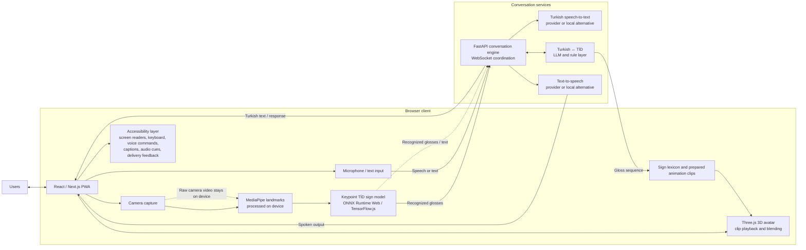

# SB-8: Project Proposal and Scope

**Project:** SignBridge-TR (İşaret Köprüsü)  
**Jira:** [SB-8 — Project Proposal and Scope Statement Finalization](https://el-dili.atlassian.net/browse/SB-8)  
**Source proposal:** [SignBridge-TR Project Proposal (PDF)](./SignBridge-TR_Project_Proposal.pdf)

This scope companion makes the proposal's architecture, requirements, target users, scenarios, and project risks easy to find and review. The linked PDF remains the complete proposal and is included unchanged from the supplied project document.

## Aim and scope

SignBridge-TR is a proposed web-based progressive web app for communication between Turkish Sign Language (TİD) users and people who do not know TİD. The project aims to support both TİD-to-Turkish text/speech and Turkish speech/text-to-TİD signs, including Deaf and hard-of-hearing, speech-impaired, blind, and low-vision users.

The MVP recognizes individual signs separated by short pauses. Turkish-to-TİD output uses a prepared, reviewable sign-animation library and fingerspelling for words without a matching clip. Generating sign motion from scratch and continuous sign-language translation are outside this version's scope.

## System architecture

The accessibility layer applies across the PWA flows. The diagram assumes landmark extraction and sign recognition run in the browser, so raw frames and landmarks stay on-device and recognized glosses/text are sent for conversation coordination. The proposal prohibits storing or sending raw camera video and says only anonymous keypoints and text may leave the device. It does not specify whether microphone audio is sent to an external speech-to-text provider; decide this before integration, and use local transcription if audio must remain on-device. Speech, LLM, and text-to-speech integrations should be replaceable by local/open-source alternatives where practical.

## Requirements

### Functional requirements

1. Provide four PWA modes: Sign → Voice, Voice → Sign, Two-way conversation, and Quick phrases.
2. Extract hand, pose, and face landmarks from camera frames on the user's device and recognize individual TİD signs from keypoints.
3. Convert recognized glosses into Turkish text, show the result, and provide spoken output; allow the user to confirm the sentence before it is spoken.
4. Accept Turkish speech or text, transcribe speech, and convert Turkish sentences into TİD gloss sequences using the language/rule layer.
5. Play mapped, prepared sign clips through a 3D avatar with captions and adjustable playback speed; fingerspell words that are not in the sign library.
6. Support blind and low-vision users with screen-reader-compatible output, voice control, spoken framing guidance, and delivery confirmation.
7. Let users save and reuse frequent phrases.

### Non-functional requirements and success measures

| Area | Requirement / proposed measure |
|---|---|
| Accessibility | Target WCAG 2.2 AA. Run axe-core and manual checks; complete all four persona flows with VoiceOver or TalkBack and keyboard-only navigation. These are targets, not a claim of current conformance. |
| Performance | At least 15 fps for browser inference on a mid-range laptop; median sign-end to spoken-output latency ≤2.0 s; median speech-end to avatar-start latency ≤2.5 s. |
| Recognition | Recognize 150 signs with ≥85% top-1 and ≥95% top-5 accuracy on signers not seen in training. |
| Translation | At least 80% of 100 test sequences rated correct in meaning and grammar by two native Turkish speakers; report BLEU/chrF against reference sentences. |
| Speech | Word error rate ≤15% on a 200-sentence quiet-room test set. |
| Avatar output | Build a library of at least 300 signs plus the Turkish fingerspelling alphabet; at least 75% of signs judged correct by Deaf TİD users (or by two independent reviewers against the Current TİD Dictionary if participants are unavailable); at least 70% of 50 test sentences judged understandable. |
| Usability | Test at least 12 participants, targeting ≥5 Deaf/hard-of-hearing TİD users, ≥3 blind users, and ≥4 hearing non-signers; target ≥80% task completion and mean SUS ≥70. Report substitutions or recruitment gaps as limitations. |
| Privacy | Do not store or transmit raw camera video. Verify through code review and network-traffic inspection; obtain written consent for recordings and check ethics approval requirements before recording or user testing. |
| Platform | Deliver a PWA for desktop and mobile browsers. |

## Target users and scenarios

| User profile | Scenario and user need |
|---|---|
| Deaf or hard-of-hearing person whose first language is TİD | At a hospital desk, signs a question for Turkish speech output, then views or replays the clerk's answer as an avatar signing TİD. |
| Hearing person who does not know TİD | At a pharmacy, speaks or types directions and has them shown as signs, including numbers and times; understands the TİD user's response. |
| Blind or low-vision person | Uses voice commands or a screen reader to start a conversation, hears guidance about camera framing and sign recognition, and receives confirmation that a message reached the other person. |
| Speech-impaired person who uses TİD | Signs a message that is read aloud after confirmation, then saves frequently used phrases for one-tap reuse. |

Potential settings include healthcare, pharmacies, public services, education, work, and everyday conversations. The application is an assistive communication prototype; its output should be confirmed by participants, and user testing and language review are necessary to assess whether translations are understandable.

## Risk register

| Risk (likelihood / impact) | Mitigation and contingency |
|---|---|
| Insufficient TİD training data (High / High) | Pre-train on AUTSL keypoints, record data from at least 10 people with consent, augment samples, and limit the MVP vocabulary to four domains. |
| Poor performance for unseen signers, lighting, or backgrounds (Medium / High) | Keep signer-independent test data, give framing guidance, evaluate under varied conditions, and ask users to confirm the sentence before speech output. |
| Incorrect Turkish ↔ TİD grammar conversion (Medium / High) | Check rules and examples against the Current TİD Dictionary, seek interpreter review if available, constrain output to library glosses, fall back to fingerspelling, and obtain human ratings on 100 test sentences. |
| Unclear avatar signs (Medium / High) | Base clips on dictionary and AUTSL references, include finger articulation and facial expression, and run comprehension checks with Deaf volunteers when available. |
| Excessive end-to-end delay (Medium / Medium) | Run inference on-device, use a compressed model, stream over WebSocket, cache frequent phrases, and switch to a smaller model if needed. |
| Interpreter or target-user recruitment gaps (Medium / Medium) | Contact the university disability support office and local associations early; use dictionary/AUTSL references and simulated tests if needed, and report participant gaps as limitations. |
| Privacy exposure of face/hand video or microphone audio (Low / High) | Keep raw video on-device, transmit only anonymous keypoints and text, and decide whether speech recognition must run locally before selecting a provider; obtain written consent and check ethics approval requirements. |
| Paid or unavailable AI services (Medium / Low) | Keep service interfaces replaceable; evaluate local Whisper, an open-source LLM, and Piper TTS as alternatives and cache frequent responses. |

## Review and approval

The proposal sets out the project targets and risks; this repository copy does not assert that all targets have been achieved. Team approval remains to be recorded by all team members before SB-8 can be considered fully accepted. Interpreter and target-user involvement is desirable but is not confirmed in the proposal.
