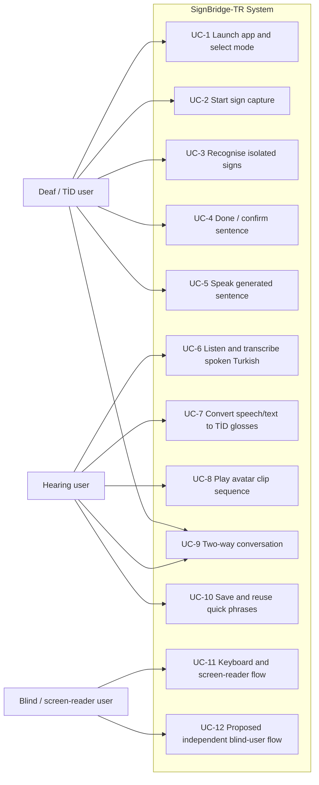

# SB-24: Statement of Work – Scope of Work, Use Cases, Complexity and Acceptance Criteria

**Project:** SignBridge-TR (İşaret Köprüsü)  
**Jira:** [SB-24](https://el-dili.atlassian.net/browse/SB-24)  
**SoW template sections:** Scope of Work (Deliverables); Low Level Functionalities; Use-case Point Complexity (T1–T13); Acceptance Criteria  
**Status:** Draft for team review · 29 October 2026  
**Source of truth:** Proposal v1.1 R6 (PR #16, merge not completed, advisor approval pending) · supporting repo references: [SB-8 Project Proposal and Scope](../SB-8_Project_Proposal_and_Scope.md), [Happy Paths](./happy-paths.md), [Supporting Technical Notes](../SB-18_Supporting_Technical_Notes.md), [Instructor Feedback and Team Review Matrix](../SB-18_Instructor_Feedback_Matrix.md)

> Important scope note: the independent blind-user flow remains a proposed extension under D-23 and is not part of the agreed MVP unless the team/advisor confirms it. D-23 applies only to the blind-specific independent-user features (voice commands, spoken framing guidance, confirmation cues), not to continuous TİD translation or fully generative avatar motion. General accessibility (keyboard, readable text, captions, screen-reader support) remains in scope.

---

## 1. Scope of Work (Deliverables)

The Scope of Work for SignBridge-TR is built directly from the project proposal and the happy-path functions described in SB-23. The MVP focuses on a browser-based PWA that supports short, practical communication between Turkish Sign Language (TİD) users and Turkish speakers, using constrained vocabulary and defined use scenarios.

### 1.1 Core deliverables

1. Application launch and mode selection
   - The application is installed as a PWA and can be launched from the home-screen icon.
   - Users can select among Sign → Voice, Voice → Sign, Two-way conversation, and Quick phrases.
   - The app presents a consistent mode selection flow and a clear start state for each scenario.

2. Sign capture and isolated-sign recognition
   - The system captures live video from the user’s camera.
   - MediaPipe landmarks are extracted and processed on the device.
   - Sign boundaries are detected automatically (hand motion + rest pose + pause duration); the Done control ends the whole sign sequence, not a single sign.
   - Recognised signs are shown as a live gloss list before the final sentence is confirmed.

3. Turkish sentence generation from glosses
   - The system converts a recognised gloss sequence into a Turkish sentence.
   - The generated sentence is displayed in large readable text.
   - The user can confirm or edit the sentence before it is spoken.
   - A clear Done / Finish Input control ends the sign sequence and triggers the final sentence step.

4. Turkish speech and text input
   - The system accepts Turkish speech input and/or text input.
   - The spoken or typed sentence is converted into a TİD gloss sequence using the approved rules and vocabulary.
   - The conversion is constrained to the selected library vocabulary and supported scenarios.

5. Avatar playback of a prepared clip library
   - Turkish output is represented as TİD glosses mapped to a prepared animation library.
   - The avatar plays the corresponding sign clips with a caption and replay controls.
   - Playback supports adjustable speed and repeat, consistent with the proposal.

6. Two-way conversation support
   - The application supports the exchange between the sign user and the hearing user in both directions.
   - The system alternates between recognition and avatar playback without requiring a separate app or external interpreter.
   - The core flows cover the happy paths for hospital desk, pharmacy, classroom communication (proposed, pending D-23), and quick ordering.

7. Accessibility and usability features
   - General accessibility remains in scope: readable text, keyboard navigation, screen-reader announcements, captions, and status messages.
   - The design must remain compatible with WCAG 2.2 AA expectations.
   - The app should be operable by keyboard and assistive technology without a researcher performing the interaction.

8. Quick phrases and reuse
   - The user can save a frequent sentence and reuse it with a single action.
   - Quick phrases support efficiency in repeated scenarios such as café ordering or common task requests.

### 1.2 Out-of-scope / not part of agreed MVP

The following items are excluded from the current MVP unless explicitly approved:

- unrestricted continuous TİD translation
- fully generative avatar motion without a prepared clip library
- natural, continuous TİD sentence generation without a prepared library and approved grammar rules
- RGB-D / Kinect-style depth input or equivalent non-RGB capture paths
- blind-specific independent-use features such as in-app voice commands, spoken framing guidance, or spoken delivery confirmation as part of the agreed MVP
- team-recorded custom training data collection as a required MVP step (only a conditional proposal, not an agreed commitment)

The proposed blind-user path remains under D-23 (see note above). D-23 applies only to the blind-specific independent-use features and does not cover the core MVP, general accessibility, or the normal TİD translation pipeline.

---

## 2. Low Level Functionalities / Use Cases

The low-level functionality is derived from the happy paths and the function IDs MF1–MF12, plus the optional PX1–PX3 items for the blind-user proposal path.

### 2.1 MVP functions

| ID | Function | Source / basis |
|---|---|---|
| MF1 | Select mode and launch PWA | Proposal functional requirement 1 + happy paths |
| MF2 | Capture camera input and extract landmarks on device | Functional requirement 2; O8 |
| MF3 | Recognise isolated signs and show live glosses | Functional requirement 2; O1 |
| MF4 | End the sign sequence with a Done / finish input control | Functional requirement 3 |
| MF5 | Build and display Turkish sentence; require confirm/edit before spoken output | Functional requirement 3; O2 |
| MF6 | Speak the confirmed sentence using TTS | Functional requirement 3 |
| MF7 | Transcribe spoken Turkish input | Functional requirement 4; O3 |
| MF8 | Convert Turkish sentence to TİD gloss sequence within approved vocabulary | Functional requirement 4; RQ2 |
| MF9 | Play avatar clips with caption, replay and adjustable speed | Functional requirement 5; O4 |
| MF10 | Support two-way conversation mode | Functional requirement 1 |
| MF11 | Save and replay quick phrases | Functional requirement 7 |
| MF12 | General accessibility: keyboard, screen-reader, large readable text, captions, status messages | Functional requirement 6; O6 |
| PX1 | Proposed blind-user voice commands (proposed path) | Proposed accessibility extension |
| PX2 | Proposed spoken framing guidance (proposed path) | Proposed accessibility extension |
| PX3 | Proposed spoken delivery confirmation / haptic support (proposed path) | Proposed accessibility extension |

### 2.2 Use cases

| Use case ID | Use case | Trigger | Related functions |
|---|---|---|---|
| UC-1 | Launch app and select mode | User opens the PWA or home-screen icon | MF1, MF12 |
| UC-2 | Open camera and begin sign capture | User selects Sign → Voice or Two-way | MF2, MF12 |
| UC-3 | Recognise isolated sign input | User signs one word or short sequence | MF2, MF3 |
| UC-4 | End sign sequence and confirm sentence | User taps Done / Finish Input | MF4, MF5 |
| UC-5 | Speak the generated Turkish sentence | User confirms the sentence | MF5, MF6 |
| UC-6 | Listen and transcribe spoken Turkish | Hearing user speaks to the system | MF7 |
| UC-7 | Translate Turkish text or speech into TİD gloss sequence | Speech/text is provided to the conversation engine | MF8 |
| UC-8 | Play avatar clip sequence | Gloss sequence is ready | MF8, MF9 |
| UC-9 | Use two-way conversation mode | User alternates sign and speech across a task | MF10 |
| UC-10 | Save and reuse a frequent phrase | User wants a single-tap sentence | MF11 |
| UC-11 | Use the system with keyboard and screen reader | User interacts without pointer control | MF12 |
| UC-12 | Proposed independent blind-user flow | Blind user interacts on their own device | PX1, PX2, PX3 |

Each use case shall specify: preconditions, normal flow, success result, and error/alternative handling. A use case is not complete if it only names the action; it must also define what the system shows the user and which fallback is used when the primary path fails.

- UC-1 (Launch app and select mode): Precondition: PWA is installed or page is open. Normal flow: user selects a mode. Success: mode opens with correct UI and camera or microphone state. Error flow: if the app cannot start, the system shows an actionable error and a retry option.
- UC-2 (Open camera and begin sign capture): Precondition: the app is on the capture screen with a selected mode. Normal flow: the app requests camera access, shows live preview, and starts on-device landmark extraction. Success: the camera view is ready for sign capture and the user receives a clear visual status. Error flow: if the camera cannot be accessed, the app shows a permission message with a retry path and prevents the capture flow until access is granted.
- UC-3 (Recognise isolated sign input): Precondition: camera is active and user is in frame. Normal flow: on-device landmarks are extracted and the system marks the sign with a live gloss. Success: recognised sign appears and can be added to a sentence. Error flow: low confidence or poor framing prompts the user to retry or adjust position.
- UC-4 (Done / confirm sentence): Precondition: user has finished sign input. Normal flow: the user taps Done, the system builds a Turkish sentence and shows it for confirmation/edit. Success: sentence is accepted and ready for speaking. Error flow: if the system cannot convert the gloss sequence, it shows a retry message and preserves the draft.
- UC-5 (Speak the generated Turkish sentence): Precondition: a confirmed Turkish sentence exists. Normal flow: the system reads the sentence aloud and the user listens for confirmation. Success: the spoken output is delivered and the app returns to the ready state. Error flow: if TTS is unavailable or fails, the app displays the sentence text and offers a retry or manual playback path.
- UC-6 (Listen and transcribe spoken Turkish): Precondition: the user has selected a speech-input mode. Normal flow: spoken Turkish is captured, transcribed, and mapped to a gloss sequence or sentence. Success: the transcript appears correctly and can be reviewed before signing or sending. Error flow: if microphone permission is denied, the app asks for microphone access again and displays a clear message; if recognition confidence is low or transcript is wrong, the app asks the user to repeat, correct the transcript, or manually type the sentence.
- UC-7 (Translate Turkish speech/text to TİD): Precondition: text or speech input is available. Normal flow: the system converts the message to a gloss sequence consistent with the approved library, checking library sign first, then synonym matches, then fingerspelling. Success: a valid avatar sequence is prepared. Error flow: if no acceptable library or synonym item exists, the app triggers a fingerspelling fallback or a clear message that the current library cannot produce that item.
- UC-8 (Play avatar clip sequence): Precondition: a valid TİD gloss sequence is ready for playback. Normal flow: the avatar plays the clip sequence with captions and replay controls. Success: the output is understandable and the user can replay it. Error flow: if a clip is missing, corrupted, or not found, the app shows a missing-clip warning and applies the fallback or a clear message.
- UC-9 (Two-way conversation): Precondition: both ends of the conversation are available and the correct mode is active. Normal flow: the system alternates between sign recognition and avatar playback. Success: each side receives the other side’s message in the expected direction. Error flow: if network or service access fails, the app shows a clear status message and keeps the last local state visible.
- UC-10 (Save and reuse a frequent phrase): Precondition: the user has a confirmed sentence available for reuse. Normal flow: the sentence is saved under a quick-phrase label and can be replayed with one tap. Success: repeated use is faster in standard scenarios. Error flow: if the phrase cannot be stored, the app informs the user and preserves the current text for manual retry.
- UC-11 (Use the system with keyboard and screen reader): Precondition: the user has entered the interface with keyboard or assistive technology. Normal flow: all controls are focused, announced, and executable via keyboard or screen-reader commands. Success: the user can complete main flows without pointer-only interaction. Error flow: if a control is inaccessible or a screen-reader announcement is missing, the app provides a visible status update and the user can continue using keyboard navigation.
- UC-12 (Proposed blind-user flow): Precondition: the proposed blind-user path (see D-23 note above) is approved. Normal flow: screen-reader, voice command, and confirmation cues guide the user. Success: the blind user can complete the flow without requiring a sighted operator. Error flow: if voice actions or screen-reader output are unavailable, the system falls back to keyboard or touch alternatives and informs the user.

### 2.3 Use case diagram

This is a use-case view rather than a process flow: actors interact with the SignBridge-TR system, while the use cases represent the functional behaviour required by the proposal. The blind-user path remains proposed until the scope decision is formally confirmed.

### 2.4 Exception and failure-handling use cases

The proposal, happy paths and review notes define the following failure cases to be handled by the SoW and eventual product design:

- sign is not recognised correctly (UC-3)
- sign is not in the recognition vocabulary / Dataset class list (UC-3)
- user speaks but speech recognition misreads the phrase (UC-6)
- STT / LLM / TTS service is unavailable or does not return a response (UC-6, UC-7, UC-9)
- microphone permission is denied (UC-2, UC-6)
- network or service connection is unavailable (UC-9)
- required sign word is missing from the avatar library (UC-7, UC-8)
- user wants to edit or repeat a sentence before speaking (UC-4, UC-5)
- accessibility flow fails under keyboard-only or VoiceOver/TalkBack conditions (UC-11, UC-12)

These are not alternate MVP goals; they are required usability and reliability scenarios for the acceptance criteria.

---

## 3. Use-Case Point Complexity (T1–T13)

The use-case complexity is based on the proposal’s Table 7 and the project’s explicit objectives. The relevant factor names must be preserved in the same sense as the proposal, and any deviation must be justified explicitly.

| Factor | Factor name (proposal meaning) | Importance | Selection | Justification |
|---|---|---|---|---|
| T1 | Distributed system | Low | No | The project is a client–server PWA with one back-end and no distributed system of our own. |
| T2 | Response time performance | High | Yes | Median sign-to-speech latency ≤ 2.0 s and speech-to-avatar latency ≤ 2.5 s are explicit objectives. |
| T3 | End-user efficiency | High | Yes | The system replaces interpreter booking and handwritten notes in everyday communication scenarios. |
| T4 | Internal processing complexity | High | Yes | The system requires landmark recognition, gloss conversion, and avatar playback in the same end-to-end flow. |
| T5 | Reusability | Low | No | The project is not judged on reuse of software components; it is judged on the delivery of a focused communication system. |
| T6 | Ease of installation | Average | Yes | The product must work as a PWA launched from a home-screen icon on supported devices. |
| T7 | Usability | High | Yes | The proposal requires keyboard, screen-reader, readable text, and WCAG 2.2 AA compliance. |
| T8 | Portability | High | Yes | The app must work across supported browser/device environments. |
| T9 | System maintenance (deployment) | Low | No | The MVP is not defined around deployment maintenance overhead. |
| T10 | Concurrency | Average | Yes | The system must handle camera, recognition, speech, and avatar tasks concurrently and asynchronously. |
| T11 | Security | High | Yes | Raw camera video must never leave the device; the proposal defines strong privacy constraints. |
| T12 | Access for third parties (APIs) | Average | Yes | Speech, LLM and TTS services may be external or local, but they must be abstracted behind the app interface. |
| T13 | User training | Low | No | The proposal does not define a training-heavy requirement for end users; the issue is communication usability, not formal training. |

The proposal’s complexity drivers remain: real-time processing, accessibility, privacy, and multimodal interaction in a constrained vocabulary environment. If the project team later decides to change a factor selection, the reason must be recorded explicitly as a scope decision rather than absorbed into a different factor meaning.

---

## 4. Acceptance Criteria

The acceptance criteria below are derived from the proposal objectives O1–O8, and they must be measurable in the final evaluation plan. Each criterion is tied to a requirement or objective in the proposal and must be traceable to the relevant system function.

### 4.1 Recognition and quality targets

1. Recognition quality (O1)
   - The MVP vocabulary shall be evaluated on a signer-independent split.
   - The system shall reach at least 85% top-1 accuracy and at least 95% top-5 accuracy on the proposal test split for the selected vocabulary.
   - These results shall be reported separately from live-webcam performance.

2. Gloss-to-Turkish quality (O2)
   - A held-out set of 100 gloss sequences shall reach at least 80% correct meaning and grammar, judged by two native Turkish speakers using the proposal rubric.
   - The result shall be reported with a Wilson confidence interval and shall be tied explicitly to the limited MVP evaluation set.

3. Turkish speech recognition quality (O3)
   - The speech-to-text component shall achieve a word-error rate of at most 15% on the controlled evaluation set defined in the proposal for 200 sentences in a quiet room.
   - Any variation due to speaker, noise, or environment shall be reported separately with no implied claim beyond the tested setup.

4. Avatar comprehension and understanding (O4)
   - The avatar library shall include at least 300 signs plus the full Turkish fingerspelling alphabet.
   - The avatar library shall be judged on its ability to communicate the intended meaning in the selected scenarios.
   - The proposal target is at least 75% sign recognition and at least 70% sentence understanding in the Deaf-user evaluation when suitable evaluators are available; the evaluation set shall include at least 50 test sentences.
   - A reference-conformance check against the Current TİD Dictionary is reported separately and does not replace the user-based quality requirement.
   - The 300-sign target remains a feasibility target for the avatar workstream; its final viability is not yet validated and is therefore not treated as a passed requirement until the pilot and advisor review in the relevant avatar work item (SB-25).
   - If suitable TİD participants cannot be reached, the O4 result is reported as not measured / not verified and is not treated as a passed criterion.

### 4.2 Performance and timing

5. Sign-to-speech latency
   - The median time from the end of the last sign to the start of spoken output shall be ≤ 2.0 s.
   - This value includes pause detection and sign completion events.
   - User confirmation time is excluded and reported separately.

6. Speech-to-avatar latency
   - The median time from the end of speech to the avatar starting to sign shall be ≤ 2.5 s.
   - This value is measured from the end of the spoken input to the first avatar playback event.

7. Processing rate
   - The system shall achieve at least 15 fps landmark processing in the browser on a mid-range laptop under the proposal benchmark setup.
   - This benchmark target is not a blanket promise for all phone devices; device-specific results shall be reported separately.

8. Supported screen sizes
   - The PWA shall work without clipped or inaccessible controls at 360 px, 768 px and 1280 px widths.
   - Supported devices are determined by the device benchmark described in Technical Notes §3.

### 4.3 Privacy, accessibility and interaction

9. Raw-video privacy
   - Raw camera video shall never leave the device.
   - This must be verified through code review and network inspection.

10. Consent and evaluation data
   - Any participant evaluation shall only proceed after ethics approval and written informed consent.
   - Evaluation data shall not be used as training data. Any supplementary sign recordings would be a separate collection with its own ethics approval, consent and data-use terms (Technical Notes §10).
   - The proposal’s Methods 6 and Technical Notes §9 define the transfer boundaries: raw camera video remains on-device; audio, landmarks and text are transferred only if the selected service path requires them (for example speech recognition, language-model processing or TTS), and those flows are reported explicitly before implementation.

11. Accessibility requirement
   - The app shall satisfy WCAG 2.2 AA for the relevant interface elements.
   - It must support keyboard-only interaction and screen-reader interaction.
   - Readable text, captions, control labels, and status announcements shall be available.

12. Functional flow requirement
   - Users shall be able to complete the main happy-path scenario without assistance from a researcher.
   - The final sentence shall only be spoken after a confirm/edit step.
   - The end-of-sign action shall be explicit and not ambiguous.

13. Fingerspelling fallback
   - If a word is not available in the avatar library, the system shall provide the required Turkish fingerspelling fallback as part of the Turkish → TİD flow, using the full Turkish fingerspelling alphabet.
   - If the correct item cannot be produced in the current library or the fallback cannot be shown, the system shall display a clear user-facing message stating that the current library cannot produce that item and the user can continue with a manual correction or retry path.
   - This fallback shall be documented as part of the alternative flow for the Turkish → TİD direction and is not replaced by a failure message alone.

### 4.4 Usability and evaluation measures

14. Task completion rate
   - The system shall achieve at least 80% task completion in the evaluated scenario set.
   - Results shall be reported by stage and by user group.

15. SUS score
   - The mean SUS score shall be at least 70 in each evaluated stage/group.
   - Results shall not be reported only as a pooled average if different groups are being compared.

16. Scenario coverage
   - The main persona flows must be demonstrably completed: hospital desk, pharmacy counter, classroom conversation (proposed, pending D-23), and café ordering.
   - The flow shall be evaluated under the defined service scenarios and reported separately if simulated conditions are used.
   - The two-stage usability evaluation requires a pre-test phase under simulated conditions and, where suitable participants can be reached, a second target-user evaluation. If target users are not available, the stage is reported as not measured / not verified.

### 4.5 Proposed blind-user path

17. Proposed extension condition
   - The independent blind-user flow with PX1–PX3 is a proposed extension, not part of the approved MVP, unless the proposed blind-user path is formally approved (see D-23 note above).
   - If approved, the flow must support VoiceOver/TalkBack, keyboard/touch alternatives, spoken framing guidance, and spoken confirmation of delivery.
   - If not approved, the flow is excluded from the core acceptance criteria and from the mandatory MVP deliverables.
   - The scope of the proposed blind-user path is limited to the blind-specific independent-user features and does not cover continuous TİD translation or fully generative avatar output.

---

## 5. Summary

This SB-24 section defines the deliverables, use cases, complexity model and acceptance criteria that are required to build the Statement of Work in line with the current proposal. It remains constrained to the agreed MVP scope and keeps the independent blind-user path clearly marked as proposed until the scope decision is made.

This draft should be read as a repository artifact supporting the SoW, not as a deviation from the project’s approved concept.
