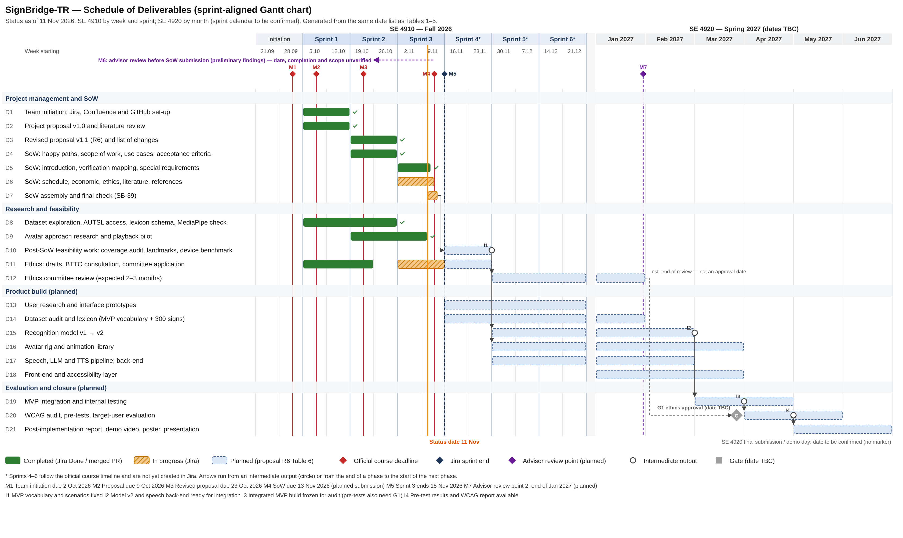

# SB-34: Schedule of Deliverables and Sprint-Aligned Gantt Chart

- **Project:** SignBridge-TR
- **Owner:** Yasmin Malgir
- **Jira:** [SB-34](https://el-dili.atlassian.net/browse/SB-34)
- **Status:** Draft for peer review. Item status recorded on 11 Nov 2026.
- **Date sources:** Jira sprints (board 3); official course *Timeline of Events* (SE 4910, Fall 2026); Project Proposal v1.1 R6, the current version in this repository (Table 6 and Methods 1, 6 and 7); SB-24 §4.6, the acceptance verification mapping merged through SB-38 (PR #35).

The section below supplies the original SoW template heading **Schedule of Deliverables**. The integration notes at the end are editorial material and are not part of the SoW text.

## Schedule of Deliverables

This schedule lists what SignBridge-TR will deliver and when. It follows the course template: deliverables are aligned with the two-week Scrum sprints of SE 4910 and with the project work plan for SE 4920. The deliverables come from the Scope of Work and from Expected Outcomes/Deliverables 1–9 of proposal R6. Each deliverable is linked to the acceptance criteria that will verify it. These criteria are defined in Acceptance Criteria §4.6. The tables and Figure 1 are generated from the same date list, so every date in this section appears unchanged in the chart.

**Sprint calendar.** SE 4910 runs six two-week sprints. Sprints 1–3 use the dates recorded in Jira. Sprints 4–6 follow the official course timeline and will be created in Jira at the corresponding sprint planning meetings. The SE 4920 sprint calendar has not been published yet, so spring work is planned by month.

*Table 1 – Sprint calendar*

| Sprint | Dates | Date source |
|---|---|---|
| Sprint 1 | 5 Oct 2026 – 18 Oct 2026 | Jira (closed) |
| Sprint 2 | 19 Oct 2026 – 1 Nov 2026 | Jira (closed) |
| Sprint 3 | 2 Nov 2026 – 15 Nov 2026 | Jira (active) |
| Sprint 4 | 16 Nov 2026 – 29 Nov 2026 | Official course timeline; not yet created in Jira |
| Sprint 5 | 30 Nov 2026 – 13 Dec 2026 | Official course timeline; not yet created in Jira |
| Sprint 6 | 14 Dec 2026 – 27 Dec 2026 | Official course timeline; not yet created in Jira |
| SE 4920 (spring) | Jan – Jun 2027, by month | Sprint calendar to be confirmed |

**Milestones.** Official course deadlines, Jira sprint boundaries and advisor review points are listed separately. The Statement of Work is due on 13 November 2026, two days before Sprint 3 ends in Jira on 15 November 2026. Proposal R6 places advisor review point 1 (M6) before the Statement of Work. Its exact date has not been recorded, and whether it took place has not been verified. For this reason it is not shown as a dated milestone.

**Pre-SoW review (M6) and post-SoW feasibility work (D10).** These are two separate items. M6 is the advisor review planned before the SoW. It could only cover the preliminary findings that existed at that time: dataset exploration and AUTSL access, MediaPipe feasibility, the lexicon schema (D8), and the avatar approach research and playback pilot (D9). Proposal R6 Methods 7 also lists the scenario coverage, the avatar method and its effort for the 300-sign library, the recording decision and the O4 fallback for this review. The sources inspected do not confirm which of these findings, if any, were actually presented to the advisor. In particular, the repository still marks the scenario coverage audit as pending (`docs/sow/happy-paths.md`), and no advisor record of the recording decision or of the O4 fallback was found. D10 is the feasibility work planned for Sprint 4, after the SoW submission. It completes the remaining checks of Methods 1 (a)–(f), including the full scenario coverage audit and the device benchmark. Its output, I1, fixes the MVP vocabulary and scenarios. No official SE 4920 submission or demonstration date is available yet. The chart therefore shows the planned final-report work up to June 2027, without a fixed deadline marker.

*Table 2 – Milestones*

| ID | Milestone | Date | Type | Source |
|---|---|---|---|---|
| M1 | Team initiation and project-management configuration due | 2 Oct 2026 | Official course deadline | Official course timeline |
| M2 | Project proposal due | 9 Oct 2026 | Official course deadline | Official course timeline |
| M3 | Revised project proposal due | 23 Oct 2026 | Official course deadline | Official course timeline |
| M4 | Statement of Work due (planned submission; not yet submitted) | 13 Nov 2026 | Official course deadline | Official course timeline |
| M5 | Sprint 3 ends | 15 Nov 2026 | Jira sprint boundary | Jira sprint SB Sprint 3 |
| M6 | Advisor review point 1 before the SoW: preliminary findings available at that time (D8, D9); which findings were reviewed is unverified | Before SoW submission — exact date and completion unverified | Advisor review point | Proposal R6 Methods 7 |
| M7 | Advisor review point 2 (baseline and model accuracy) | End of Jan 2027 (planned) | Advisor review point | Proposal R6 Methods 7 |
| M8 | SE 4920 final submission and demo day | To be confirmed | To be confirmed | No official SE 4920 calendar available |

**Submission evidence.** Official deadlines, Jira closure dates and the actual submissions are kept apart. A Jira resolution date records when the team closed the issue. It does not prove that the document was submitted to the course system or delivered to the advisor, and neither of those has been verified.

*Table 3 – Proposal and SoW submission evidence*

| Item | Official deadline | Jira record | Submission to the course system | Delivery to the advisor |
|---|---|---|---|---|
| Project proposal v1.0 | 9 Oct 2026 (M2) | SB-8 Done 17 Oct 2026; PR #10 merged 17 Oct 2026 | Not verified: no access to the course-system record | Not verified |
| Revised proposal v1.1 and list of changes | 23 Oct 2026 (M3) | SB-18 Done 24 Oct 2026; R6 merged in PR #16 on 24 Oct 2026. R6 is the current version in the repository (`docs/SignBridge-TR_Project_Proposal.pdf`) | Not verified: no access to the course-system record | Not verified |
| Statement of Work | 13 Nov 2026 (M4) | SB-39 (assembly and final check) In Progress on 11 Nov 2026 | Not yet submitted; planned for 13 Nov 2026 | Not yet delivered |

**Deliverables.** Completed items are supported by verified Jira records (status *Done* and resolution date) and, where applicable, by pull requests merged into `main`. Items in progress reflect their Jira status on 11 Nov 2026. Planned items take their periods from Table 6 of proposal R6 and are mapped to the sprints that cover those months. They are plans, not completed work. The last column uses the criterion numbers of Acceptance Criteria §4.6. Every planned result remains *not measured / not verified* until the corresponding check has been run.

*Table 4 – Schedule of deliverables*

| ID | Deliverable | Planned period | Sprint | Status (11 Nov 2026) | Evidence / source | Related acceptance criteria (SB-24 §4.6) |
|---|---|---|---|---|---|---|
| D1 | Team initiation; Jira, Confluence and GitHub set-up | 5 Oct 2026 – 18 Oct 2026 | Sprint 1 | Completed | SB-10, SB-11: Jira Done 17 Oct 2026 | — |
| D2 | Project proposal v1.0 and literature review | 5 Oct 2026 – 18 Oct 2026 | Sprint 1 | Completed | SB-8, SB-13: Jira Done 17 Oct 2026; SB-8 merged in PR #10 (17 Oct 2026). Submission evidence: Table 3 | — |
| D3 | Revised proposal v1.1 (R6) and list of changes | 19 Oct 2026 – 1 Nov 2026 | Sprint 2 | Completed | SB-18: Jira Done 24 Oct 2026; R6 merged in PR #16 (24 Oct 2026) and is the current version on main. Submission evidence: Table 3 | — |
| D4 | SoW: happy paths, scope of work, use cases, acceptance criteria | 19 Oct 2026 – 1 Nov 2026 | Sprint 2 | Completed | SB-23 (PR #22), SB-24 (PR #29): Jira Done | 1–17 (defined) |
| D5 | SoW: introduction, verification mapping, special requirements | 2 Nov 2026 – 11 Nov 2026 | Sprint 3 | Completed | SB-33 (PR #30), SB-38 (PR #35), SB-41 (PR #38): Jira Done 10–11 Nov 2026 | 1–17 (verification methods) |
| D6 | SoW: schedule, economic, ethics, literature, references | 2 Nov 2026 – 12 Nov 2026 | Sprint 3 | In progress | SB-34, SB-35, SB-37, SB-42, SB-43: Jira In Progress on 11 Nov 2026 | — |
| D7 | SoW assembly and final check (SB-39) | 11 Nov 2026 – 13 Nov 2026 | Sprint 3 | In progress | SB-39: Jira In Progress on 11 Nov 2026 (preparation status). The submission itself is milestone M4 and has not happened yet | — |
| D8 | Dataset exploration, AUTSL access, lexicon schema, MediaPipe check | 5 Oct 2026 – 1 Nov 2026 | Sprints 1–2 | Completed | SB-12, SB-14, SB-15, SB-16: Jira Done | 1, 7 (inputs) |
| D9 | Avatar approach research and playback pilot | 19 Oct 2026 – 10 Nov 2026 | Sprints 2–3 | Completed | SB-25: Jira Done; SB-40: PR #32, Jira Done 10 Nov 2026 | 4, 13 (inputs) |
| D10 | Post-SoW feasibility work: coverage audit, landmarks, device benchmark | 16 Nov 2026 – 29 Nov 2026 | Sprint 4 | Planned | Proposal R6 Table 6 (Oct–Nov) and Methods 1 (a)–(f); the remaining checks continue after the SoW. Separate from the pre-SoW review M6 | 1, 7 |
| D11 | Ethics: drafts, BTTO consultation, committee application | 5 Oct 2026 – 25 Oct 2026 (completed); 2 Nov 2026 – 15 Nov 2026 (in progress); 16 Nov 2026 – 29 Nov 2026 (planned) | Sprints 1–4 | Partly completed; in progress | SB-9, SB-19: Jira Done; SB-36: Jira In Progress; application per proposal R6 Table 6 | 10 |
| D12 | Ethics committee review (expected 2–3 months) | 30 Nov 2026 – 27 Dec 2026; Jan 2027 | Sprints 5–6, Jan 2027 | Planned | Proposal R6 Table 6 (Nov–Jan) and Methods 6; the end shown is an estimate, not an approval date | 10 |
| D13 | User research and interface prototypes | 16 Nov 2026 – 27 Dec 2026 | Sprints 4–6 | Planned | Proposal R6 Table 6 (Nov–Dec) | 8, 11, 12 |
| D14 | Dataset audit and lexicon (MVP vocabulary + 300 signs) | 16 Nov 2026 – 27 Dec 2026; Jan 2027 | Sprints 4–6, Jan 2027 | Planned | Proposal R6 Table 6 (Nov–Jan); deliverable 5 | 1, 4, 10 |
| D15 | Recognition model v1 → v2 | 30 Nov 2026 – 27 Dec 2026; Jan–Feb 2027 | Sprints 5–6, Jan–Feb 2027 | Planned | Proposal R6 Table 6 (Dec–Feb); deliverable 2 | 1, 5, 7 |
| D16 | Avatar rig and animation library | 30 Nov 2026 – 27 Dec 2026; Jan–Mar 2027 | Sprints 5–6, Jan–Mar 2027 | Planned | Proposal R6 Table 6 (Dec–Mar); deliverable 3 | 4, 6, 13 |
| D17 | Speech, LLM and TTS pipeline; back-end | 30 Nov 2026 – 27 Dec 2026; Jan–Feb 2027 | Sprints 5–6, Jan–Feb 2027 | Planned | Proposal R6 Table 6 (Dec–Feb); deliverable 4 | 2, 3, 5, 6, 10 |
| D18 | Front-end and accessibility layer | Jan–Mar 2027 | Jan–Mar 2027 | Planned | Proposal R6 Table 6 (Jan–Mar); deliverable 1 | 8, 9, 11, 12, 13 |
| D19 | MVP integration and internal testing | Mar–Apr 2027 | Mar–Apr 2027 | Planned | Proposal R6 Table 6 (Mar–Apr); deliverables 1, 7 | 1–13 |
| D20 | WCAG audit, pre-tests, target-user evaluation | Apr–May 2027 | Apr–May 2027 | Planned | Proposal R6 Table 6 (Apr–May); deliverables 7, 8 | 11, 14, 15, 16 (17 if D-23 approved) |
| D21 | Post-implementation report, demo video, poster, presentation | May–Jun 2027 | May–Jun 2027 | Planned | Proposal R6 Table 6 (May–Jun); deliverable 9. Official SE 4920 dates to be confirmed | Reports evidence for 1–17 |

**Dependencies, intermediate outputs and reviews.** Several phases in Table 6 of the proposal overlap by month. Where they do, the next phase starts when a named intermediate output is ready, not when the whole previous phase has ended (Table 5).

*Table 5 – Intermediate outputs that start the next phase*

| ID | Intermediate output | Produced by | Expected | Starts |
|---|---|---|---|---|
| I1 | MVP vocabulary and scenarios fixed after the coverage audit | D10 | 29 Nov 2026 | D15, D16 |
| I2 | Recognition model v2 and speech/LLM/TTS back-end ready for integration | D15, D17 | End of Feb 2027 | D19 |
| I3 | Integrated MVP build frozen for the WCAG audit and, once G1 is in place, the pre-tests | D19 | End of Mar 2027 | D20 |
| I4 | Pre-test results and WCAG audit report available for the final report | D20 | End of Apr 2027 | D21 |
| G1 | Ethics approval obtained — date to be confirmed | D11–D12 (ethics committee) | To be confirmed; the end of D12 is only an estimate of the review period | Participant tests in D20 |

- The SoW sections (D5, D6) feed the assembly and final check of the document (D7, SB-39). The team reviews the SoW jointly before submission, and every section is merged only after an independent teammate's pull-request approval. The planned submission is milestone M4.
- The post-SoW feasibility work (D10) runs in Sprint 4, after the SoW submission and separately from the pre-SoW review M6. Its output, I1, fixes the MVP vocabulary and scenarios and starts training the recognition model (D15) and producing the avatar library (D16). The dataset audit and lexicon (D14) continues in parallel and refines both.
- The ethics committee application (D11) is followed by the committee review (D12). The end of D12 is only the proposal's estimate of the review period. Participant testing in D20 is gated by G1, the actual ethics approval, together with written, explicit consent (criterion 10). No participant test, including simulated pre-tests, begins before G1.
- I2 starts MVP integration (D19). The avatar library (D16) and the front-end (D18) continue to deliver into integration until the end of March. I3 starts the WCAG audit in D20; the participant pre-tests in D20 also need G1. I4 starts the post-implementation report (D21).
- Advisor review point 2, planned for the end of January 2027, assesses the baseline and the model accuracy. If it is not met, the scope is narrowed with the advisor; no target is changed by this schedule.
- Each sprint ends with a sprint review with the advisor, who acts as Product Owner, followed by a retrospective and sprint planning. These reviews are where the schedule is checked and adjusted.

**Figure 1 – Sprint-aligned Gantt chart of deliverables (status on 11 Nov 2026).**

*Solid green bars: completed work verified in Jira/GitHub. Hatched bars: work in progress. Dashed bars: planned work from proposal R6 Table 6. Diamonds: official course deadlines (red), the Jira end of Sprint 3 (dark blue) and a planned advisor review point (purple). Circles: intermediate outputs (I1–I4). Grey gate: ethics approval, date to be confirmed. Advisor review point 1 is shown only as "before SoW submission", and the SE 4920 final deadline is not shown because its date has not been confirmed. An editable vector version is provided as `SB-34-gantt.svg`.*

**Items to be confirmed.** The following have no accessible source yet:

- the SE 4920 sprint calendar and official SE 4920 deadlines (post-implementation report, demo day, poster and presentation; M8);
- the date of advisor review point 1, whether it took place, and which preliminary findings were reviewed (M6);
- the actual submission of the proposal, the revised proposal and the SoW to the course system, and their delivery to the advisor (Table 3);
- the ethics committee submission date and the actual approval date (G1), which depend on the BTTO / Project Support Office guidance (SB-36);
- the creation of Sprints 4–6 in Jira with the course-timeline dates shown above.

---

### Integration and Review Notes — not part of the SoW section

- Copy the section under the existing **Schedule of Deliverables** heading of the Confluence page *Statement of Work* (https://el-dili.atlassian.net/wiki/spaces/SIGNBRIDGE/pages/5046283/Statement+of+Work). Do not add or reorder template headings. Upload `SB-34-gantt.png` as Figure 1.
- `SB-34-gantt.py` is the single source for every date and table in this file and in the chart. If a date changes, edit the script and regenerate both outputs.
- AC-5 in the Jira description names `task/SB-34`. The branch rule that currently applies, `docs/BRANCHING.md` (updated by SB-45, PR #34), requires the exact issue key. This work is therefore committed on branch `SB-34`.
- Statuses are a snapshot of 11 Nov 2026. Before the SoW is submitted, recheck D6, D7 and Table 3 against Jira and update them if their status has changed.
- Peer approval, applicable checks, merge and the final SoW/Confluence evidence updates are still pending. Do not mark SB-34 Done on the basis of this draft.
