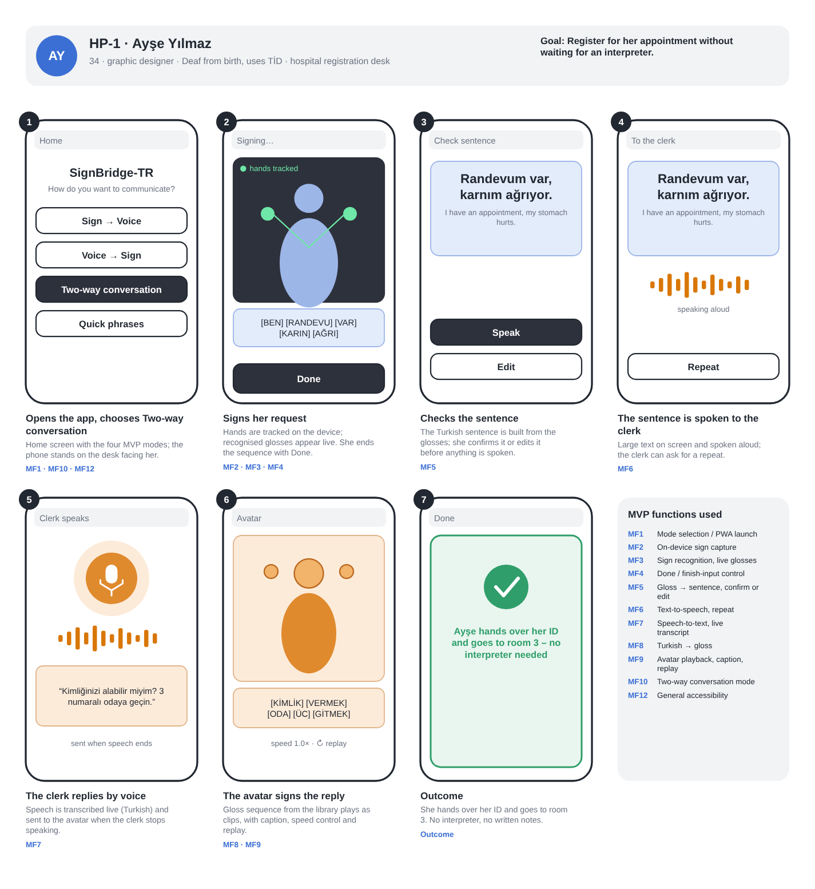
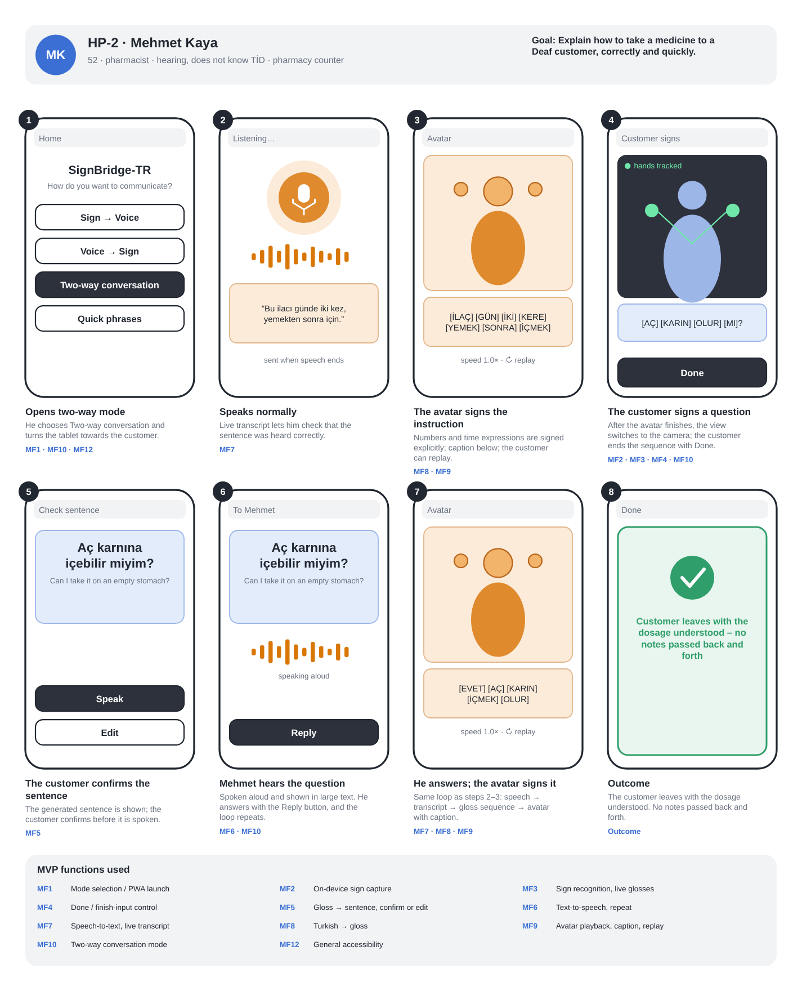
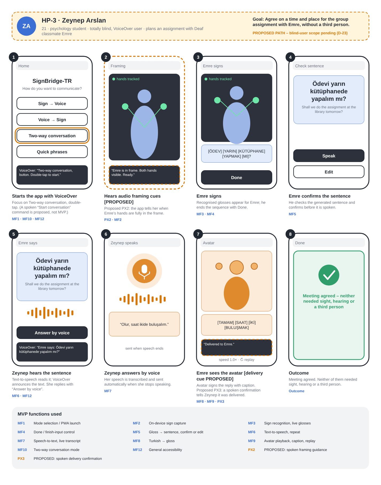
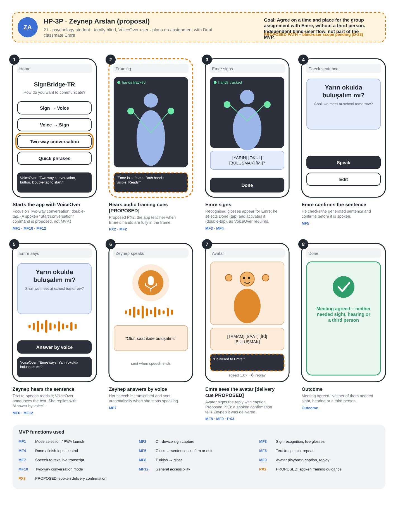
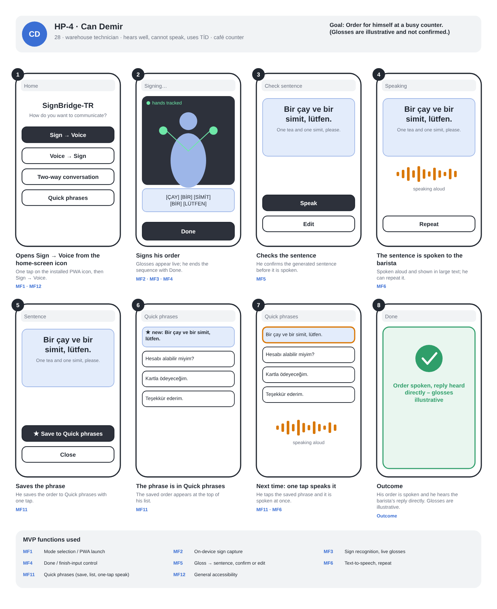
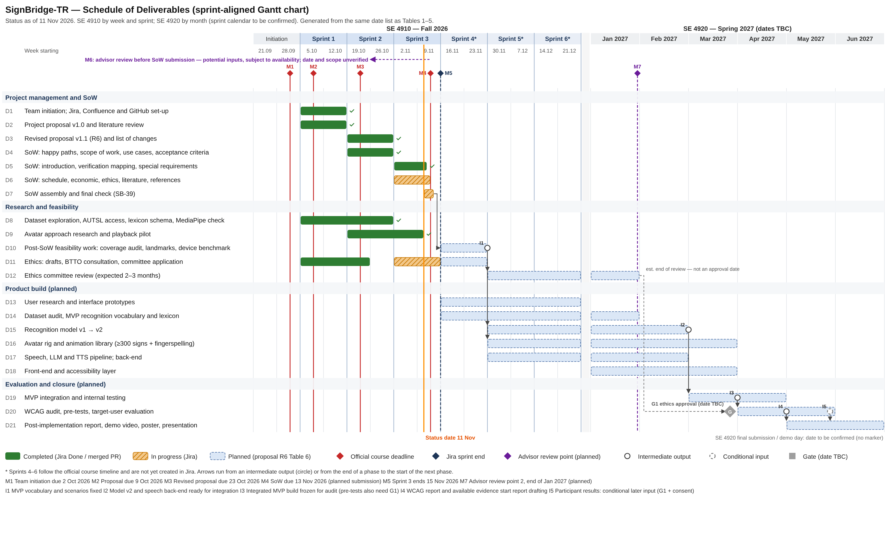
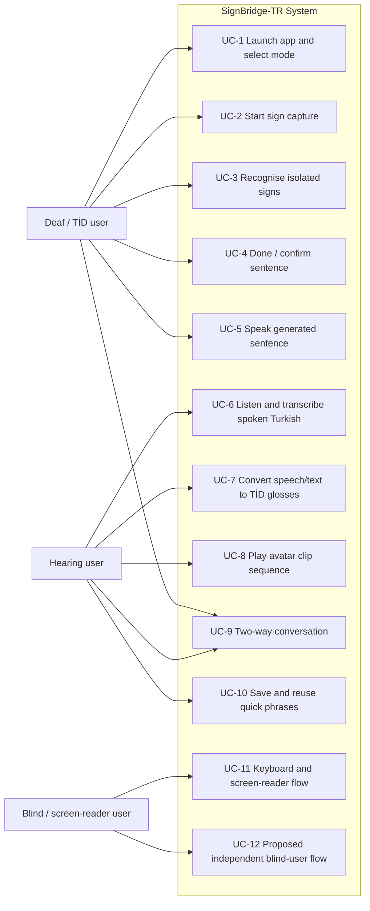

# Statement of Work

**Project:** SignBridge-TR

**Working version:** SB-39 assembly draft · 11 November 2026

**Status:** Working draft assembled from merged SoW section sources. No rendered PDF is attached. Whole-team review, final PDF verification, Confluence publication and submission evidence are intentionally outside this draft.

> This assembly combines the SB-43 first pass with sources from the merged section-owner documents. Reference numbering follows first citation in the assembled SoW; incomplete bibliographic details remain flagged.

## 1. Introduction

SignBridge-TR (İşaret Köprüsü) is a progressive web application intended to support short, two-way conversations between Turkish Sign Language (TİD) users and Turkish-speaking people who do not know TİD. The project combines computer vision, natural language processing and human–computer interaction within an assistive communication prototype. TİD is treated as a language with its own vocabulary and grammar; recognising a sign label is therefore distinct from converting a sequence of signs into a Turkish sentence. [1]

The problem addressed is the communication barrier encountered when the two participants do not share a language or an accessible communication channel. The proposal illustrates this through hospital registration, pharmacy, education and everyday service scenarios. These scenarios guide the vocabulary and interface design; they do not establish that all required expressions are supported or that the prototype is suitable for clinical decisions. The intended users include Deaf and hard-of-hearing TİD users, people who communicate in TİD and cannot speak, and hearing non-signers. Blind and low-vision participation is considered in the proposal, but blind-specific independent-use features are proposed and remain subject to a pending team/advisor scope decision; general accessibility (keyboard, readable text, captions) stays in scope. [1]

The product has two planned directions. In Direction A, the application captures a user's isolated signs, derives landmarks on the device, recognises sign classes and maps them to glosses. A gloss is a written label representing a sign. The application converts the gloss sequence into Turkish text, which the user can review and confirm before speech output. In Direction B, Turkish speech is transcribed, or Turkish text is entered directly; the language and rule layer produces a gloss sequence for playback through a prepared 3D signing-avatar animation library, with captions and replay controls. The proposal also includes sign-to-voice, voice-to-sign, two-way conversation and quick-phrase modes. [1]

The minimum viable product recognises isolated TİD signs separated by user pauses and supports constrained conversion within a selected vocabulary and defined scenarios. Recognition and translation of unrestricted continuous TİD signing are outside its scope. Recognition vocabulary and avatar-clip vocabulary are separate and must be checked against the intended scenarios. The baseline prioritises AUTSL and considers BosphorusSign22k if AUTSL cannot be used under its terms. Supplementary recordings remain a conditional option requiring the necessary scope agreement, ethics approval, consent and data-use arrangements; this section does not authorise collection. [1]

The baseline uses on-device camera processing and a prepared animation library rather than fully generative signing motion. Raw camera video is not to leave the device; possible external processing of audio, landmarks and text must follow the proposal's data-flow conditions. Technology selection, device support and avatar production feasibility require evidence. [1]

## 2. Literature Review

### Scope and basis

This section summarises the literature that supports the choice of method for SignBridge-TR: how recognition models for Turkish Sign Language (TİD) compare, what their evidence does and does not show, and what follows for the project. It is a synthesis of the full review SB-13 v2.1 [2], which is on `main` under `docs/literature-review/`. SB-13 is a targeted narrative review, not a systematic review, and its source audit was carried out on 15 October 2026. SB-42 does not repeat the search: source details are taken from SB-13 and were not re-retrieved for this section. No new training, benchmark or user study is reported; every figure below is a number reported by a source or a target set by the proposal.

The scope is the one fixed in the proposal [1]: a pause-separated, vocabulary-bounded recognition of isolated signs, with a constrained conversion between glosses and Turkish sentences. Unrestricted continuous TİD translation is outside the scope and is discussed here only to explain limits.

### Approaches compared

Recognition, translation and segmentation are different tasks. Isolated recognition predicts a gloss from a bounded sign clip; continuous recognition predicts a gloss sequence from an unsegmented stream; translation produces a spoken-language sentence [3], [4]. A recognition score therefore says nothing about translation quality.

| Approach | What it offers | Main limitations | Implication for SignBridge-TR |
|---|---|---|---|
| Recurrent models (LSTM) [5] | Transparent sequence baseline; easy failure analysis | No joint-graph prior unless added; bidirectional variants are not causal streaming models | Baseline in the planned model comparison |
| Transformer encoders [6], [7] | Attention over the whole landmark sequence; SPOTER [7] is a pose-based word-level design | Possible overfitting on a small vocabulary; sensitive to padding, resampling and landmark noise; browser export must be tested | Lightweight encoder is a candidate and the model named in hypothesis H1 [1] |
| Graph networks (ST-GCN [8], SL-GCN in SAM-SLR [9]) | Explicit joint adjacency over space and time | Topology and omitted hand or face nodes change what is retained; SAM-SLR is a multi-stream, multi-modal system, so its score is not a landmark-only GCN score [9] | Spatio-temporal graph network is the third candidate; ST-GCN first if resources are limited [2] |
| Pre-trained pose models and transfer [10] | Reported benefit from pose pre-training; usable with a small domain vocabulary | Benefit differs by pre-training objective; cross-language gains are not assumed for TİD | Only if pose format, licence and browser export fit [1] |
| Landmark extraction (MediaPipe Holistic) [11], [12], [13] | On-device hand, body and face landmarks | Legacy Holistic has 543 landmarks and the current Holistic Landmarker 553 (478 face points); they are not interchangeable feature vectors | Version not chosen yet; to be pinned with a documented point schema [1] |
| Translation and segmentation [3], [4], [14], [15], [16] | Sequence-to-sequence translation; sign detection and boundary segmentation; E-TSL is a TİD example | Different languages, inputs and annotation from a small TİD MVP; the E-TSL result (3.28 BLEU-4 for GNN-T) is on a published split that is not shown to be signer-disjoint [14] | MVP keeps pauses between signs; continuous signing is a documented extension |
| TİD language knowledge [17], [18] | Non-manual features matter; Turkish → TİD conversion needs explicit rules | No universal word-by-word rule | Direction B uses a rule layer reviewed against TİD references, plus a separate clip library |
| Browser deployment [19], [20] | ONNX Runtime Web and TensorFlow.js are deployment routes | A framework being available does not mean a trained model runs correctly in the browser | Export and runtime tests are a decision gate; fps and latency figures are targets |

**Datasets.** AUTSL [21] is described with 226 sign classes. Its original paper reports 43 signers and 38,336 samples, while the label files received by the team match the challenge release with 36,302 samples and a signer-disjoint split of 31, 6 and 6 signers [1]. BosphorusSign22k [22] has 744 glosses from six signers and 22,542 samples. The few signers limit what it can show about unseen users. Sensitivity of results to the evaluation partition is documented for AUTSL [21], so a signer-independent split is the only meaningful test of unseen users.

**Published accuracy.** The one comparison on a common benchmark in SB-13 comes from OpenHands [10] (AUTSL, signer-independent test partition, 2D inputs derived from MediaPipe, best-run results as reported by the source):

| Model | AUTSL top-1 accuracy as reported [10] |
|---|---|
| LSTM | 77.4% |
| BERT-style Transformer | 81.0% |
| ST-GCN | 90.4% |
| SL-GCN | 91.9% |

These numbers favour graph models in that experiment. They are not SignBridge measurements and do not establish a universal ranking. Classifier timing in the same study was measured on a different dataset (INCLUDE) and a server CPU, and it is not browser or end-to-end latency, so accuracy and timing must not be combined into one comparison [2].

### Implications for the selected method

1. **Scope stays isolated and pause-separated.** The literature shows that segmentation of natural signing and sentence-level TİD translation are open problems [16], [14]. The MVP therefore keeps its pauses and its vocabulary bound, as the proposal states [1].
2. **The model is chosen by measurement, not by citation.** The evidence supports comparing a recurrent baseline, a lightweight Transformer and a graph network on identical landmarks, vocabulary and signer-independent splits. It does not justify fixing a winner in advance. The proposal plans exactly this comparison, uses validation data for selection and uses the test split once; H1 names the Transformer but states that the final model is chosen by comparison with baselines and a graph network [1].
3. **A published graph-model lead is a hypothesis to test here.** The reported lead of the graph models (13.0 to 14.5 points over the LSTM and 9.4 to 10.9 points over the Transformer) was obtained on a specific input format and partition [10], and may not carry over to the project's vocabulary, landmark version or browser runtime.
4. **Landmark schema and export are early risks.** The MediaPipe version (543 or 553 landmarks) is not chosen, and training and browser use must share one schema. Export to ONNX or TensorFlow.js has to be tested before the training format is fixed [1], [13].
5. **Transfer learning is optional.** It is evaluated only if the pre-trained model's pose format, licence and browser export fit [1].
6. **Direction B has limited literature support.** Turkish → TİD evidence is limited to rule-based or hybrid work [18] and linguistic descriptions [17]; the rule layer needs review by TİD references or experts, and the avatar clip library is a separate asset from the recognition vocabulary [1].
7. **Targets are not literature results.** The ≥85% top-1, ≥15 fps and latency targets belong to the proposal [1]; the literature gives context for them but no guarantee.

### Currency check of SB-13 against Proposal v1.1 R6

SB-13 compared its recommendations with the nine-page proposal v1.0 (SB-13 §11). The table checks each row against the current v1.1 R6 [1], [23].

| SB-13 §11 item | Status in v1.1 R6 |
|---|---|
| H1 names a Transformer; wording of model selection to be clarified | Resolved: H1 now says the final model is chosen by comparison with baselines and a graph network |
| BosphorusSign22k mentioned but training use not established | Updated: AUTSL is primary; BosphorusSign22k is the alternative if AUTSL cannot be used, subject to licence and team approval [24] |
| Holistic landmark conventions to be separated and pinned | Still open: the version is not chosen (543 or 553) |
| O1 and H1 targets (≥85% top-1 on unseen signers) are targets, not guarantees | Unchanged [23] |
| MVP is pause-separated; continuous translation excluded | Unchanged |
| Recognised vocabulary (150 signs) and the ≥300-sign avatar library are separate deliverables | **Partly outdated.** The ≥300-sign avatar target is unchanged. The plan to record 150 signs with at least 10 participants (SB-13 §8 and §11) was replaced in v1.1: the own dataset is no longer a deliverable, and the MVP vocabulary is chosen from the existing dataset's classes after the coverage audit [23] (change A12) |

The last row is recorded as inconsistency C-1 in section 4. The SoW text in this document follows v1.1 R6.

---

## 3. Purpose of the Project (Aim of the Product)

**Problem addressed.** SignBridge-TR addresses the communication barrier that arises during short, everyday exchanges between Turkish Sign Language (TİD) users and Turkish speakers who do not know TİD. Such barriers can limit access to healthcare, education, work and public services. [1]

**Aim.** The aim is to design, develop and test SignBridge-TR, a real-time, two-way application that translates Turkish Sign Language into Turkish text and speech, and Turkish speech or text into TİD signs performed by a 3D avatar, so that Deaf, speech-impaired and blind people (blind-specific features are proposed, pending a team/advisor scope decision, and are not an agreed MVP commitment) can hold short conversations without an interpreter. Independent task completion is an evaluation target, not an established outcome. It is evaluated in simulated pre-tests and, if suitable volunteers can be reached, with target users. Under O7, a task counts as completed only if the participant finishes it without researcher assistance. [1]

**Objectives.** The table summarises the proposal's objectives and success criteria from Table 2 of Project Proposal v1.1 (R6). It keeps the identifiers O1–O8 so that the SoW acceptance criteria and verification plan trace back to the same baseline. Shortened cells do not change a threshold or test condition; the proposal prevails where wording differs. [1]

| # | Objective | Success criterion (summarised from R6 Table 2) |
|---|---|---|
| O1 | Recognise single TİD signs from a phone or computer camera in real time. | MVP vocabulary selected from the Dataset's sign classes (AUTSL: 226; BosphorusSign22k: 744), with priority for health, pharmacy, public services and daily conversation, and fixed after the coverage audit using training and validation data only. ≥85% top-1 and ≥95% top-5 accuracy on the Dataset's signer-independent test split; ≥15 fps of landmark processing in the browser on a mid-range laptop (a laptop target, not evidence for phones). These are benchmark results; live-webcam accuracy is reported separately. |
| O2 | Build grammatical Turkish sentences from recognised gloss sequences. | ≥80% (point estimate, with its 95% interval) of a held-out MVP test set of 100 gloss sequences, separate from the development examples, judged "correct meaning and correct grammar" by two native Turkish speakers with a written rubric; BLEU/chrF reported against reference sentences. The result covers this test set only. |
| O3 | Transcribe Turkish speech in streaming mode. | Planned controlled test: word error rate ≤15% on 200 sentences recorded in a quiet room (audio source not yet chosen; Methods 5). WER for other speakers, devices, distances and background noise is reported separately, without a target. |
| O4 | Translate Turkish into TİD and show it with a 3D avatar. | Animation library of ≥300 signs plus the full Turkish fingerspelling alphabet; ≥75% of signs correctly recognised and ≥70% of 50 test sentences understood by Deaf TİD users. A reference-conformance check against the Current TİD Dictionary video (≥75% of signs passing) is reported separately and does not replace these user measures. Without suitable TİD users, the user measures are reported as not measured and those O4 criteria are not verified (Methods 5). |
| O5 | Work fast enough not to break the flow of a conversation. | Median system time from the end of the last sign (including pause detection) to the start of spoken output ≤2.0 s; median time from the end of speech to the avatar starting to sign ≤2.5 s. Time a user spends confirming a sentence, and manual-mode interaction time, are excluded and reported separately (event definitions in Methods 4). |
| O6 | Make every flow in the MVP accessible. | Compliance with WCAG 2.2 level AA (automated axe-core scan plus manual checks); all four persona flows completed from start to finish with VoiceOver/TalkBack and with the keyboard only. |
| O7 | Evaluate usability in two stages. | (1) Pre-tests under simulated conditions in the defined service scenarios (system behaviour, interface problems); (2) if suitable volunteers can be reached, an additional evaluation with target users: Deaf/hard-of-hearing TİD users, blind users and hearing non-signers. Participant numbers, distribution and sampling are agreed with the advisor before testing. ≥80% task completion (a task counts as completed only without researcher assistance) and mean SUS ≥70, reported per stage and group with actual numbers and limitations. |
| O8 | Protect users' privacy. | Raw camera video never leaves the device (checked by code review and network-traffic inspection); audio, landmarks and text leave it only as set out in the proposal's data-flow table (Methods 6). Order for evaluation participants: ethics committee approval, then written, explicit consent from every participant (collected only after approval), then participant evaluation. |

These are targets set in the proposal, not results. The pending team/advisor scope decision on blind-specific features may affect O6 and O7, so blind-specific flows and the criteria that depend on them remain open until it is made. Simulated pre-test results alone do not verify usability for target users. The avatar-library target is separate from the number of AUTSL recognition classes. [1]

The intended social contribution aligns most directly with **SDG 10, Reduced Inequalities**, particularly target 10.2 on inclusion irrespective of disability: the project seeks to reduce a communication barrier in short service and everyday exchanges [25]. It also aligns indirectly with **SDG 4, Quality Education**, target 4.5, through more accessible exchanges between classmates and educators [26]; **SDG 8, Decent Work and Economic Growth**, target 8.5, through communication that may support workplace participation [27]; and **SDG 3, Good Health and Well-being**, target 3.8, through communication at healthcare service interfaces [28]. These are intended contributions, not measured improvements in education, employment or health. Healthcare examples do not establish clinical safety or replace professional interpretation where required.

---

## 4. User Personas of the Product

### Target audience

The proposal expects three main user groups: Deaf and hard-of-hearing people who use TİD; speech-impaired people who hear but communicate in TİD; and blind or low-vision people who need to talk to a TİD user. Hearing people who do not know TİD (hospital and municipal staff, pharmacists, teachers, classmates, family) are users on the other side of the conversation. Users differ in age and comfort with technology, so the interface has to work without training. The four personas below are taken from Table 3 of the proposal [1] and are fictional.

### Personas

| Persona | Profile | Situation and challenges | What the persona needs to do | Scope status |
|---|---|---|---|---|
| **Ayşe Yılmaz** (Deaf, uses TİD) | 34, female, İzmir. Graphic designer at a printing company. Deaf from birth; TİD is her first language; basic written Turkish; uses video calls in TİD | Books an interpreter days ahead or takes her sister to hospital appointments; in a sudden illness she writes notes and staff answer by speaking. No interpreter in emergencies, long written Turkish is hard, staff lose patience, reliance on family reduces privacy | Sign in front of her phone and have it read aloud; see replies in TİD and not only as text, with replay; start within a few seconds without setup | In MVP scope (HP-1) |
| **Mehmet Kaya** (hearing, does not know TİD) | 52, male, Konya. Pharmacist with his own neighbourhood pharmacy. Moderate technology skills (tablet for prescriptions) | A few Deaf customers come every month; he explains dosage by writing and gesturing and worries that a misunderstood instruction could harm someone. Written instructions are sometimes misread; he has to hurry in a queue | Speak normally and have it signed correctly, including numbers and times; understand the customer's question; use the app without learning anything first | In MVP scope (HP-2) |
| **Zeynep Arslan** (blind student) | 21, female, Ankara. Third-year psychology student. Totally blind since childhood; very good with VoiceOver; hearing | In the same project group as her Deaf classmate Emre; they can text to plan, but face to face they can only talk through a friend who knows a little TİD. Camera apps assume the camera is aimed correctly, many apps work poorly with screen readers, and she cannot tell whether Emre is in frame or whether her message got through | Use the whole app by voice or with a screen reader; get spoken framing guidance; hear what Emre signs; know that her spoken reply was shown to Emre | **HP-3 (mediated; Emre operates the device) is in MVP scope.** Only the independent flow (HP-3P; PX1 to PX3) is **proposed, scope pending (D-23)** |
| **Can Demir** (speech-impaired, uses TİD) | 28, male, Bursa. Warehouse technician. Hears well but cannot speak because of a congenital speech disorder; learned TİD at a special-education school | At a café, shop or bus terminal he types what he wants and shows it; in a busy queue this is too slow and people answer before he finishes. Typing takes time, people do not read notes, text-to-speech apps want typed text | Have what he signs read out at once, in a voice he chose, after checking the sentence before it is spoken; save frequent sentences and reuse them with one tap | In MVP scope (HP-4); the vocabulary of the example is illustrative (see 2.3) |

### Unresolved decisions that the personas preserve

- **D-23, blind-user scope.** Whether the independent blind-user features (in-app voice commands, spoken framing guidance, spoken delivery confirmation; PX1 to PX3) are part of the MVP is not decided. Only the independent flow HP-3P and PX1 to PX3 are marked as proposed; the mediated classroom flow HP-3 is an MVP scenario, as in the merged SB-38 verification mapping (SB-24 section 4.6, criteria 11, 16 and 17). If D-23 narrows the scope, HP-3P is dropped and HP-3 remains unchanged [29], [30]. General accessibility (keyboard, readable text, captions, screen-reader support) stays in scope for everyone.
- **Vocabulary and coverage audit.** The glosses used in the happy paths are illustrative. A class-name match with the 226 AUTSL classes shows that HASTANE, DOKTOR, YARDIM, İLAÇ, YARIN, OKUL and ÇAY exist and that BİR, SİMİT, LÜTFEN, BULUŞMAK and Mİ do not; a name match does not prove that the intended TİD sign is covered [29]. Scenario sentences are fixed only after the coverage audit, which the proposal schedules before 13 November 2026 [1]. The instructor feedback and team review matrix lists the audit as not yet run (item F-3) [31], and I found no audit result in the other repository documents reviewed for this issue.
- **Correct understanding.** The healthcare personas (Ayşe, Mehmet) show an intended flow only. No claim is made that medical information is understood correctly; this is tested in the usability study, and the health professional remains responsible for checking understanding [29].
- **Can's chosen voice.** The persona needs "a voice he chose", but no functional requirement covers it, so the happy path uses a default voice (open point 6 in [29]).

---

## 5. Happy Paths of the User Personas

This section turns the four persona scenarios of the proposal into happy paths: one successful, end-to-end scenario per persona, from the persona's goal to the completed task. Each path states its preconditions, a step-by-step flow of user actions and system responses, and its outcome, and is accompanied by a low-fidelity screen sketch. Together the four paths exercise the core functions of the minimum viable product (MVP).

The high-level functionalities that these paths require, their use cases and their measurable acceptance criteria are defined in the next SoW sections ([SB-24](https://el-dili.atlassian.net/browse/SB-24)). This document therefore refers to MVP functions by short IDs (MF1–MF12) so that SB-24 can build on them.

### Ground rules

1. **Only the successful scenario is shown.** Failures (a sign is not recognised, speech is misheard, no network, a word is missing from the avatar library) are handled in the use cases of SB-24, not here.
2. **Only MVP functions are used**, as SB-23 requires (the point was raised in the Sprint 2 Technical Meeting). The functions are listed in the table below, with their source in the proposal. Blind-specific features are not an agreed MVP commitment (open decision D-23). Therefore the primary path of the blind persona (HP-3) uses only MVP functions, and the independent blind-user flow is kept apart as the **proposal HP-3P**, whose steps use the proposed features PX1–PX3.
3. **Two controls separate input from output** in every sign-to-speech flow, as the proposal requires (functional requirement 3): the signer ends the sign sequence with an accessible **Done** control (a longer pause is an alternative, Technical Notes §4), and then **confirms or edits** the generated sentence before it is spoken.
4. **Gloss examples are illustrative, not confirmed signs.** No gloss in this document has passed the coverage audit yet. The table below separates what a class-name comparison with the 226 AUTSL classes found from what is not among them. A name match does not prove that the Dataset sign is the intended TİD sign. The single *saat* class does not cover numbers or clock times. The avatar side (Direction B) uses the team's own clip library, which is separate from the Dataset vocabulary and has not been produced or validated yet. The scenario dialogues are fixed only after the coverage audit (before 13 November 2026) and may be shortened or replaced.
5. **Labels are in English for readability.** The final interface will be in Turkish. In the flow tables, **S1, S2, …** refer to the numbered screens of that path's storyboard; some steps show their result on the next screen.
6. **Raw camera video is processed on the device and is neither stored nor sent by the application** (objective O8). Landmarks are also processed on the device; they would be sent to the project back-end only if server-assisted classification is selected, which is undecided. Microphone audio, glosses and Turkish text may be processed by external speech, language-model or text-to-speech services, depending on the providers that are chosen later. These data flows are defined in [ETHICS.md](../ETHICS.md), section 4; the paths below do not depend on any of these choices.
7. **Healthcare scenarios make no claim of correctness.** HP-1 and HP-2 take place in healthcare settings. They show the intended flow only. They do not claim that medical information is communicated correctly or that misunderstandings are removed; that depends on validated vocabulary, validated avatar signs and measured system performance (O1, O4, O5, O7), and is tested in the usability study. The health professional remains responsible for checking that the message was understood.

#### Vocabulary status of the examples

| Path | Signed input (Direction A) | Status |
|---|---|---|
| HP-1 | HASTANE, DOKTOR, YARDIM | Found by class-name match in AUTSL; coverage audit pending |
| HP-2 | İLAÇ, YARIN, Mİ | İLAÇ and YARIN found by class-name match; Mİ **not found** among the 226 classes; coverage audit pending |
| HP-3 | YARIN, OKUL, BULUŞMAK, Mİ | YARIN and OKUL found by class-name match; BULUŞMAK and Mİ **not found** (classes that exist and could replace them after the audit: *beraber, arkadas, nerede, saat, olur, tamam*) |
| HP-4 | ÇAY, BİR, SİMİT, LÜTFEN | **Illustrative.** ÇAY found by class-name match; BİR, SİMİT and LÜTFEN **not found** (existing classes that fit a café order: *cay, rica_etmek, tesekkur, para, seker, sut, bardak*); coverage audit pending |

#### MVP functions used by the happy paths

| ID | MVP function | Source in the proposal / scope companion |
|---|---|---|
| MF1 | Mode selection on the home screen (Sign → Voice, Voice → Sign, Two-way conversation, Quick phrases); launch of the installed PWA from its home-screen icon | Functional requirement 1; Happy Paths text |
| MF2 | On-device camera capture and landmark extraction ("hands tracked") | Functional requirement 2; O8 |
| MF3 | Recognition of isolated signs with automatic segmentation; glosses shown live | Functional requirement 2; O1 |
| MF4 | "Done / finish input" control that ends the sign sequence | Functional requirement 3; Technical Notes §4 |
| MF5 | Turkish sentence built from the glosses; shown in large text; confirm or edit before it is spoken | Functional requirement 3; O2 |
| MF6 | Turkish text-to-speech output, with repeat | Functional requirement 3 |
| MF7 | Turkish speech-to-text with live transcript | Functional requirement 4; O3 |
| MF8 | Turkish sentence → TİD gloss sequence (LLM + rule layer, limited to library glosses) | Functional requirement 4; RQ2 |
| MF9 | Avatar playback of library clips with caption, adjustable speed and replay | Functional requirement 5; O4 |
| MF10 | Two-way conversation mode (alternating sign → voice and voice → sign) | Functional requirement 1 |
| MF11 | Quick phrases: save a sentence, list, speak with one tap | Functional requirement 7 |
| MF12 | General accessibility: all controls operable by keyboard and screen reader, readable large text, captions, results exposed as status messages (WCAG 2.2 AA) | Functional requirement 6 (general accessibility stays in scope); O6 |
| PX1 | **PROPOSED (D-23), HP-3P only:** in-app voice commands, with keyboard and touch alternatives | Functional requirement 6 |
| PX2 | **PROPOSED (D-23), HP-3P only:** spoken framing guidance | Functional requirement 6 |
| PX3 | **PROPOSED (D-23), HP-3P only:** spoken confirmation that the message was delivered; vibration only where supported | Functional requirement 6 |

#### Measures from the proposal that apply to the paths

No new targets are set here. The measures below are the existing objectives, and each path states which of them it exercises.

| Measure | Target in the proposal |
|---|---|
| O5-A, signs → speech | Median time from the end of the last sign (pause detection included) to the start of spoken output ≤ 2.0 s; the time a user spends confirming a sentence is excluded and reported separately |
| O5-B, speech → avatar | Median time from the end of speech to the avatar starting to sign ≤ 2.5 s |
| O6, accessibility | WCAG 2.2 AA; all four persona flows completed from start to finish with VoiceOver/TalkBack and with the keyboard only (the blind-user flow itself is only shown in the proposal HP-3P) |
| O7, usability | Task completion without researcher assistance ≥ 80% and mean SUS ≥ 70, reported per stage and per user group |
| O8, privacy | Raw camera video never leaves the device |

---

### HP-1 · Ayşe Yılmaz – registration at a hospital desk

**Persona:** Ayşe Yılmaz, 34, graphic designer, Deaf from birth; TİD is her first language and she reads Turkish at a basic level ([Table 3](../SignBridge-TR_Project_Proposal.pdf)).
**Goal:** Register for her appointment at the hospital desk without waiting for an interpreter.
**Mode:** Two-way conversation.

**Preconditions**

- SignBridge-TR is installed or open on Ayşe's phone; camera and microphone permissions are already granted, and the device is online.
- The phone stands on the desk, facing Ayşe, with her hands and upper body in frame and enough light.
- The clerk speaks Turkish. The words of the scenario are in the recognition vocabulary (Direction A) and in the avatar clip library (Direction B).

**Flow**

| # | User action | System response | MVP functions | Sketch |
|---|---|---|---|---|
| 1 | Ayşe opens the app, places the phone on the desk and taps **Two-way conversation**. | Shows the home screen with the four modes, opens two-way mode and starts the camera preview. | MF1, MF10, MF12 | S1 |
| 2 | Ayşe signs her request (*HASTANE, DOKTOR, YARDIM*), pausing briefly between signs. | Extracts landmarks on the device, recognises each isolated sign after its pause and lists the glosses live. | MF2, MF3 | S2 |
| 3 | Ayşe taps **Done**. | Ends the sign sequence, builds the Turkish sentence from the glosses and shows it in large text with **Speak** and **Edit**. | MF4, MF5 | S3 |
| 4 | Ayşe checks the sentence and taps **Speak**. | Reads *"Hastanede doktor için yardım istiyorum."* aloud to the clerk and keeps it on screen; **Repeat** is available. | MF5, MF6 | S4 |
| 5 | The clerk answers aloud: *"Kaydınız tamam. Doktor sizi çağıracak."* | Switches to listening, shows a live transcript and, when the speech ends, sends it on. | MF7, MF10 | S5 |
| 6 | Ayşe watches the avatar. | Converts the sentence into a gloss sequence from the library and plays the clips with a caption; Ayşe can replay or change the speed. | MF8, MF9 | S6 |
| 7 | Ayşe takes a seat in the waiting area. | Flow ends. | – | S7 |

**Outcome:** Ayşe's request reaches the clerk and the clerk's reply reaches her, without an interpreter and without written notes. Whether the exchange is understood correctly is measured in the usability study (O4, O7), not assumed here.

**Measures exercised:** O5-A (signing to spoken output), O5-B (clerk's speech to avatar), O6, O7 (Deaf/hard-of-hearing TİD users and hearing non-signers), O8.

---

### HP-2 · Mehmet Kaya – explaining a dosage at a pharmacy counter

**Persona:** Mehmet Kaya, 52, pharmacist with his own neighbourhood pharmacy in Konya; hearing, does not know TİD, moderate technology skills.
**Goal:** Explain to a Deaf customer how a medicine is taken, without written notes.
**Mode:** Two-way conversation, starting from the hearing side.

**Preconditions**

- SignBridge-TR is open on the pharmacy tablet; permissions are granted and the device is online.
- A Deaf TİD user stands at the counter and can see the tablet; the tablet can also see the customer's hands when it is turned toward them.
- The glosses for the dosage sentence are in the avatar clip library. Numbers and time expressions ("iki kez", "yemekten sonra") are signed explicitly, not left to the caption.

**Flow**

| # | User action | System response | MVP functions | Sketch |
|---|---|---|---|---|
| 1 | Mehmet opens the app, taps **Two-way conversation** and turns the tablet toward the customer. | Opens two-way mode (as HP-1, step 1). | MF1, MF10, MF12 | S1 |
| 2 | Mehmet says: *"Bu ilacı günde iki kez, yemekten sonra için."* | Transcribes live so that Mehmet can check that he was heard correctly; when the speech ends, sends the transcript on. | MF7 | S2 |
| 3 | The customer watches the avatar. | Converts the sentence into a gloss sequence from the library, with numbers and times as explicit signs, and plays the clips with a caption; the customer can replay or slow down. | MF8, MF9 | S3 |
| 4 | The customer signs a question (*İLAÇ, YARIN, Mİ*) and taps **Done**. | After the avatar finishes, switches to the camera, recognises the signs and lists the glosses; on **Done**, builds the sentence and shows it with **Speak** and **Edit**. | MF2, MF3, MF4, MF5, MF10 | S4–S5 |
| 5 | The customer confirms with **Speak**. | Reads *"İlacı yarın da içeyim mi?"* aloud and shows it in large text, with a **Reply** button. | MF5, MF6 | S5–S6 |
| 6 | Mehmet taps **Reply** and answers by voice: *"Evet, yarın da aynı şekilde için."* | Repeats steps 2–3: transcript, gloss sequence, avatar with caption. | MF7, MF8, MF9, MF10 | S6–S7 |
| 7 | The customer acknowledges the answer and leaves. | Flow ends. | – | S8 |

**Outcome:** The instruction and the customer's question are exchanged without written notes. This path does not claim that the dosage is understood correctly or that the risk of a misunderstanding is removed: that depends on validated vocabulary and avatar signs and is tested in the usability study (O4, O7). The pharmacist remains responsible for checking that the customer understood.

**Measures exercised:** O5-A and O5-B, O4 (comprehension of the avatar signs, measured in the study), O7, O8.

---

### HP-3 · Zeynep Arslan – planning a group assignment with a Deaf classmate

**Persona:** Zeynep Arslan, 21, third-year psychology student, totally blind since childhood, very good with VoiceOver, hearing. Her Deaf classmate Emre is in the same project group.
**Goal:** Agree with Emre on a time and place for the group assignment, without a third person.
**Mode:** Two-way conversation, on Emre's device. Zeynep takes part by speaking and listening; she does not operate the screen. This is the mediated variant, which uses MVP functions only. The independent blind-user flow is kept apart as the proposal HP-3P (section 5.1).

**Preconditions**

- SignBridge-TR is open on Emre's phone; permissions are granted and the device is online. Emre owns and operates the device.
- Emre and Zeynep sit opposite each other; the phone stands so that the camera sees Emre's hands and upper body (Emre sets it up).
- The words of the scenario are in the recognition vocabulary (Direction A) and in the avatar clip library (Direction B).

**Flow**

| # | User action | System response | MVP functions | Sketch |
|---|---|---|---|---|
| 1 | Emre opens the app and taps **Two-way conversation**. | Shows the home screen with the four modes, opens two-way mode and starts the camera preview. | MF1, MF10, MF12 | S1 |
| 2 | Emre signs (*YARIN, OKUL, BULUŞMAK, Mİ*), pausing briefly between signs. | Extracts landmarks on the device, recognises each isolated sign after its pause and lists the glosses live. | MF2, MF3 | S2 |
| 3 | Emre taps **Done**. | Ends the sign sequence, builds the Turkish sentence from the glosses and shows it in large text with **Speak** and **Edit**. | MF4, MF5 | S3 |
| 4 | Emre checks the sentence and taps **Speak**. | Reads *"Yarın okulda buluşalım mı?"* aloud, so that Zeynep hears it, and keeps it on screen; **Repeat** is available. | MF5, MF6 | S4 |
| 5 | Zeynep answers aloud: *"Olur, saat ikide buluşalım."* | Switches to listening, shows a live transcript and, when the speech ends, sends it on. | MF7, MF10 | S5 |
| 6 | Emre watches the avatar. | Converts the sentence into a gloss sequence from the library and plays the clips with a caption; Emre can replay or change the speed. | MF8, MF9 | S6 |
| 7 | Zeynep and Emre agree on the meeting. | Flow ends. | – | S7 |

**Outcome:** The meeting is agreed. Zeynep takes part through speech and hearing only, Emre through signs and the avatar, and no third person is needed.

**Measures exercised:** O5-A, O5-B, O7, O8. The blind-user part of O6 (a flow completed with VoiceOver/TalkBack by the blind user herself) is not exercised here; it is exercised only by the proposal HP-3P.

#### HP-3P · Independent blind-user flow (PROPOSED)

> **PROPOSAL, NOT PART OF THE MVP.** Blind-specific features (PX1–PX3) are not an agreed MVP commitment; the team preference and the advisor decision are open (D-23). This flow is kept so that the decision can be made with a concrete example: it shows Zeynep using the application on her own phone. Steps that depend on a proposed feature are marked **PROPOSED**. If D-23 narrows the scope, HP-3P is dropped and HP-3 remains unchanged.

**Preconditions**

- SignBridge-TR is open on Zeynep's phone; VoiceOver is on, permissions are granted and the device is online.
- Emre sits opposite Zeynep and the phone is positioned so that the camera sees him (Emre sets it up or the phone stands on a stand). Zeynep cannot check the framing herself.
- The phone is Zeynep's, so VoiceOver stays on while Emre uses the on-screen controls **Done**, **Speak** and **Edit**. With VoiceOver on, a control is selected with one tap (the focus frame is visible) and activated with a double-tap; Zeynep shows Emre this once. Whether the signer's side needs a view that works without VoiceOver gestures is open point 7.

**Flow**

| # | User action | System response | MVP functions | Sketch |
|---|---|---|---|---|
| 1 | Zeynep starts the app with VoiceOver, moves the focus to **Two-way conversation** and double-taps. (**PROPOSED** alternative: she says "Start conversation".) | VoiceOver announces the control; opens two-way mode and starts the camera. | MF1, MF10, MF12 (PX1) | S1 |
| 2 | Zeynep waits. | **PROPOSED:** speaks a cue when Emre's hands are fully in the frame: *"Emre is in frame. Both hands visible. Ready."* | PX2, MF2 | S2 |
| 3 | Emre signs (*YARIN, OKUL, BULUŞMAK, Mİ*) and ends the sequence with **Done** (tap to select, double-tap to activate). | Recognises the signs and lists the glosses for Emre; on **Done**, builds the sentence. | MF3, MF4, MF5 | S3 |
| 4 | Emre checks the sentence and confirms with **Speak** (tap, double-tap). | Reads *"Yarın okulda buluşalım mı?"* aloud and exposes the text to VoiceOver as a status message. | MF5, MF6, MF12 | S4–S5 |
| 5 | Zeynep activates **Answer by voice** (focus and double-tap; **PROPOSED** alternative: voice command) and says: *"Olur, saat ikide buluşalım."* | Transcribes the speech and, when it ends, sends it on. | MF7 (PX1) | S5–S6 |
| 6 | Emre watches the avatar. | Converts the sentence into a gloss sequence and plays the clips with a caption. **PROPOSED:** tells Zeynep by voice *"Delivered to Emre."* | MF8, MF9, PX3 | S7 |
| 7 | Zeynep and Emre have agreed the meeting. | Flow ends. | – | S8 |

**Outcome:** The meeting is agreed on Zeynep's own phone. Neither of them needed sight, hearing or a third person.

**Measures exercised:** O6 (VoiceOver and keyboard completion of the whole flow), RQ4 and the blind-user group of O7, only if D-23 keeps the independent flow.

---

### HP-4 · Can Demir – ordering at a busy café

**Persona:** Can Demir, 28, warehouse technician in Bursa; hears well but cannot speak because of a congenital speech disorder; learned TİD at a special-education school.
**Goal:** Order for himself at a busy counter and be understood the first time.
**Mode:** Sign → Voice, then Quick phrases.

**Preconditions**

- SignBridge-TR is installed as a PWA and has an icon on Can's home screen; permissions are granted and the device is online.
- The phone is propped on the counter or held so that Can's hands and upper body are in frame.
- A default speaking voice is set.

**Flow**

| # | User action | System response | MVP functions | Sketch |
|---|---|---|---|---|
| 1 | Can taps the SignBridge-TR icon on his home screen, then **Sign → Voice**. | Launches the PWA, opens Sign → Voice and starts the camera. | MF1, MF12 | S1 |
| 2 | Can signs his order (*ÇAY, BİR, SİMİT, BİR, LÜTFEN*) and taps **Done**. | Recognises the signs, lists the glosses live; on **Done**, builds the sentence. | MF2, MF3, MF4 | S2–S3 |
| 3 | Can checks the sentence and taps **Speak**. | Reads *"Bir çay ve bir simit, lütfen."* aloud and keeps it in large text; **Repeat** is available. | MF5, MF6 | S3–S4 |
| 4 | The barista hears the order and prepares it. Can taps **Repeat** if needed. | Speaks the sentence again. | MF6 | S4 |
| 5 | Can taps **Save to Quick phrases**. | Stores the sentence on the device and shows it at the top of the Quick phrases list. | MF11 | S5–S6 |
| 6 | *Next visit:* Can opens **Quick phrases** and taps the saved phrase. | Speaks the phrase at once, without the camera step. | MF11, MF6 | S7 |

*The glosses of this path are illustrative. Only ÇAY is found by the class-name match; BİR, SİMİT and LÜTFEN are not among the 226 AUTSL classes (see the vocabulary table in section 2). No gloss is confirmed by the coverage audit. The scenario is rephrased after the audit with covered glosses.*

**Outcome:** Can gets his order right the first time and hears the barista's reply directly. His order is saved for one-tap reuse.

**Measures exercised:** O5-A, O6, O7, O8.

---

### Coverage of MVP functions

| Function | HP-1 Ayşe | HP-2 Mehmet | HP-3 Zeynep | HP-3P Zeynep (proposal) | HP-4 Can |
|---|:---:|:---:|:---:|:---:|:---:|
| MF1 Mode selection / PWA launch | ✓ | ✓ | ✓ | ✓ | ✓ |
| MF2 On-device sign capture | ✓ | ✓ | ✓ | ✓ | ✓ |
| MF3 Sign recognition, live glosses | ✓ | ✓ | ✓ | ✓ | ✓ |
| MF4 Done control | ✓ | ✓ | ✓ | ✓ | ✓ |
| MF5 Sentence, confirm or edit | ✓ | ✓ | ✓ | ✓ | ✓ |
| MF6 Text-to-speech | ✓ | ✓ | ✓ | ✓ | ✓ |
| MF7 Speech-to-text | ✓ | ✓ | ✓ | ✓ | – |
| MF8 Turkish → gloss | ✓ | ✓ | ✓ | ✓ | – |
| MF9 Avatar playback | ✓ | ✓ | ✓ | ✓ | – |
| MF10 Two-way mode | ✓ | ✓ | ✓ | ✓ | – |
| MF11 Quick phrases | – | – | – | – | ✓ |
| MF12 General accessibility | ✓ | ✓ | ✓ | ✓ | ✓ |
| PX1–PX3 (proposed, D-23) | – | – | – | ✓ | – |

Not shown on any path: the fingerspelling fallback for words that are not in the avatar library (functional requirement 5), and the stand-alone **Voice → Sign** mode, which shares MF7–MF9 with the voice half of the two-way mode (HP-1, HP-2). Both are exceptional or alternative flows for the use cases of SB-24.

### Open points for team review

| # | Point | What this document assumes | Decision needed from |
|---|---|---|---|
| 1 | **Blind-user scope (D-23)** | HP-3 is the MVP-compatible mediated flow (Emre operates the device, Zeynep speaks and listens). The independent blind-user flow with PX1–PX3 is kept apart as the proposal HP-3P and is dropped if D-23 narrows the scope. | Team, then advisor |
| 2 | **Confirm before speaking** | Every sign-to-speech flow has Done and confirm/edit (functional requirement 3, Technical Notes §4). Figure 2 (a) and (b) in the Technical Notes show the sentence spoken directly, so those wireframes would need to be updated if the team agrees. | Team |
| 3 | **When speech is sent to the avatar** | Sent automatically when the speech ends. Figure 2 (a) says "Auto-sent" and (b) shows a **Send to avatar** button; the two differ. | Team |
| 4 | **Vocabulary** | Glosses are illustrative and none is confirmed by the coverage audit yet. HP-1 to HP-3 use mainly classes found by a name match; HP-4 has only ÇAY (BİR, SİMİT and LÜTFEN are not among the classes), and BULUŞMAK and Mİ of HP-3 are not found either (see the vocabulary table in section 2). If the audit shows that a sign is missing, the scenario sentence is rephrased with covered glosses. | Owner of the coverage audit |
| 5 | **Quick phrases (HP-4)** | Saving is an explicit user action, and phrases are stored on the device only. The proposal says only "saved quick phrases". | Team, together with the privacy decisions (data-flow table) |
| 6 | **Figure 2 (d) items not carried over** | The persona need "a voice he chose" has no matching functional requirement, so a default voice is used. Confirming the sentence by signing TAMAM is not used; confirmation is by tap only. | Team |
| 7 | **VoiceOver on a shared phone (HP-3P)** | In the proposal, the signer uses the controls of the blind user's phone with VoiceOver on (tap, then double-tap). If this proves impractical, the signer's side needs a view without VoiceOver gestures, or HP-3P is dropped. | Team, together with D-23 |

### Traceability

| Item | Where |
|---|---|
| Personas, happy-path summary | Proposal v1.1, Table 3 and "Happy Paths of the User Personas" |
| Original wireframes (Figure 2 a–d) | [Technical Notes, appendix](../SB-18_Supporting_Technical_Notes.md) |
| Functional requirements and objectives O1–O8 | [SB-8 scope companion](../SB-8_Project_Proposal_and_Scope.md) |
| Blind-user scope decision D-23 | [Feedback Matrix](../SB-18_Instructor_Feedback_Matrix.md) |
| Data flows of video, audio, landmarks, glosses and text | [ETHICS.md, section 4](../ETHICS.md) |
| Happy paths use MVP functions only | SB-23 description; raised in the Sprint 2 Technical Meeting, Topic 3 (20 October 2026) |
| Next sections that build on these paths | [SB-24](https://el-dili.atlassian.net/browse/SB-24): scope of work, use cases, acceptance criteria |

## 6. Scope of Work (Deliverables)

The Scope of Work for SignBridge-TR is built directly from the project proposal and the happy-path functions described in SB-23. The MVP focuses on a browser-based PWA that supports short, practical communication between Turkish Sign Language (TİD) users and Turkish speakers, using constrained vocabulary and defined use scenarios.

### Core deliverables

1. Application launch and mode selection
   - The application is installed as a PWA and can be launched from the home-screen icon.
   - Users can select among Sign → Voice, Voice → Sign, Two-way conversation, and Quick phrases.
   - The app presents a consistent mode selection flow and a clear start state for each scenario.

2. Sign capture and isolated-sign recognition
   - The system captures live video from the user’s camera.
   - MediaPipe landmarks are extracted and processed on the device.
   - Sign boundaries are detected automatically (hand motion + rest pose + pause duration); the Done control ends the whole sign sequence, not a single sign.
   - Recognised signs are shown as a live gloss list before the final sentence is confirmed.

3. Turkish sentence generation from glosses
   - The system converts a recognised gloss sequence into a Turkish sentence.
   - The generated sentence is displayed in large readable text.
   - The user can confirm or edit the sentence before it is spoken.
   - A clear Done / Finish Input control ends the sign sequence and triggers the final sentence step.

4. Turkish speech and text input
   - The system accepts Turkish speech input and/or text input.
   - The spoken or typed sentence is converted into a TİD gloss sequence using the approved rules and vocabulary.
   - The conversion is constrained to the selected library vocabulary and supported scenarios.

5. Avatar playback of a prepared clip library
   - Turkish output is represented as TİD glosses mapped to a prepared animation library.
   - The avatar plays the corresponding sign clips with a caption and replay controls.
   - Playback supports adjustable speed and repeat, consistent with the proposal.

6. Two-way conversation support
   - The application supports the exchange between the sign user and the hearing user in both directions.
   - The system alternates between recognition and avatar playback without requiring a separate app or external interpreter.
   - The core flows cover the happy paths for hospital desk, pharmacy, classroom communication (HP-3), and quick ordering.

7. Accessibility and usability features
   - General accessibility remains in scope: readable text, keyboard navigation, screen-reader announcements, captions, and status messages.
   - The design must remain compatible with WCAG 2.2 AA expectations.
   - The app should be operable by keyboard and assistive technology without a researcher performing the interaction.

8. Quick phrases and reuse
   - The user can save a frequent sentence and reuse it with a single action.
   - Quick phrases support efficiency in repeated scenarios such as café ordering or common task requests.

### Out-of-scope / not part of agreed MVP

The following items are excluded from the current MVP unless explicitly approved:

- unrestricted continuous TİD translation
- fully generative avatar motion without a prepared clip library
- natural, continuous TİD sentence generation without a prepared library and approved grammar rules
- RGB-D / Kinect-style depth input or equivalent non-RGB capture paths
- blind-specific independent-use features such as in-app voice commands, spoken framing guidance, or spoken delivery confirmation as part of the agreed MVP
- team-recorded custom training data collection as a required MVP step (only a conditional proposal, not an agreed commitment)

The proposed blind-user path remains under D-23 (see note above). D-23 applies only to the blind-specific independent-use features and does not cover the core MVP, general accessibility, or the normal TİD translation pipeline.

---

## 7. Schedule of Deliverables

This schedule lists what SignBridge-TR will deliver and when. It follows the course template: deliverables are aligned with the two-week Scrum sprints of SE 4910 and with the project work plan for SE 4920. The deliverables come from the Scope of Work and from Expected Outcomes/Deliverables 1–9 of proposal R6. Each deliverable is linked to the acceptance criteria that will verify it. These criteria are defined in Acceptance Criteria §4.6. The tables and Figure 1 are generated from the same date list, so every date in this section appears unchanged in the chart.

**Sprint calendar.** SE 4910 runs six two-week sprints. Sprints 1–3 use the dates recorded in Jira. Sprints 4–6 follow the official course timeline and will be created in Jira at the corresponding sprint planning meetings. The SE 4920 sprint calendar has not been published yet, so spring work is planned by month.

*Table 1 – Sprint calendar*

| Sprint | Dates | Date source |
|---|---|---|
| Sprint 1 | 5 Oct 2026 – 18 Oct 2026 | Jira (closed) |
| Sprint 2 | 19 Oct 2026 – 1 Nov 2026 | Jira (closed) |
| Sprint 3 | 2 Nov 2026 – 15 Nov 2026 | Jira (active) |
| Sprint 4 | 16 Nov 2026 – 29 Nov 2026 | Official course timeline; not yet created in Jira |
| Sprint 5 | 30 Nov 2026 – 13 Dec 2026 | Official course timeline; not yet created in Jira |
| Sprint 6 | 14 Dec 2026 – 27 Dec 2026 | Official course timeline; not yet created in Jira |
| SE 4920 (spring) | Jan – Jun 2027, by month | Sprint calendar to be confirmed |

**Milestones.** Official course deadlines, Jira sprint boundaries and advisor review points are listed separately. The Statement of Work is due on 13 November 2026, two days before Sprint 3 ends in Jira on 15 November 2026. Proposal R6 places advisor review point 1 (M6) before the Statement of Work. Its exact date has not been recorded, and whether it took place has not been verified. For this reason it is not shown as a dated milestone.

**Pre-SoW review (M6) and post-SoW feasibility work (D10).** These are two separate items. M6 is the advisor review planned before the SoW. Potential inputs, subject to availability at the time, are the dataset exploration and AUTSL access, the MediaPipe feasibility check and the lexicon schema (D8), and the avatar approach research and playback pilot (D9). The date of the review and its scope remain unverified. Proposal R6 Methods 7 also lists the scenario coverage, the avatar method and its effort for the 300-sign library, the recording decision and the O4 fallback for this review. The sources inspected do not confirm which of these findings, if any, were actually presented to the advisor. In particular, the repository still marks the scenario coverage audit as pending (`docs/sow/happy-paths.md`), and no advisor record of the recording decision or of the O4 fallback was found. D10 is the feasibility work planned for Sprint 4, after the SoW submission. It completes the remaining checks of Methods 1 (a)–(f), including the full scenario coverage audit and the device benchmark. Its output, I1, fixes the MVP vocabulary and scenarios. No official SE 4920 submission or demonstration date is available yet. The chart therefore shows the planned final-report work up to June 2027, without a fixed deadline marker.

*Table 2 – Milestones*

| ID | Milestone | Date | Type | Source |
|---|---|---|---|---|
| M1 | Team initiation and project-management configuration due | 2 Oct 2026 | Official course deadline | Official course timeline |
| M2 | Project proposal due | 9 Oct 2026 | Official course deadline | Official course timeline |
| M3 | Revised project proposal due | 23 Oct 2026 | Official course deadline | Official course timeline |
| M4 | Statement of Work due (planned submission; not yet submitted) | 13 Nov 2026 | Official course deadline | Official course timeline |
| M5 | Sprint 3 ends | 15 Nov 2026 | Jira sprint boundary | Jira sprint SB Sprint 3 |
| M6 | Advisor review point 1 before the SoW. Potential inputs, subject to availability at the time: D8, D9. Date and scope unverified | Before SoW submission — exact date and completion unverified | Advisor review point | Proposal R6 Methods 7 |
| M7 | Advisor review point 2 (baseline and model accuracy) | End of Jan 2027 (planned) | Advisor review point | Proposal R6 Methods 7 |
| M8 | SE 4920 final submission and demo day | To be confirmed | To be confirmed | No official SE 4920 calendar available |

**Submission evidence.** Official deadlines, Jira closure dates and the actual submissions are kept apart. A Jira resolution date records when the team closed the issue. It does not prove that the document was submitted to the course system or delivered to the advisor, and neither of those has been verified.

*Table 3 – Proposal and SoW submission evidence*

| Item | Official deadline | Jira record | Submission to the course system | Delivery to the advisor |
|---|---|---|---|---|
| Project proposal v1.0 | 9 Oct 2026 (M2) | SB-8 Done 17 Oct 2026; PR #10 merged 17 Oct 2026 | Not verified: no access to the course-system record | Not verified |
| Revised proposal v1.1 and list of changes | 23 Oct 2026 (M3) | SB-18 Done 24 Oct 2026; R6 merged in PR #16 on 24 Oct 2026. R6 is the current version in the repository (`docs/SignBridge-TR_Project_Proposal.pdf`) | Not verified: no access to the course-system record | Not verified |
| Statement of Work | 13 Nov 2026 (M4) | SB-39 (assembly and final check) In Progress on 11 Nov 2026 | Not yet submitted; planned for 13 Nov 2026 | Not yet delivered |

**Deliverables.** Completed items are supported by verified Jira records (status *Done* and resolution date) and, where applicable, by pull requests merged into `main`. Items in progress reflect their Jira status on 11 Nov 2026. Planned items take their periods from Table 6 of proposal R6 and are mapped to the sprints that cover those months. They are plans, not completed work. The last column uses the criterion numbers of Acceptance Criteria §4.6. Every planned result remains *not measured / not verified* until the corresponding check has been run.

*Table 4 – Schedule of deliverables*

| ID | Deliverable | Planned period | Sprint | Status (11 Nov 2026) | Evidence / source | Related acceptance criteria (SB-24 §4.6) |
|---|---|---|---|---|---|---|
| D1 | Team initiation; Jira, Confluence and GitHub set-up | 5 Oct 2026 – 18 Oct 2026 | Sprint 1 | Completed | SB-10, SB-11: Jira Done 17 Oct 2026 | — |
| D2 | Project proposal v1.0 and literature review | 5 Oct 2026 – 18 Oct 2026 | Sprint 1 | Completed | SB-8, SB-13: Jira Done 17 Oct 2026; SB-8 merged in PR #10 (17 Oct 2026). Submission evidence: Table 3 | — |
| D3 | Revised proposal v1.1 (R6) and list of changes | 19 Oct 2026 – 1 Nov 2026 | Sprint 2 | Completed | SB-18: Jira Done 24 Oct 2026; R6 merged in PR #16 (24 Oct 2026) and is the current version on main. Submission evidence: Table 3 | — |
| D4 | SoW: happy paths, scope of work, use cases, acceptance criteria | 19 Oct 2026 – 1 Nov 2026 | Sprint 2 | Completed | SB-23 (PR #22), SB-24 (PR #29): Jira Done | 1–17 (defined) |
| D5 | SoW: introduction, verification mapping, special requirements | 2 Nov 2026 – 11 Nov 2026 | Sprint 3 | Completed | SB-33 (PR #30), SB-38 (PR #35), SB-41 (PR #38): Jira Done 10–11 Nov 2026 | 1–17 (verification methods) |
| D6 | SoW: schedule, economic, ethics, literature, references | 2 Nov 2026 – 12 Nov 2026 | Sprint 3 | In progress | SB-34, SB-35, SB-37, SB-42, SB-43: Jira In Progress on 11 Nov 2026 | — |
| D7 | SoW assembly and final check (SB-39) | 11 Nov 2026 – 13 Nov 2026 | Sprint 3 | In progress | SB-39: Jira In Progress on 11 Nov 2026 (preparation status). The submission itself is milestone M4 and has not happened yet | — |
| D8 | Dataset exploration, AUTSL access, lexicon schema, MediaPipe check | 5 Oct 2026 – 1 Nov 2026 | Sprints 1–2 | Completed | SB-12, SB-14, SB-15, SB-16: Jira Done | 1, 7 (inputs) |
| D9 | Avatar approach research and playback pilot | 19 Oct 2026 – 10 Nov 2026 | Sprints 2–3 | Completed | SB-25: Jira Done; SB-40: PR #32, Jira Done 10 Nov 2026 | 4, 13 (inputs) |
| D10 | Post-SoW feasibility work: coverage audit, landmarks, device benchmark | 16 Nov 2026 – 29 Nov 2026 | Sprint 4 | Planned | Proposal R6 Table 6 (Oct–Nov) and Methods 1 (a)–(f); the remaining checks continue after the SoW. Separate from the pre-SoW review M6 | 1, 7 |
| D11 | Ethics: drafts, BTTO consultation, committee application | 5 Oct 2026 – 25 Oct 2026 (completed); 2 Nov 2026 – 15 Nov 2026 (in progress); 16 Nov 2026 – 29 Nov 2026 (planned) | Sprints 1–4 | Partly completed; in progress | SB-9, SB-19: Jira Done; SB-36: Jira In Progress; application per proposal R6 Table 6 | 10 |
| D12 | Ethics committee review (expected 2–3 months) | 30 Nov 2026 – 27 Dec 2026; Jan 2027 | Sprints 5–6, Jan 2027 | Planned | Proposal R6 Table 6 (Nov–Jan) and Methods 6; the end shown is an estimate, not an approval date | 10 |
| D13 | User research and interface prototypes | 16 Nov 2026 – 27 Dec 2026 | Sprints 4–6 | Planned | Proposal R6 Table 6 (Nov–Dec) | 8, 11, 12 |
| D14 | Dataset audit, MVP recognition vocabulary and lexicon | 16 Nov 2026 – 27 Dec 2026; Jan 2027 | Sprints 4–6, Jan 2027 | Planned | Proposal R6 Table 6 (Nov–Jan); deliverable 5. Also supplies lexicon entries as an input to the avatar library (D16); the 300-sign target belongs to D16 | 1, 10 |
| D15 | Recognition model v1 → v2 | 30 Nov 2026 – 27 Dec 2026; Jan–Feb 2027 | Sprints 5–6, Jan–Feb 2027 | Planned | Proposal R6 Table 6 (Dec–Feb); deliverable 2 | 1, 5, 7 |
| D16 | Avatar rig and animation library (≥300 signs + fingerspelling) | 30 Nov 2026 – 27 Dec 2026; Jan–Mar 2027 | Sprints 5–6, Jan–Mar 2027 | Planned | Proposal R6 Table 6 (Dec–Mar); deliverable 3. The ≥300-sign + Turkish fingerspelling target is verified under SB-24 §4.6 criterion 4. Input: lexicon entries from D14 | 4, 6, 13 |
| D17 | Speech, LLM and TTS pipeline; back-end | 30 Nov 2026 – 27 Dec 2026; Jan–Feb 2027 | Sprints 5–6, Jan–Feb 2027 | Planned | Proposal R6 Table 6 (Dec–Feb); deliverable 4 | 2, 3, 5, 6, 10 |
| D18 | Front-end and accessibility layer | Jan–Mar 2027 | Jan–Mar 2027 | Planned | Proposal R6 Table 6 (Jan–Mar); deliverable 1 | 8, 9, 11, 12, 13 |
| D19 | MVP integration and internal testing | Mar–Apr 2027 | Mar–Apr 2027 | Planned | Proposal R6 Table 6 (Mar–Apr); deliverables 1, 7 | 1–13 |
| D20 | WCAG audit, pre-tests, target-user evaluation | Apr–May 2027 | Apr–May 2027 | Planned | Proposal R6 Table 6 (Apr–May); deliverables 7, 8 | 11, 14, 15, 16 (17 if D-23 approved) |
| D21 | Post-implementation report, demo video, poster, presentation | May–Jun 2027 | May–Jun 2027 | Planned | Proposal R6 Table 6 (May–Jun); deliverable 9. Official SE 4920 dates to be confirmed | Reports evidence for 1–17 |

**Dependencies, intermediate outputs and reviews.** Several phases in Table 6 of the proposal overlap by month. Where they do, the next phase starts when a named intermediate output is ready, not when the whole previous phase has ended (Table 5).

*Table 5 – Intermediate outputs that start the next phase, and conditional later inputs*

| ID | Intermediate output | Produced by | Expected | Starts |
|---|---|---|---|---|
| I1 | MVP vocabulary and scenarios fixed after the coverage audit | D10 | 29 Nov 2026 | D15, D16 |
| I2 | Recognition model v2 and speech/LLM/TTS back-end ready for integration | D15, D17 | End of Feb 2027 | D19 |
| I3 | Integrated MVP build frozen for the WCAG audit and, once G1 is in place, the pre-tests | D19 | End of Mar 2027 | D20 |
| I4 | WCAG audit report and other available evidence (test and benchmark reports); starts report drafting | D20 | End of Apr 2027 | D21 |
| I5 | Participant test results (pre-tests and, if held, target-user stage): a later input, only if obtained after G1 and written consent; otherwise reported as not measured | D20 | End of May 2027 at the earliest; conditional on G1 and consent | D21 |
| G1 | Ethics approval obtained — date to be confirmed | D11–D12 (ethics committee) | To be confirmed; the end of D12 is only an estimate of the review period | Participant tests in D20 |

- The SoW sections (D5, D6) feed the assembly and final check of the document (D7, SB-39). The team reviews the SoW jointly before submission, and every section is merged only after an independent teammate's pull-request approval. The planned submission is milestone M4.
- The post-SoW feasibility work (D10) runs in Sprint 4, after the SoW submission and separately from the pre-SoW review M6. Its output, I1, fixes the MVP vocabulary and scenarios and starts training the recognition model (D15) and producing the avatar library (D16). D14 continues in parallel: it refines the MVP recognition vocabulary and the lexicon for D15, and supplies lexicon entries to D16 as an input. The ≥300-sign avatar-library target belongs to D16 and is verified under criterion 4.
- The ethics committee application (D11) is followed by the committee review (D12). The end of D12 is only the proposal's estimate of the review period. Participant testing in D20 is gated by G1, the actual ethics approval, together with written, explicit consent (criterion 10). No participant test, including simulated pre-tests, begins before G1.
- I2 starts MVP integration (D19). The avatar library (D16) and the front-end (D18) continue to deliver into integration until the end of March. I3 starts the WCAG audit in D20; the participant pre-tests in D20 also need G1. I4, the WCAG audit report and other available evidence, starts the drafting of the post-implementation report (D21). Participant test results (I5) are a conditional later input. They exist only if the pre-tests or the target-user stage run after G1 and written consent. Otherwise the report states those measures as not measured.
- Advisor review point 2, planned for the end of January 2027, assesses the baseline and the model accuracy. If it is not met, the scope is narrowed with the advisor; no target is changed by this schedule.
- Each sprint ends with a sprint review with the advisor, who acts as Product Owner, followed by a retrospective and sprint planning. These reviews are where the schedule is checked and adjusted.

**Figure 1 – Sprint-aligned Gantt chart of deliverables (status on 11 Nov 2026).**

*Solid green bars: completed work verified in Jira/GitHub. Hatched bars: work in progress. Dashed bars: planned work from proposal R6 Table 6. Diamonds: official course deadlines (red), the Jira end of Sprint 3 (dark blue) and a planned advisor review point (purple). Circles: intermediate outputs (I1–I4); the dashed circle and arrow mark I5, a conditional later input. Grey gate: ethics approval, date to be confirmed. Advisor review point 1 is shown only as "before SoW submission", and the SE 4920 final deadline is not shown because its date has not been confirmed. An editable vector version is provided as `SB-34-gantt.svg`.*

**Items to be confirmed.** The following have no accessible source yet:

- the SE 4920 sprint calendar and official SE 4920 deadlines (post-implementation report, demo day, poster and presentation; M8);
- the date of advisor review point 1, whether it took place, and which preliminary findings were reviewed (M6);
- the actual submission of the proposal, the revised proposal and the SoW to the course system, and their delivery to the advisor (Table 3);
- the ethics committee submission date and the actual approval date (G1), which depend on the BTTO / Project Support Office guidance (SB-36);
- the creation of Sprints 4–6 in Jira with the course-timeline dates shown above.

---

## 8. Low Level Functionalities

The low-level functionality is derived from the happy paths and the function IDs MF1–MF12, plus the optional PX1–PX3 items for the blind-user proposal path.

### MVP functions

| ID | Function | Source / basis |
|---|---|---|
| MF1 | Select mode and launch PWA | Proposal functional requirement 1 + happy paths |
| MF2 | Capture camera input and extract landmarks on device | Functional requirement 2; O8 |
| MF3 | Recognise isolated signs and show live glosses | Functional requirement 2; O1 |
| MF4 | End the sign sequence with a Done / finish input control | Functional requirement 3 |
| MF5 | Build and display Turkish sentence; require confirm/edit before spoken output | Functional requirement 3; O2 |
| MF6 | Speak the confirmed sentence using TTS | Functional requirement 3 |
| MF7 | Transcribe spoken Turkish input | Functional requirement 4; O3 |
| MF8 | Convert Turkish sentence to TİD gloss sequence within approved vocabulary | Functional requirement 4; RQ2 |
| MF9 | Play avatar clips with caption, replay and adjustable speed | Functional requirement 5; O4 |
| MF10 | Support two-way conversation mode | Functional requirement 1 |
| MF11 | Save and replay quick phrases | Functional requirement 7 |
| MF12 | General accessibility: keyboard, screen-reader, large readable text, captions, status messages | Functional requirement 6; O6 |
| PX1 | Proposed blind-user voice commands (proposed path) | Proposed accessibility extension |
| PX2 | Proposed spoken framing guidance (proposed path) | Proposed accessibility extension |
| PX3 | Proposed spoken delivery confirmation / haptic support (proposed path) | Proposed accessibility extension |

### Use cases

| Use case ID | Use case | Trigger | Related functions |
|---|---|---|---|
| UC-1 | Launch app and select mode | User opens the PWA or home-screen icon | MF1, MF12 |
| UC-2 | Open camera and begin sign capture | User selects Sign → Voice or Two-way | MF2, MF12 |
| UC-3 | Recognise isolated sign input | User signs one word or short sequence | MF2, MF3 |
| UC-4 | End sign sequence and confirm sentence | User taps Done / Finish Input | MF4, MF5 |
| UC-5 | Speak the generated Turkish sentence | User confirms the sentence | MF5, MF6 |
| UC-6 | Listen and transcribe spoken Turkish | Hearing user speaks to the system | MF7 |
| UC-7 | Translate Turkish text or speech into TİD gloss sequence | Speech/text is provided to the conversation engine | MF8 |
| UC-8 | Play avatar clip sequence | Gloss sequence is ready | MF8, MF9 |
| UC-9 | Use two-way conversation mode | User alternates sign and speech across a task | MF10 |
| UC-10 | Save and reuse a frequent phrase | User wants a single-tap sentence | MF11 |
| UC-11 | Use the system with keyboard and screen reader | User interacts without pointer control | MF12 |
| UC-12 | Proposed independent blind-user flow | Blind user interacts on their own device | PX1, PX2, PX3 |

Each use case shall specify: preconditions, normal flow, success result, and error/alternative handling. A use case is not complete if it only names the action; it must also define what the system shows the user and which fallback is used when the primary path fails.

- UC-1 (Launch app and select mode): Precondition: PWA is installed or page is open. Normal flow: user selects a mode. Success: mode opens with correct UI and camera or microphone state. Error flow: if the app cannot start, the system shows an actionable error and a retry option.
- UC-2 (Open camera and begin sign capture): Precondition: the app is on the capture screen with a selected mode. Normal flow: the app requests camera access, shows live preview, and starts on-device landmark extraction. Success: the camera view is ready for sign capture and the user receives a clear visual status. Error flow: if the camera cannot be accessed, the app shows a permission message with a retry path and prevents the capture flow until access is granted.
- UC-3 (Recognise isolated sign input): Precondition: camera is active and user is in frame. Normal flow: on-device landmarks are extracted and the system marks the sign with a live gloss. Success: recognised sign appears and can be added to a sentence. Error flow: low confidence or poor framing prompts the user to retry or adjust position.
- UC-4 (Done / confirm sentence): Precondition: user has finished sign input. Normal flow: the user taps Done, the system builds a Turkish sentence and shows it for confirmation/edit. Success: sentence is accepted and ready for speaking. Error flow: if the system cannot convert the gloss sequence, it shows a retry message and preserves the draft.
- UC-5 (Speak the generated Turkish sentence): Precondition: a confirmed Turkish sentence exists. Normal flow: the system reads the sentence aloud and the user listens for confirmation. Success: the spoken output is delivered and the app returns to the ready state. Error flow: if TTS is unavailable or fails, the app displays the sentence text and offers a retry or manual playback path.
- UC-6 (Listen and transcribe spoken Turkish): Precondition: the user has selected a speech-input mode. Normal flow: spoken Turkish is captured, transcribed, and mapped to a gloss sequence or sentence. Success: the transcript appears correctly and can be reviewed before signing or sending. Error flow: if microphone permission is denied, the app asks for microphone access again and displays a clear message; if recognition confidence is low or transcript is wrong, the app asks the user to repeat, correct the transcript, or manually type the sentence.
- UC-7 (Translate Turkish speech/text to TİD): Precondition: text or speech input is available. Normal flow: the system converts the message to a gloss sequence consistent with the approved library, checking library sign first, then synonym matches, then fingerspelling. Success: a valid avatar sequence is prepared. Error flow: if no acceptable library or synonym item exists, the app triggers a fingerspelling fallback or a clear message that the current library cannot produce that item.
- UC-8 (Play avatar clip sequence): Precondition: a valid TİD gloss sequence is ready for playback. Normal flow: the avatar plays the clip sequence with captions and replay controls. Success: the output is understandable and the user can replay it. Error flow: if a clip is missing, corrupted, or not found, the app shows a missing-clip warning and applies the fallback or a clear message.
- UC-9 (Two-way conversation): Precondition: both ends of the conversation are available and the correct mode is active. Normal flow: the system alternates between sign recognition and avatar playback. Success: each side receives the other side’s message in the expected direction. Error flow: if network or service access fails, the app shows a clear status message and keeps the last local state visible.
- UC-10 (Save and reuse a frequent phrase): Precondition: the user has a confirmed sentence available for reuse. Normal flow: the sentence is saved under a quick-phrase label and can be replayed with one tap. Success: repeated use is faster in standard scenarios. Error flow: if the phrase cannot be stored, the app informs the user and preserves the current text for manual retry.
- UC-11 (Use the system with keyboard and screen reader): Precondition: the user has entered the interface with keyboard or assistive technology. Normal flow: all controls are focused, announced, and executable via keyboard or screen-reader commands. Success: the user can complete main flows without pointer-only interaction. Error flow: if a control is inaccessible or a screen-reader announcement is missing, the app provides a visible status update and the user can continue using keyboard navigation.
- UC-12 (Proposed blind-user flow): Precondition: the proposed blind-user path (see D-23 note above) is approved. Normal flow: screen-reader, voice command, and confirmation cues guide the user. Success: the blind user can complete the flow without requiring a sighted operator. Error flow: if voice actions or screen-reader output are unavailable, the system falls back to keyboard or touch alternatives and informs the user.

### Use case diagram

This is a use-case view rather than a process flow: actors interact with the SignBridge-TR system, while the use cases represent the functional behaviour required by the proposal. The blind-user path remains proposed until the scope decision is formally confirmed.

### Exception and failure-handling use cases

The proposal, happy paths and review notes define the following failure cases to be handled by the SoW and eventual product design:

- sign is not recognised correctly (UC-3)
- sign is not in the recognition vocabulary / Dataset class list (UC-3)
- user speaks but speech recognition misreads the phrase (UC-6)
- STT / LLM / TTS service is unavailable or does not return a response (UC-6, UC-7, UC-9)
- microphone permission is denied (UC-2, UC-6)
- network or service connection is unavailable (UC-9)
- required sign word is missing from the avatar library (UC-7, UC-8)
- user wants to edit or repeat a sentence before speaking (UC-4, UC-5)
- accessibility flow fails under keyboard-only or VoiceOver/TalkBack conditions (UC-11, UC-12)

These are not alternate MVP goals; they are required usability and reliability scenarios for the acceptance criteria.

---

## 9. Use-case Point Complexity (T1–T13)

The use-case complexity is based on the proposal’s Table 7 and the project’s explicit objectives. The relevant factor names must be preserved in the same sense as the proposal, and any deviation must be justified explicitly.

| Factor | Factor name (proposal meaning) | Importance | Selection | Justification |
|---|---|---|---|---|
| T1 | Distributed system | Low | No | The project is a client–server PWA with one back-end and no distributed system of our own. |
| T2 | Response time performance | High | Yes | Median sign-to-speech latency ≤ 2.0 s and speech-to-avatar latency ≤ 2.5 s are explicit objectives. |
| T3 | End-user efficiency | High | Yes | The system replaces interpreter booking and handwritten notes in everyday communication scenarios. |
| T4 | Internal processing complexity | High | Yes | The system requires landmark recognition, gloss conversion, and avatar playback in the same end-to-end flow. |
| T5 | Reusability | Low | No | The project is not judged on reuse of software components; it is judged on the delivery of a focused communication system. |
| T6 | Ease of installation | Average | Yes | The product must work as a PWA launched from a home-screen icon on supported devices. |
| T7 | Usability | High | Yes | The proposal requires keyboard, screen-reader, readable text, and WCAG 2.2 AA compliance. |
| T8 | Portability | High | Yes | The app must work across supported browser/device environments. |
| T9 | System maintenance (deployment) | Low | No | The MVP is not defined around deployment maintenance overhead. |
| T10 | Concurrency | Average | Yes | The system must handle camera, recognition, speech, and avatar tasks concurrently and asynchronously. |
| T11 | Security | High | Yes | Raw camera video must never leave the device; the proposal defines strong privacy constraints. |
| T12 | Access for third parties (APIs) | Average | Yes | Speech, LLM and TTS services may be external or local, but they must be abstracted behind the app interface. |
| T13 | User training | Low | No | The proposal does not define a training-heavy requirement for end users; the issue is communication usability, not formal training. |

The proposal’s complexity drivers remain: real-time processing, accessibility, privacy, and multimodal interaction in a constrained vocabulary environment. If the project team later decides to change a factor selection, the reason must be recorded explicitly as a scope decision rather than absorbed into a different factor meaning.

---

## 10. Applicable standards

The table lists the standards and regulations that apply to SignBridge-TR and links each one to the requirements it affects. The proposal and SB-24 do not define numbered functional or non-functional requirement IDs; where a standard has no matching objective, function or criterion, the row says so instead of creating a new ID.

*Table S-1 – Standards and regulations*

| Standard / regulation | What it covers | Requirement(s) it applies to | How the project complies or will verify |
|---|---|---|---|
| KVKK, Turkish Personal Data Protection Law No. 6698 [1], [32] | Processing of personal data, including health data. The proposal treats participants' disability status as health data under KVKK [1] | O8; MF2, MF7–MF9; criteria 9 and 10; deliverable 8 | Raw camera video stays on the device; audio, landmarks and text leave it only as in the proposal data-flow table (Methods 6) [1]. Each external STT, LLM or TTS service is assessed against KVKK before selection [1], [33]. The KVKK privacy notice draft (consent drafts, Section B) waits for the institution to confirm the data controller and legal bases [34]. Criteria 9 and 10 verify the flows by code review and network inspection [30] |
| GDPR, Regulation (EU) 2016/679 | EU data-protection rules, including international transfers | Applicability to be verified: relevant to O8 and criterion 10 only if a selected provider or transfer falls under it | No provider is selected [33]. The consent drafts do not establish whether international transfers occur [34]. Check applicability when a provider is chosen |
| WCAG 2.2, level AA [35] | Accessibility of web content | O6; MF12; UC-1, UC-11; criteria 8 and 11; deliverable 7 | axe-core scan plus manual checks; all four MVP persona flows with keyboard only and with VoiceOver/TalkBack; no clipped controls at 360, 768 and 1280 px; WCAG audit report as deliverable 7 [1], [30] |
| WAI-ARIA (W3C) | Accessible names, roles and live regions for assistive technology | MF12; criterion 11 | ARIA live regions announce results to screen readers (proposal Methods 3) [1]; checked in the manual part of criterion 11. Version to be verified |
| Platform screen readers and accessibility guidelines (VoiceOver, TalkBack) | Behaviour of the app with the platform screen readers on iOS and Android | O6; criterion 11; PX1–PX3 and criterion 17 only if D-23 is decided in favour | Flows are exercised with VoiceOver and TalkBack under criterion 11 [30]. The specific platform guideline documents are not yet selected; to be verified |
| ISO 9241-11 (usability: effectiveness, efficiency, satisfaction) | Definition and measurement of usability | O7; criteria 14, 15 and 16 | Effectiveness: task completion without researcher assistance (criterion 14). Satisfaction: SUS [36] (criterion 15). Efficiency: no linked requirement yet – to be added. Not yet cited in the proposal; edition to be verified |
| ISO 9241-210 (human-centred design) | User involvement and iterative evaluation in design | O7 (two-stage evaluation); personas and happy paths (SB-23) | Simulated pre-tests, then target users if volunteers can be reached [1]. User involvement depends on reaching participants; the SB-20 contact had no response when recorded [37]. Edition to be verified |
| ISO/IEC 25010 (product quality model) | Quality characteristics such as performance efficiency, usability, security, reliability and portability | O5 and criteria 5–7 (performance); O6 and criteria 8, 11 (usability); O8 and criteria 9–10 (security); SB-24 §2.4 failure cases (reliability); complexity factor T8 (portability) | Used to group the non-functional criteria of SB-24 §4.6 [30]. Numbered non-functional requirement IDs: none in the repository – to be added. Edition to be verified |
| ISO/IEC/IEEE 29148 (requirements engineering) | Quality and traceability of requirements | Deliverable 6 (functional and non-functional requirements); SB-24 §4.6 traceability | SB-24 §4.6 links each criterion to O, MF and UC IDs [30]. The proposal has no numbered functional or non-functional requirement list: no linked requirement yet – to be added. Edition to be verified |
| Law No. 5378 on Persons with Disabilities, Art. 15 [38] | Provides for the creation of a Turkish Sign Language system to support the education and communication of people with hearing impairments [1] | No linked requirement yet – to be added. Context for O4 and the Current TİD Dictionary reference check (criterion 4) | Not a technical compliance test. Any specific obligation for this product is to be verified |
| glTF 2.0 (Khronos) | 3D asset and animation format | Deliverable 3; MF9; criterion 4 | Clips stored as glTF/GLB and played with Three.js; the SB-40 pilot exported and played GLB clips in Chromium [1], [39] |

Full citations for GDPR, WAI-ARIA and the ISO/ISO/IEC standards remain to be verified; no edition or publication details are inferred. The glTF 2.0 specification is cited separately in [40].

*Table S-2 – Dataset, reference and library licences*

| Asset | Terms as recorded in the repository | Requirement(s) | Status |
|---|---|---|---|
| AUTSL [21] | Academic, non-commercial use with citation. Access gives no right to redistribute the data or derived landmarks or animations [1], [41] | O1; deliverables 2 and 5; criterion 1 | Access through SB-16. Public use of AUTSL-derived content is open decision D-18 [31]. Licence check before public sample frames is pending (SB-36 open item 7) [42] |
| BosphorusSign22k | Licence agreement with its developers [1] | O1 (alternative only) | Used only if AUTSL cannot be used; request awaits team approval [1] |
| Current TİD Dictionary [43] | Terms of use to be checked [1] | O4; criterion 4 (reference conformance) | To be verified |
| SIGN-HUB *A Grammar of Turkish Sign Language* [44] | CC BY-NC-SA 4.0; the SB-40 ÇOK and TEYZE pose adaptations are shared under the same licence [39] | Criterion 4; deliverable 3 | Non-commercial only; does not cover the two synthetic test clips [39] |
| MediaPipe | Not recorded in the repository | O1; MF2; criterion 7 | To be verified |
| Three.js | MIT (version r180 used in the pilot) [39], [45] | MF9; deliverable 3 | Recorded |
| Blender | The Blender licence covers the application and is separate from artwork it produces; the pilot generator scripts carry a GPL-3.0-or-later SPDX identifier [39] | Deliverable 3 | Recorded for the pilot |
| Avatar rig and character | Engine licences give no rights to characters, motion files, reference videos or derived assets [46] | Deliverable 3; criterion 4 | No rig selected; per-asset licence check required [47], [46] |
| ONNX Runtime Web / TensorFlow.js; Whisper; open-source LLM; Piper TTS; Zemberek | Not recorded in the repository | Deliverables 2 and 4; MF6–MF8 | To be verified when each component is selected |
| External STT, LLM and TTS providers | No provider selected; data-processing terms assessed against KVKK before selection [1], [33] | MF6–MF8; criterion 10 | Pending |
| OpenHands (pretrained pose model) | Used only if its licence allows our use; not checked [1] | O1 (optional transfer learning) | To be verified |

## 11. Acceptance criteria

The acceptance criteria below are derived from the proposal objectives O1–O8, and they must be measurable in the final evaluation plan. Each criterion is tied to a requirement or objective in the proposal and must be traceable to the relevant system function.

### Recognition and quality targets

1. Recognition quality (O1)
   - The MVP vocabulary shall be evaluated on a signer-independent split.
   - The system shall reach at least 85% top-1 accuracy and at least 95% top-5 accuracy on the proposal test split for the selected vocabulary.
   - These results shall be reported separately from live-webcam performance.

2. Gloss-to-Turkish quality (O2)
   - A held-out set of 100 gloss sequences shall reach at least 80% correct meaning and grammar, judged by two native Turkish speakers using the proposal rubric.
   - The result shall be reported with a Wilson confidence interval and shall be tied explicitly to the limited MVP evaluation set.

3. Turkish speech recognition quality (O3)
   - The speech-to-text component shall achieve a word-error rate of at most 15% on the controlled evaluation set defined in the proposal for 200 sentences in a quiet room.
   - Any variation due to speaker, noise, or environment shall be reported separately with no implied claim beyond the tested setup.

4. Avatar comprehension and understanding (O4)
   - The avatar library shall include at least 300 signs plus the full Turkish fingerspelling alphabet.
   - The avatar library shall be judged on its ability to communicate the intended meaning in the selected scenarios.
   - The proposal target is at least 75% sign recognition and at least 70% sentence understanding in the Deaf-user evaluation when suitable evaluators are available; the evaluation set shall include at least 50 test sentences.
   - A reference-conformance check against the Current TİD Dictionary is reported separately and does not replace the user-based quality requirement.
   - The 300-sign target remains a feasibility target for the avatar workstream; its final viability is not yet validated and is therefore not treated as a passed requirement until the pilot and advisor review in the relevant avatar work item (SB-25).
   - If suitable TİD participants cannot be reached, the O4 result is reported as not measured / not verified and is not treated as a passed criterion.

### Performance and timing

5. Sign-to-speech latency
   - The median time from the end of the last sign to the start of spoken output shall be ≤ 2.0 s.
   - This value includes pause detection and sign completion events.
   - User confirmation time is excluded and reported separately.

6. Speech-to-avatar latency
   - The median time from the end of speech to the avatar starting to sign shall be ≤ 2.5 s.
   - This value is measured from the end of the spoken input to the first avatar playback event.

7. Processing rate
   - The system shall achieve at least 15 fps landmark processing in the browser on a mid-range laptop under the proposal benchmark setup.
   - This benchmark target is not a blanket promise for all phone devices; device-specific results shall be reported separately.

8. Supported screen sizes
   - The PWA shall work without clipped or inaccessible controls at 360 px, 768 px and 1280 px widths.
   - Supported devices are determined by the device benchmark described in Technical Notes §3.

### Privacy, accessibility and interaction

9. Raw-video privacy
   - Raw camera video shall never leave the device.
   - This must be verified through code review and network inspection.

10. Consent and evaluation data
   - Any participant evaluation shall only proceed after ethics approval and written informed consent.
   - Evaluation data shall not be used as training data. Any supplementary sign recordings would be a separate collection with its own ethics approval, consent and data-use terms (Technical Notes §10).
   - The proposal’s Methods 6 and Technical Notes §9 define the transfer boundaries: raw camera video remains on-device; audio, landmarks and text are transferred only if the selected service path requires them (for example speech recognition, language-model processing or TTS), and those flows are reported explicitly before implementation.

11. Accessibility requirement
   - The app shall satisfy WCAG 2.2 AA for the relevant interface elements.
   - It must support keyboard-only interaction and screen-reader interaction.
   - Readable text, captions, control labels, and status announcements shall be available.

12. Functional flow requirement
   - Users shall be able to complete the main happy-path scenario without assistance from a researcher.
   - The final sentence shall only be spoken after a confirm/edit step.
   - The end-of-sign action shall be explicit and not ambiguous.

13. Fingerspelling fallback
   - If a word is not available in the avatar library, the system shall provide the required Turkish fingerspelling fallback as part of the Turkish → TİD flow, using the full Turkish fingerspelling alphabet.
   - If the correct item cannot be produced in the current library or the fallback cannot be shown, the system shall display a clear user-facing message stating that the current library cannot produce that item and the user can continue with a manual correction or retry path.
   - This fallback shall be documented as part of the alternative flow for the Turkish → TİD direction and is not replaced by a failure message alone.

### Usability and evaluation measures

14. Task completion rate
   - The system shall achieve at least 80% task completion in the evaluated scenario set.
   - Results shall be reported by stage and by user group.

15. SUS score
   - The mean SUS score shall be at least 70 in each evaluated stage/group.
   - Results shall not be reported only as a pooled average if different groups are being compared.

16. Scenario coverage
   - The main persona flows must be demonstrably completed: hospital desk, pharmacy, classroom conversation (HP-3), and café ordering.
   - The flow shall be evaluated under the defined service scenarios and reported separately if simulated conditions are used.
   - The two-stage usability evaluation requires a pre-test phase under simulated conditions and, where suitable participants can be reached, a second target-user evaluation. If target users are not available, the stage is reported as not measured / not verified.

### Proposed blind-user path

17. Proposed extension condition
   - The independent blind-user flow with PX1–PX3 is a proposed extension, not part of the approved MVP, unless the proposed blind-user path is formally approved (see D-23 note above).
   - If approved, the flow must support VoiceOver/TalkBack, keyboard/touch alternatives, spoken framing guidance, and spoken confirmation of delivery.
   - If not approved, the flow is excluded from the core acceptance criteria and from the mandatory MVP deliverables.
   - The scope of the proposed blind-user path is limited to the blind-specific independent-user features and does not cover continuous TİD translation or fully generative avatar output.

### Acceptance verification mapping

The mapping below defines how each criterion is checked without changing its proposal target. Record the test date, build/model or service version, device and browser, sample count, result, and evidence location with each run where applicable. These are planned verification procedures, not test results. A target with no evidence remains **not measured / not verified**; it must not be reported as passed. Where the proposal leaves a test source, participant availability, or scope decision open, report that limitation rather than substituting an unapproved condition.

| Criterion | Trace | Verification method and conditions | Success threshold | Evidence status |
|---|---|---|---|---|
| 1. Recognition quality | O1; MF2–MF3; UC-2–UC-3 | Evaluate the fixed MVP vocabulary on the proposal's signer-independent test split. Report dataset benchmark results separately from live-webcam results. | ≥85% top-1 and ≥95% top-5 on the benchmark split. | Target; not measured. Vocabulary and split must be fixed without using test results. |
| 2. Gloss-to-Turkish quality | O2; MF5; UC-4 | Evaluate 100 held-out gloss sequences, separate from development examples; two native Turkish speakers judge meaning and grammar using the proposal rubric. Report the point estimate, 95% Wilson interval, BLEU and chrF. | ≥80% judged correct in both meaning and grammar. | Target; not measured. |
| 3. Turkish speech recognition | O3; MF7; UC-6 | Measure WER through the streaming speech-transcription path on the planned 200-sentence quiet-room controlled test. Record the selected audio source and setup; include any chunking and voice-activity-detection delay in the streaming result. Report other speaker, device, distance and noise conditions separately. | WER ≤15% on the defined controlled test. | Target; not measured. Audio source remains undecided; do not claim verification until selected and tested. |
| 4. Avatar library and comprehension | O4; MF8–MF9; UC-7–UC-8 | Inventory the prepared clips and Turkish fingerspelling alphabet. For the isolated-sign target, show each clip to a Deaf TİD participant without captions or other meaning cues; collect the participant's meaning in TİD (with an interpreter) or Turkish and score it against an acceptable-meanings key prepared before testing. Compute the answer-level rate as correct clip–participant answers divided by all valid clip–participant answers; fix replay, missing-answer and clip-assignment rules before testing. Keep this measure separate from the 50-sentence comprehension test and the Current TİD Dictionary reference-conformance inspection. | ≥300 signs plus the full Turkish fingerspelling alphabet; ≥75% correct isolated-sign answers under the stated answer-level method and ≥70% sentence understanding in the separate 50-sentence user evaluation. Separately, ≥75% of signs pass the reference-conformance check. | Library size is a feasibility target; not verified. User measures are not measured unless suitable participants complete the evaluations. The answer-level method follows the current O4 protocol; D-19's alternative per-sign counting rule remains an advisor decision. Reference inspection cannot replace user measures. |
| 5. Sign-to-speech latency | O5-A; MF2–MF6; UC-3–UC-5 | Record end-of-last-sign (including pause detection) and spoken-output start timestamps for defined sign-to-speech runs. Report sample count and device; exclude and separately report user confirmation time. | Median ≤2.0 s. | Target; not measured. If a manual mode is approved, report it separately under the applicable decision. |
| 6. Speech-to-avatar latency | O5-B; MF7–MF9; UC-6–UC-8 | Record speech-end and first-avatar-playback timestamps for defined speech-to-avatar runs. Report sample count, device and selected service path. | Median ≤2.5 s. | Target; not measured. |
| 7. Browser landmark processing rate | O1; MF2; UC-2–UC-3 | Run the proposal benchmark on a documented mid-range laptop and browser; record hardware, software versions and measured frame rate. Report phone results separately. | ≥15 fps in the browser under the proposal benchmark setup. | Target; not measured. This is not a blanket phone-device claim. |
| 8. Supported screen sizes | O6; MF1, MF12; UC-1, UC-11 | Inspect and operate the PWA at viewport widths of 360 px, 768 px and 1280 px, including relevant modes and controls. | No clipped or inaccessible controls at each width. | Target; verification pending. |
| 9. Raw-video privacy | O8; MF2; UC-2 | Review camera-processing code and inspect network traffic during camera-enabled flows; check whether raw camera frames are stored or transmitted. | Raw camera video never leaves the device and is not stored by the application. | Governance/security check; evidence pending code review and network inspection. |
| 10. Data flow, consent and evaluation-data use | O8; O7; MF2, MF7–MF9; UC-2, UC-6–UC-8 | Separately from criterion 9's raw-video check, review code and inspect network traffic during the selected service flows to record whether audio, landmark sequences, glosses and Turkish text are sent, to which destination, and under what service/configuration conditions; compare each observed transfer with the proposal's Methods 6 data-flow table. Separately, verify ethics approval precedes written, explicit consent and participant evaluation, and review data lineage to confirm evaluation data is not used for training. Check separate approval, consent and data-use terms for any supplementary recording collection. | Transfers of audio, landmarks and text match the Methods 6 data-flow conditions; no undeclared transfer. Ethics approval precedes written, explicit consent, which precedes participant evaluation. Evaluation data is not used for training; supplementary recordings require a separate collection and governance. | Data-flow, consent and lineage checks are pending. Keep their evidence separate from criterion 9's raw-video evidence. No supplementary collection is authorized by this document. |
| 11. Accessibility | O6; MF12; UC-1, UC-11 | Run axe-core and manual WCAG 2.2 AA checks. Exercise all four defined persona flows with keyboard-only and VoiceOver/TalkBack. For HP-3, assess the interface as operated by Emre; do not treat it as Zeynep's independent-use test. Assess independent use only through HP-3P if D-23 is approved. | WCAG 2.2 AA for relevant interface elements; all four defined persona flows operable with keyboard-only and screen-reader interaction. HP-3 is the mediated MVP flow; HP-3P remains conditional on D-23. | Target; not measured. HP-3P independent-use checks are not part of MVP verification unless D-23 is approved. |
| 12. End-to-end interaction | O5, O7; MF4–MF6; UC-4–UC-5 | Observe the sign-to-speech flow and inspect interaction ordering: explicit end-of-sign action, generated sentence review, then user confirm/edit before speech. Record whether the task required researcher assistance. | Sign sequence ends through an explicit, unambiguous action; no sentence is spoken before confirm/edit; main flow is completable without researcher assistance. | Target; not measured. Aggregate task completion is reported under criterion 14. |
| 13. Fingerspelling fallback | O4; MF8–MF9; UC-7–UC-8 | Test supported library terms and terms absent from the library. Verify the documented lookup order (library, synonym, then fingerspelling), coverage of the full Turkish alphabet, and the user-facing fallback when an item cannot be produced. | Missing library terms use Turkish fingerspelling where available; if unavailable, a clear message and manual-correction or retry path are provided. | Target; not measured. |
| 14. Task completion rate | O7; MF1–MF12; HP-1–HP-4 as in scope | In each evaluation stage and user group, count tasks completed without researcher assistance and report numerator, denominator, participant count and limitations. Agree participant numbers/distribution with the advisor before testing. Report simulated pre-tests separately from target-user evaluation. | ≥80% completion in each reported stage/group; do not pool groups. | Target; not measured. If a target-user stage cannot be run, report it as not measured / not verified. |
| 15. System Usability Scale | O7; MF1–MF12; HP-1–HP-4 as in scope | Collect and score SUS after each evaluated stage/group; report group and stage sample sizes and results separately. | Mean SUS ≥70 in each evaluated stage/group. | Target; not measured. Do not present a pooled mean as evidence for each group. |
| 16. Scenario coverage | O7; HP-1–HP-4; associated MF/UC IDs | Walk through and record completion of hospital desk, pharmacy counter, classroom conversation (HP-3, with Emre operating the device) and café ordering under defined evaluation conditions. Separate simulated pre-test and target-user results. | Each of the four defined MVP scenarios is demonstrably completed; report scenarios and evaluation stage separately. | Target; not measured. Report target-user outcomes separately; if that evaluation stage cannot be run, mark it not measured / not verified. |
| 17. Proposed blind-user extension | D-23; PX1–PX3; UC-12; HP-3P | First verify that D-23 has a recorded approval. If approved, evaluate VoiceOver/TalkBack, keyboard/touch alternatives, spoken framing guidance and spoken delivery confirmation. If not approved, exclude this flow from core MVP verification. | Conditional: the listed features are required only if the independent blind-user flow is formally approved. | Proposed; not a core-MVP pass/fail item until D-23 is decided. |

The proposal targets above are not results. Test evidence should be linked from the final SoW/Confluence record only after the corresponding checks have actually been run. AC-10's governance conditions are prerequisites, not a substitute for measured performance; AC-17 remains conditional on D-23.

---

## 12. Special requirements

| SB-24 criterion | Special requirement and planned check |
| --- | --- |
| 1. Recognition quality | Fix the MVP vocabulary and signer-independent split before testing. Report ≥85% top-1 and ≥95% top-5 on that split. Report webcam results separately. |
| 2. Gloss-to-Turkish quality | Provide gloss-to-Turkish conversion and access to two native Turkish reviewers. Assess meaning and grammar on 100 held-out gloss sequences. The target is ≥80% correct on both dimensions. Report the point estimate, 95% Wilson interval, BLEU and chrF. |
| 3. Turkish speech recognition | Provide a microphone-enabled browser, microphone permission and a streaming Turkish STT path. Measure WER ≤15% on the defined quiet-room 200-sentence test with the selected audio source. Include the effects of chunking and voice activity detection in the streaming test. Document setup and report other noise, distance, speaker and device conditions separately. |
| 4. Avatar library and comprehension | Provide compatible 3D rendering and licensed rig and clip assets. Inventory ≥300 signs plus the full Turkish fingerspelling alphabet. Measure ≥75% correct isolated-sign answers with Deaf TİD participants using the answer-level protocol without meaning cues. Fix the scoring key, replay, missing-answer and clip-assignment rules beforehand. Evaluate ≥70% sentence understanding in a separate 50-sentence user test. In a separate Current TİD Dictionary reference inspection, require ≥75% of signs to pass the conformance check. D-19's alternate per-sign counting rule remains an advisor decision. |
| 5. Sign-to-speech latency | Instrument end-of-last-sign through spoken-output start, including pause detection. Target median ≤2.0 s. Exclude and separately report user confirmation time. Record device and sample count. Report an approved manual mode separately if applicable. |
| 6. Speech-to-avatar latency | Instrument speech end through first avatar playback on the selected STT, text-to-avatar and rendering path. Target median ≤2.5 s. Record device, sample count and selected service path. |
| 7. Browser landmark processing rate | Require camera permission and on-device landmark extraction. Benchmark ≥15 fps on the documented mid-range laptop and browser. Record hardware, software versions, camera setup and lighting. Report phone results separately. |
| 8. Supported screen sizes | Exercise the PWA and its relevant controls at 360, 768 and 1280 px. Verify that each width has no clipped or inaccessible controls. |
| 9. Raw-video privacy | Inspect camera-processing code and network traffic to verify that raw camera video stays on-device and the application does not store it. |
| 10. Data flow, consent and evaluation-data use | Audit code and network traffic for audio, landmark sequences, glosses and Turkish text against proposal Methods 6, recording destinations and configurations and checking for undeclared transfers. Keep this evidence separate from criterion 9. Verify that ethics approval precedes written, explicit consent and that consent precedes participant evaluation. Audit data lineage to keep evaluation data out of training. Any supplementary recordings require a separate collection with its own approval, consent and data-use terms. |
| 11. Accessibility | Run axe-core and manual checks against applicable WCAG 2.2 AA requirements. Exercise all four MVP flows with keyboard-only and VoiceOver/TalkBack interaction, including captions, labels and announcements where relevant. In HP-3, assess the interface Emre operates. HP-3P requires D-23 approval. |
| 12. End-to-end interaction | Provide an explicit end-of-sign action, a sentence review step and confirm/edit controls before speech. Check that the main flow is completable without researcher assistance. Report aggregate task completion under criterion 14. |
| 13. Fingerspelling fallback | Exercise library lookup, synonym lookup and Turkish fingerspelling in order. Verify the full alphabet. If an item cannot be produced, show a clear message with manual correction or retry. |
| 14. Task completion rate | Agree participant distribution with the advisor. Verify ≥80% unaided task completion per evaluation stage and user group. Record numerator, denominator, sample size and limitations. Report simulated pre-tests separately from target-user evaluation. |
| 15. System Usability Scale | Collect and score SUS per stage and user group. The target is a mean SUS ≥70 for each evaluated stage and group. Report sample sizes and results separately. |
| 16. Scenario coverage | Document completion of the four MVP scenarios under defined conditions. Include the hospital desk, pharmacy counter, classroom conversation with Emre operating the device (HP-3), and café ordering. Report by scenario and evaluation stage. |
| 17. Proposed blind-user extension | Verify recorded D-23 approval before including HP-3P and PX1–PX3. If approved, test VoiceOver/TalkBack, keyboard and touch alternatives, spoken framing guidance and spoken delivery confirmation. |

### Proposed technical requirements and open assumptions

- **Device and browser.** Camera capture and landmark extraction run on-device. Proposed test coverage includes camera and microphone permission denial, framing errors, typed fallback for STT and accessible replay controls. Record device, OS, browser version and configuration when selected. Cross-browser camera, microphone, PWA and 3D compatibility remains unverified.
- **Optional project-server classifier.** If selected, transmit only the required landmark sequence to the project back end under the declared Methods 6 conditions. Record when the path is enabled and audit its payload, destination and retention. Treat landmark sequences as potentially identifying. The classification deployment choice remains open.
- **External services and network.** Turkish STT, gloss-to-text and TTS may depend on browser, local or remote implementations. For each selected path, record provider/version, payload, destination, network conditions, region, logging and retention. Keep project-managed remote-service credentials server-side. Exercise timeouts, service outages and network interruption, including retry/correction and preservation of draft text where applicable. Provider choice, retention behavior and offline support remain unverified.
- **Avatar assets.** [SB-25](../SB-25-3D-Avatar-Approach-Research.md) and [SB-40](../avatar-pilot/README.md) support evaluating manual Blender keyframes, glTF/GLB export and Three.js/WebGL browser playback. Check rig, reference and derived-clip usage rights, asset loading, hand and facial controls, captions, replay and failure behavior before production use. Production effort and vocabulary coverage remain open.

### Measured findings from the SB-40 pilot

- Two synthetic hand clips were exported using Blender 4.5.3 LTS. The Three.js 0.180.0 checks and Chromium 141 playback passed on the documented Linux/software WebGL setup. A simulated missing GLB produced a visible load error and disabled playback controls.
- Two manually authored TİD approximations, ÇOK and TEYZE, were exported with Blender 4.3.2 from SIGN-HUB reference poses with CC BY-NC-SA 4.0 attribution. Three.js verified the tested motion properties. Chromium rendered both clips, held the final poses and restarted on replay. The pilot report records the corrections, screenshots and script execution timings.
- The pilot covered manual asset authoring, export and playback for the tested clips. Recognition, automatic motion extraction/retargeting, human authoring effort, independent linguistic fidelity, participant comprehension and 300-sign feasibility remain unverified. The clip playback findings leave the end-to-end latency and criterion 4 user targets pending.

Record build or service version, device/browser, test date, sample count, result and evidence location for each applicable check. All SB-38 product checks without evidence remain pending. Mark unavailable participant stages as not measured and keep simulated and target-user evidence separate. See [ETHICS.md](../ETHICS.md) for the data-handling baseline.

## 13. Economic effects

SignBridge-TR is an assistive-communication prototype for short exchanges between Turkish Sign Language (TİD) users and Turkish speakers in service settings such as hospital desks, pharmacies, classrooms and cafés [1]. Its economic effects are discussed here at two levels: the cost of building and running the prototype within the senior project, and the wider effects the product could have if it were developed further. No figure in this section is a measured expense or a measured benefit.

**Spending recorded so far.** The project records (Jira, the GitHub repository and the Confluence space) contain no project expenditure. The tools used up to Sprint 3 are listed in proposal Table 5 as free or available under student licences: Python, PyTorch, MediaPipe, Blender, Three.js, React/Next.js, FastAPI, Jira, Confluence and GitHub [1]. The SB-40 avatar pilot used Blender, Three.js (MIT licence), Node.js and a headless Chromium browser, with no paid service [39]. These records do not show whether a team member paid for anything privately. Such spending, if any, has not been reported to the team.

**Development cost items.** Table E-1 lists the cost items of the project and shows whether each one is recorded, estimated or not yet calculable. The quantities that drive each cost are named, so that the estimates can be filled in once those quantities are known.

*Table E-1 – Development and operating cost items*

| Item | Link to project scope | Status | What the cost depends on |
|---|---|---|---|
| Team labour | Six students over two semesters (Oct 2026 – Jun 2027) under the course Scrum process [1] | Not priced. Effort is tracked as story points, not hours | Hours actually worked per sprint. Story points measure relative size, not time or money |
| Devices | Training and testing on the team's own laptops, a 1080p webcam, two Android phones and one iPhone [1] | Existing devices; no purchase recorded | Whether the first device benchmark (SB-24 criterion 7) shows that additional test devices are needed |
| Model training | GPU time for the landmark-based recognition model (deliverable 2) on the university GPU server if available, otherwise Google Colab, Kaggle or team GPUs [1] | Not calculable yet | Model choice, number of training runs and the quotas of the free tiers. Proposal R6 expects landmark models to be light [1] |
| Avatar content production and validation | ≥300 signs plus the Turkish fingerspelling alphabet (O4, deliverable 3) [1] | Not calculable yet | Measured authoring time per sign, the share of signs that need correction, independent TİD review and asset licences. SB-25 Gate C defines the calculation: number of signs × measured per-sign effort + one-time costs + review and revisions [46] |
| Hosting | One back-end (FastAPI with WebSocket) serving the PWA, plus the optional project-server classifier [1], [47] | Not calculable yet | The selected hosting provider, traffic during evaluation and whether the server-side classifier is enabled. Student credits may cover part of it (see below) |
| Storage | Lexicon, glTF/GLB clips, model files and evaluation records. Raw camera video is not stored by the application [1] | Not calculable yet | Size of the clip library and model, and the retention rules set before the evaluation (proposal Methods 6) [1] |
| Paid API use | Speech-to-text, LLM and text-to-speech services for both directions [1], [47] | Possible; no provider selected | Provider and model, number of requests, length of audio and text per request, and the provider's prices on the selection date. Proposal R6 keeps open-source alternatives (local Whisper, an open-source LLM, Piper TTS) [1] |
| Maintenance | Updates to the model, the lexicon, the clip library, dependencies and the hosting environment (see the next section) | Not calculable yet | How long the system is kept running after June 2027, and who maintains it |

**Potential student support.** The SE 4910 Week 5 slides (29 Oct 2026) list two student offers: Azure for Students, described as USD 100 of cloud credit plus some free-tier services, and the GitHub Student Developer Pack, which lists Azure for Students among its cloud offers [48]. The team has not verified whether these offers can be combined, whether any member has activated them, or whether they would cover the hosting and API costs above. They are therefore shown only as potential support and are not included in any budget or cost estimate.

**Effects outside the project.** If the prototype were developed further, its main economic effects would come from making short exchanges possible without booking an interpreter or relying on written notes [1]:

- *Time and resources.* For short, routine exchanges within the supported vocabulary, users could avoid waiting for an interpreter appointment. No time saving has been measured. Task completion is an evaluation target (O7), not a result [30].
- *Employment.* The prototype is intended to support short, routine exchanges within a limited vocabulary of isolated signs [1]. Situations that require professional interpretation, such as clinical decisions, are outside the project scope [1]. The effect of the product on interpreter employment, or on other jobs, has not been assessed.
- *Revenue streams.* No business model is part of the project scope. Any later commercial use would be limited by licence terms. AUTSL may be used only for academic, non-commercial purposes [1]. In the SB-40 pilot, the two TİD examples ÇOK and TEYZE are adaptations of SIGN-HUB reference poses and are shared under CC BY-NC-SA 4.0 [39], [44]. This licence statement does not apply to the two synthetic test clips (index and four-finger curls), which are original test movements [39]. Commercial use would therefore need new training data or licences, and newly authored or relicensed versions of any clips derived from non-commercial references. This cost is not calculable yet.
- *Economic sustainability.* Running costs after the project would depend on paid API use, hosting and the effort needed to keep the clip library and the model up to date. These are assessed in the next section.

## 14. Manufacturability, Productivity and Sustainability

SignBridge-TR is a software product with no hardware of its own. It runs as a progressive web application on phones, tablets and computers that users already have [1]. In this project, "manufacturability" therefore means whether the model, the lexicon and the avatar content can be produced, updated and maintained with the planned methods and effort. Productivity and sustainability depend mainly on the work these assets require and on the external services the product uses. This section follows the major risks listed in proposal Table 1 [1].

**Processing locations and dependencies.** Table M-1 shows where each part of the system runs according to SB-41 and the proposal data-flow table [1], [47]. Several choices are still open; they are marked as such.

*Table M-1 – Processing locations and external dependencies*

| Function | Where it runs | External dependency | Status |
|---|---|---|---|
| Camera capture and landmark extraction | On the device (MediaPipe in the browser). Raw camera video never leaves the device | MediaPipe library and the browser's camera and WebGL/WASM support | Required design; device support depends on the first benchmark [47] |
| Sign classification | On the device, or optionally on the project back end using only landmark sequences | Own back end if the server path is selected | Deployment choice open [47] |
| Turkish speech-to-text | Browser, local model or remote provider | Speech provider or browser vendor | Provider, retention and offline support unverified [47] |
| Gloss → Turkish and Turkish → gloss | Project back end with a local or external LLM, plus the rule layer and lexicon | LLM provider if an external model is chosen | Provider open [1], [47] |
| Text-to-speech | Browser, local engine or remote provider | TTS provider if a remote engine is chosen | Provider open [47] |
| Avatar playback | On the device (Three.js/WebGL), loading glTF/GLB clips from the application | Three.js and the browser's WebGL support | Playback shown in the SB-40 pilot on one desktop setup; mobile playback untested [39] |

**Producing and updating the recognition model.** The model is trained offline on landmarks extracted from an existing dataset, AUTSL, or BosphorusSign22k if AUTSL cannot be used. It is exported to ONNX or TensorFlow.js for use in the browser [1]. Reproducible extraction and preprocessing scripts and a data card are planned (deliverable 5), so that the model can be retrained when the vocabulary changes [1]. Training and the browser must use the same MediaPipe version and point schema [1]. A MediaPipe update could therefore require re-extracting the landmarks and retraining the model. Pinning versions and recording them with each model export (SB-41) reduces this risk. The main production risk is data: the dataset may not cover the target signs, and the model may not generalise to new signers, lighting conditions or backgrounds (proposal Table 1) [1].

**Producing and updating the lexicon.** The lexicon is a JSON file that links each gloss to its Turkish equivalents, its domain and its clip file (deliverable 3) [1]. Adding a sign means adding a lexicon entry and its clip and repeating the reference and review checks. The Turkish → gloss rules are planned to be reviewed by a TİD expert where available [1]. The scenario coverage audit that fixes the MVP vocabulary is planned in proposal Methods 1 [1] and is still marked as pending [29].

**Producing and updating the avatar content.** The SB-40 pilot produced four short clips: two synthetic finger curls and two manual approximations of documented TİD signs, ÇOK and TEYZE [39]. All were authored with Blender keyframes, exported as GLB and played with Three.js in Chromium. The pilot found and fixed three export problems: a generic clip name, an extra frame in the clip length and a previous action carried into the next export. This shows that the production pipeline needs scripted checks; the pilot's `verify.mjs` checker is an example [39]. The pilot does **not** establish the following: the effort needed to produce 300 signs, the linguistic accuracy of the clips, whether TİD users understand them, facial and mouth movement, two-handed signs or mobile performance [39], [47]. The script run times recorded in the pilot measure the scripts only, not human authoring time [39]. They are therefore not used here as a production rate. Clip production capacity remains a major risk (proposal Table 1). SB-25 Gate B proposes the next step: a 5–10-sign pilot that records rig preparation, authoring, correction, review and export time separately. The 300-sign target is kept until any change is decided with the advisor [1], [46].

**Asset rights.** Engine licences do not cover characters, motion files, reference videos or derived clips [46]. Each rig, each reference source and each derived clip needs its own licence check before it is used or published [47], [46]. Of the current pilot clips, only ÇOK and TEYZE, which are adapted from SIGN-HUB references, are under CC BY-NC-SA 4.0 and limited to non-commercial use [39], [44]. The two synthetic test clips are original test movements and are not covered by that licence statement [39].

**External services: outages, quotas, prices and versions.** The speech, LLM and TTS services are the main sustainability risk. A provider may stop a service, change quotas or prices, change data-retention terms or retire a model version. Proposal Table 1 rates the risk that AI services become paid or unavailable as medium likelihood and low impact [1]. The planned responses differ in maturity:

- *Documented requirements (SB-41).* Record the provider, version, payload, destination, region, logging and retention for each selected path. Keep project-managed credentials on the server. Test timeouts, service outages and network interruptions, including retry and correction and keeping draft text where applicable [47].
- *Proposed, not yet technically validated.* Place the services behind one service interface, with open-source alternatives (local Whisper, an open-source LLM, Piper TTS), and cache frequent sentences and responses [1]. Typed text is a proposed fallback when speech-to-text fails, and fingerspelling covers words that are not in the clip library [47], [30]. None of these alternatives has been tested yet. Switching to a different model may change accuracy, latency and resource needs. The affected criteria (O2, O3, O5) would then need to be measured again [30].
- *Version compatibility.* A new model or provider version can change outputs without any code change. Each evaluation run therefore records the build, model or service version, device, browser and date (SB-24 §4.6 and SB-41) [47], [30]. Browser support for camera, microphone, PWA and WebGL varies by platform and is not yet verified across browsers [47].

**Productivity.** The product aims to make short exchanges possible without an interpreter appointment. It also aims to make repeated exchanges faster with quick phrases and cached responses [1]. No productivity gain has been measured. Task completion, SUS and latency are evaluation targets (O5, O7), not results [30]. On the development side, scripted asset generation and verification, a shared lexicon schema and reproducible preprocessing scripts are intended to make it easier to add vocabulary later. How much effort they save has not been measured.

**Sustainability.** Raw camera video never leaves the device. Camera capture and landmark extraction run on the device, and the application does not store the video [1], [47]. Which other data leave the device depends on the providers that are selected. Each of the following paths applies only if that provider is selected, and only under the data-flow conditions of proposal Methods 6 and the SB-41 checks [1], [47]:

- *Microphone audio* may be sent to a speech-to-text provider if a remote STT service is selected. A browser speech API is not proof of on-device processing: browser-managed speech recognition can depend on a remote vendor service unless on-device processing is available [1], [47].
- *Glosses and Turkish text* are sent to the project back end and, if an external language model is chosen, to that LLM provider [1].
- *Text* is sent to a text-to-speech provider if a remote TTS engine is selected [47].
- *Landmark sequences* are sent to the project back end only if the optional server-side classifier is selected [1], [47].

For each selected path, the provider, version, payload, destination, region, logging and retention are recorded. Code review and network inspection then check them against Methods 6 (SB-41; SB-24 criterion 10) [47], [30]. No energy, carbon or cost saving is claimed for this design, because none has been measured. After the project, the system can be kept running only if four things are maintained: the licences and storage for the clip library, a funded or open-source path for the speech and language services, the hosting environment, and a person responsible for updating the model and the lexicon. How the system will be maintained after June 2027 has not been decided.

## 15. Ethical, Health and Safety Issues

SignBridge-TR processes camera images and audio of people, may involve Deaf, hard-of-hearing and speech-impaired participants in its evaluation, and may be used in health and pharmacy conversations. This section describes the data flows, keeps dataset terms, participant consent, ethics status and conditional recordings apart, and lists the risks of wrong translation. [`docs/ETHICS.md`](../ETHICS.md) is the project's working ethics and data policy [49]. Nothing in this section changes it.

### Data flows

Table H-1 follows the data-flow table in proposal Methods 6 and `docs/ETHICS.md` §4 [1], [49]. It describes the proposed application design, not a completed implementation or a network audit. Criteria 9 and 10 verify it later [30].

*Table H-1 – Application data flows*

| Data | Produced | Processed | Leaves the device? | Stored by the application? | Retention | Status |
|---|---|---|---|---|---|---|
| Raw camera video | User's device camera | On the device by MediaPipe (landmark extraction) | Never | No | Not stored | Required design (O8, criterion 9) |
| Microphone audio | User's device microphone | Speech-to-text; browser voice commands (voice commands belong to PX1, conditional on D-23) | Only if an external speech service is used. Browser speech recognition is server-based by default unless on-device processing is available | No | Not stored by the application. Provider processing, location and retention must be confirmed | **Undecided:** on-device or external speech-to-text (SB-36 open item 5). If external, the "not stored" statement must also hold for the provider |
| Landmark sequences | On the device, from camera frames | On the device (sign classification) | Only if server-assisted classification is chosen; then sent to the project back end, never raw video | No | Not stored under the proposed design | **Undecided:** whether landmarks are sent. Landmarks are not treated as anonymous |
| Glosses and Turkish text | Glosses: recognition model. Turkish text: gloss-to-Turkish conversion, speech-to-text output or typed input | Project back end, LLM and TTS | Yes, to the project back end for sentence generation, Turkish → gloss and speech output; to a local or external LLM/TTS depending on the deployment | Not defined | To be set before the evaluation | **Undecided:** local or external LLM/TTS; providers, logs, caches and retention |

Two further points are not covered by the data-flow table:

- **Quick phrases.** MF11 saves frequent sentences for reuse [30]. Where these sentences are stored and for how long is not defined in Methods 6 or `docs/ETHICS.md`; to be added.
- **Research-session recordings** are separate from the application's live camera and microphone processing. **Team's current position:** usability sessions are not recorded, and no video or audio is stored. This follows the team's agreed privacy constraint (SB-36 open item 2) and the Department Head's guidance on an information form stating that camera image and audio are used during the session but not stored [42]. `docs/ETHICS.md` still lists session recording as undecided until the advisor has reviewed it [49]. The SB-9 consent drafts still contain audio and video recording options [34]; they will be updated in the follow-up information and KVKK form issue (SB-36 open item 4) [42].

### Dataset terms

AUTSL is used under its terms for academic, non-commercial use with citation [1]. Access was arranged under SB-16 [41]. The terms apply to processing the data, to sharing them, to derived landmarks and animations, and to showing sample frames in public reports or demos. Access does not by itself permit redistribution of source recordings, derived landmarks or animations [49], [41]. Landmarks are not redistributed unless the licence allows it (deliverable 5) [1]. Before AUTSL sample frames are shown publicly, the licence terms are checked (SB-36 open item 7) [42]. BosphorusSign22k is an alternative only, under a licence agreement with its developers [1].

### Participant consent

Under the working policy, every evaluation participant gives written, explicit consent, collected only after ethics committee approval (O8) [1], [49]. The SB-9 consent drafts (Turkish and English, v1.3) contain separate participation, KVKK privacy notice and explicit consent sections. They are drafts for advisor and institutional review and are not ready for participant signatures [34]. Under SB-36 open item 4, these drafts are to be adapted into an information and KVKK notice form (TR/EN) before the Spring 2027 usability test [42].

Usability feedback follows the team's agreed privacy constraint: anonymous and non-identifying; no names, no stored video or audio, no disability status linked to a person and no combinable demographics. Participants are told not to include names or identifying details in free-text responses; any identifying detail that appears is removed before the response is stored, and free text is never linked to a person (SB-36 open item 2) [42]. The final evaluation protocol and metrics are pending: task completion, difficulty, 1–5 satisfaction and a free comment are proposed only, and `docs/ETHICS.md` also lists SUS questionnaires and interviews as possible measures (SB-36 open item 3) [49], [42]. Scripted, fictional service scenarios with no real patient data are proposed but not yet agreed (D-12) [31].

### Ethics status

`docs/ETHICS.md` is the project's working policy [49]. It records no ethics committee application and no ethics committee decision, and it requires applicable ethics approval and informed consent before any participant test, including simulated pre-tests [49].

On 11 November 2026, the Head of the Software Engineering Department gave verbal guidance, recorded in the SB-36 consultation record [42]. It is verbal guidance, not an ethics committee decision, and has not been confirmed in writing. On usability testing it differs from `docs/ETHICS.md`: the guidance indicated that no ethics committee application is needed when volunteers only use the application with no experiment and no personal data collection, while `docs/ETHICS.md` still requires ethics approval first [49], [42]. This difference remains open until the advisor has reviewed the guidance (SB-36 open items 1 and 9). Until then, `docs/ETHICS.md` applies.

### Conditional supplementary recordings

No supplementary recording is planned [1]. New sign video or audio recordings would be considered only if the coverage audit shows that AUTSL is insufficient [1]. Any such recording, including recordings of team members, requires both:

- consultation with the Head of the Software Engineering Department before recording (SB-36 open item 6) [42]; **and**
- the `docs/ETHICS.md` protocol requirements: advisor agreement, applicable ethics approval, informed consent and data-use arrangements [49].

Supplementary recordings would be a separate collection with their own consent and data-use terms. Evaluation data are research data and are not used for training [1], [33]. This document does not authorise any collection.

### Misinterpretation and healthcare risks

SignBridge-TR is an assistive communication aid for short exchanges within a limited vocabulary. It is not a certified interpreter and not a medical or emergency tool. **The system's accuracy has not been validated for medical or emergency use.** All accuracy, comprehension and latency figures in the SoW (O1–O5) are targets, not results [30], [50]. Healthcare scenarios guide the vocabulary and interface; they do not establish clinical safety or replace professional interpretation [50].

*Table H-2 – Misinterpretation risks and mitigations*

| Risk | Example | Mitigation | Status |
|---|---|---|---|
| Wrong or missed sign recognition | A sign by an unseen signer, in poor light or with a hand out of frame is misrecognised. The SB-15 test found mid-sign hand dropouts [51] | Live gloss list (MF3); low confidence or poor framing prompts a retry (UC-3); confirm/edit before speech (MF5, criterion 12); live-webcam results reported separately from benchmark results (criterion 1) [30] | In requirements. Showing a confidence indication to the user: no linked requirement yet – to be added |
| Vocabulary gaps in health scenarios | The AUTSL class list contains hospital, doctor, medicine and pharmacy, but not appointment, stomach or pain; one hour class does not cover numbers and times [1] | Scenario coverage audit before the vocabulary is fixed [1]; fingerspelling fallback with a clear message when an item cannot be produced (criterion 13) [30] | Coverage audit pending |
| Wrong gloss ↔ Turkish conversion | A medication instruction such as "twice a day, after meals" (pharmacist persona) loses its meaning [1] | Output limited to library glosses; rule layer checked against the Current TİD Dictionary; held-out test sets (O2, RQ2); numbers and times signed explicitly in the pharmacist happy path [1] | Targets; not measured |
| Speech misrecognition | The hearing user's sentence is transcribed wrongly | Transcript shown for review; repeat, correct or type the sentence instead (UC-6); typed fallback when STT fails [30], [47] | In requirements |
| Avatar signing errors | Handshape, orientation or facial expression is wrong or unclear | Captions, replay and adjustable speed (MF9); reference-conformance check; comprehension tests with Deaf TİD users if they can be reached (O4, criterion 4) [1], [30] | Not measured; without suitable participants the O4 user measures are reported as not measured |
| Regional or individual TİD variation | A user signs a variant that differs from the training data or the avatar clip | Lexicon records sign variants; the regional variant policy is an open team decision [52] | Not assessed |
| Use in emergencies or for clinical decisions | A user relies on the app when an interpreter is needed | Research-session outputs are not used for real healthcare, emergency or similarly consequential decisions [34]. An in-app notice that the app is an assistive communication aid, not a certified interpreter or a medical or emergency tool: no linked requirement yet – to be added | Proposed |

### Health and safety of use

- **Camera and microphone.** The application asks for camera and microphone permission and shows a clear message and retry path when permission is denied (UC-2, UC-6); SB-41 includes permission-denial tests [30], [47]. Raw camera video is not stored or sent (criterion 9). An in-app indicator showing when the camera or microphone is active: no linked requirement yet – to be added. Browser-level indicators vary by platform and have not been checked.
- **Motion and animation comfort.** Avatar playback has replay and adjustable speed (MF9) [30]. The WCAG 2.2 AA checks under criterion 11 include the success criteria on flashing content (2.3.1) and on pausing moving content (2.2.2) [35]. No further motion-comfort requirement exists yet.
- **Physical strain and session load.** Signing in front of a camera and completing tasks can cause fatigue or discomfort. The consent drafts provide for breaks and stopping the session at any time [34].
- **Accessibility of the app for Deaf users.** O6 and criterion 11 cover readable text, captions, keyboard and screen-reader use [30]. Many Deaf adults read Turkish as a second language, so replies are shown in TİD through the avatar and not only as text [1].

### Pending institutional guidance

The following items are **pending**. None of them is resolved by this document.

*Table H-3 – Pending items*

| Item | Source | Status |
|---|---|---|
| Sending audio, text or landmarks to external services (for example cloud speech-to-text): the question was not answered by any unit | SB-36 consultation log and open item 5 [42] | Pending |
| Advisor review of the Department Head's verbal guidance | SB-36 open item 1 [42] | Pending |
| Reconciliation of `docs/ETHICS.md` (ethics approval before participant tests) with the verbal guidance, after the advisor's view | SB-36 open item 9 [42] | Pending |
| Final evaluation protocol and metrics | SB-36 open item 3 [42] | Pending |
| Information and KVKK notice form (TR/EN) adapted from the SB-9 drafts | SB-36 open item 4 [42] | Pending |
| AUTSL licence check before public sample frames | SB-36 open item 7 [42] | Pending |
| Ethics committee identity, required documents and submission route | `docs/ETHICS.md` §6 [49] | Pending |
| Advisor review of the team's position that usability sessions are not recorded; `docs/ETHICS.md` still lists session recording as undecided | `docs/ETHICS.md` §5 [49]; SB-36 open items 1 and 2 [42] | Pending |
| Removal of the recording options from the SB-9 consent drafts | SB-36 open item 4 (follow-up information and KVKK form issue) [42], [34] | Pending |
| Data controller, legal bases and retention periods | Consent drafts, Section B [34] | Pending |
| Response from the university's disability support unit | SB-20 [37] | Pending |

## 16. Social, Legal and Political Effects

### Social effects

- **Access to communication.** SignBridge-TR aims to reduce a communication barrier in short service and everyday exchanges between TİD users and people who do not know TİD. The intended contribution aligns most directly with SDG 10 (target 10.2) and indirectly with SDG 4 (4.5), SDG 8 (8.5) and SDG 3 (3.8) [1], [50]. These are intended contributions, not measured improvements.
- **Over-reliance and interpreters.** The prototype supports short, routine exchanges in a limited vocabulary of isolated signs. Situations that need professional interpretation, such as clinical decisions, are outside its scope [53]. There is a risk that users or institutions treat the app as a substitute for interpreter services; the product is positioned as a complement. Its effect on interpreter employment has not been assessed [53].
- **Respect for TİD and Deaf community perspectives.** TİD has its own vocabulary and grammar and is not Turkish done with the hands [1]. The gloss examples in the proposal are illustrative and linguistically unverified [1]. Review by a TİD interpreter and early involvement of Deaf users are desirable but not yet confirmed [1].
- **Digital divide.** The app needs a device with a camera, a microphone, a modern browser and a network connection for the back end and possibly external services. Phone performance has not been measured [51], and offline support and cross-browser compatibility are unverified [47]. People without such devices or connections cannot benefit.
- **Bias from limited signer diversity.** AUTSL has 43 signers; its challenge release splits them into 31 training, 6 validation and 6 test signers. BosphorusSign22k has 6 signers [1]. The demographic composition of the signers (for example age, gender, region or handedness) is not documented in the repository – to be verified. The model may perform worse for under-represented signers. Signer-independent testing and separate live-webcam reporting reduce, but do not remove, this risk [1], [30].

### Legal effects

- **KVKK obligations.** Camera images, audio and participants' disability status are personal data; the proposal treats disability status as health data under KVKK [1]. The data controller, legal bases and retention periods must be confirmed by the institution [34]. Signed forms, participant identities, identifiable recordings, credentials and private correspondence are not stored in the public repository [49], [34], [41].
- **Dataset and library licences.** Table S-2 lists the recorded terms and the licences still to be verified.
- **No commercial use.** AUTSL may be used only for academic, non-commercial purposes [1], and the SIGN-HUB-derived pilot clips are under a non-commercial licence [39]. The SB-36 verbal guidance is conditional on the project remaining academic and non-commercial; the team re-consults if that changes (SB-36 open item 8) [42]. Commercial use would need new data or licences [53].
- **Liability of an assistive tool.** The application is a research prototype and may produce incorrect results [34]. It is not a certified interpreter or a medical or emergency tool. How liability would be allocated in a deployed product is outside the project sources – to be verified.
- **Intellectual property of the team's code.** The repository has no top-level licence file, so the licence for the team's code is not decided. Individual pilot files carry their own SPDX identifiers [39]. The university's intellectual-property rules for senior projects are not in the project sources – to be verified.

### Political and policy effects

- **TİD in Turkish law.** Article 15 of Law No. 5378 on Persons with Disabilities provides for the creation of a Turkish Sign Language system to support the education and communication of people with hearing impairments [1], [38]. Since 2017, the Ministry of Family and Social Services has published the Current TİD Dictionary online, covering the 2,000 most frequent words [1], [43]. Whether Law No. 5378 constitutes formal recognition of TİD as an official language is to be verified; this SoW makes no such claim.
- **Accessibility policy context.** The project relates to the SDG targets above [50]. Further national accessibility regulations (for example for public-sector digital services) are not in the project sources – to be verified.
- **Position of the project.** The project takes no political position. It does not advocate a policy change and does not aim to replace public interpreter services.

## 17. References

### Consolidated references (working numbering)

Numbers follow **order of first citation** in the SoW section order of `docs/sow/README.md`: Introduction → Literature Review → Purpose → Personas → Happy Paths. Internal project documents are cited by repository path. No URL, DOI, page range or date has been added to any entry unless it was already in the source list.

[1] SignBridge Team, "SignBridge-TR project proposal," v1.1 (R6), Yaşar University, SE 4910, SignBridge-TR repository, `docs/SignBridge-TR_Project_Proposal.pdf`, Oct. 2026. Internal project document.
[2] C. Bilgenoğlu, "SB-13: Literature review on TİD recognition and translation models," v2.1, SignBridge-TR repository, `docs/literature-review/SB-13_Literature_Review_SignBridge.md`, Oct. 2026. Internal project document.
[3] N. C. Camgöz, S. Hadfield, O. Koller, H. Ney, and R. Bowden, "Neural sign language translation," in *Proc. IEEE/CVF Conf. Comput. Vis. Pattern Recognit. (CVPR)*, 2018, doi: 10.1109/CVPR.2018.00812.
[4] N. C. Camgöz, O. Koller, S. Hadfield, and R. Bowden, "Sign language transformers: Joint end-to-end sign language recognition and translation," in *Proc. IEEE/CVF Conf. Comput. Vis. Pattern Recognit. (CVPR)*, 2020.
[5] S. Hochreiter and J. Schmidhuber, "Long short-term memory," *Neural Comput.*, vol. 9, no. 8, pp. 1735–1780, 1997.
[6] A. Vaswani *et al.*, "Attention is all you need," in *Adv. Neural Inf. Process. Syst. 30 (NeurIPS)*, 2017.
[7] M. Boháček and M. Hrúz, "Sign pose-based transformer for word-level sign language recognition," in *Proc. IEEE/CVF Winter Conf. Appl. Comput. Vis. Workshops (WACV)*, 2022, pp. 182–191.
[8] S. Yan, Y. Xiong, and D. Lin, "Spatial temporal graph convolutional networks for skeleton-based action recognition," in *Proc. AAAI Conf. Artif. Intell.*, 2018.
[9] S. Jiang, B. Sun, L. Wang, Y. Bai, K. Li, and Y. Fu, "Skeleton aware multi-modal sign language recognition," in *Proc. IEEE/CVF Conf. Comput. Vis. Pattern Recognit. Workshops (CVPRW)*, 2021, pp. 3413–3423.
[10] P. Selvaraj, G. NC, P. Kumar, and M. Khapra, "OpenHands: Making sign language recognition accessible with pose-based pretrained models across languages," in *Proc. 60th Annu. Meeting Assoc. Comput. Linguist. (Vol. 1: Long Papers)*, 2022, pp. 2114–2133, doi: 10.18653/v1/2022.acl-long.150.
[11] I. Grishchenko and V. Bazarevsky, "MediaPipe Holistic — Simultaneous face, hand and pose prediction, on device," Google Research Blog, Dec. 2020.
[12] Google AI Edge, "Holistic landmark detection guide," MediaPipe Solutions documentation. [Online]. Available: https://developers.google.com/edge/mediapipe/solutions/vision/holistic_landmarker (accessed Oct. 15, 2026).
[13] Google AI Edge, "Holistic landmark detection guide for Web," MediaPipe Solutions documentation. [Online]. Available: https://developers.google.com/edge/mediapipe/solutions/vision/holistic_landmarker?tab=Web (accessed Nov. 11, 2026).
[14] Ş. Öztürk and H. Y. Keles, "E-TSL: A continuous educational Turkish Sign Language dataset with baseline methods," in *Proc. Int. Congr. Human-Comput. Interact., Optim. Robot. Appl. (HORA)*, 2024, doi: 10.1109/HORA61326.2024.10550648.
[15] A. Moryossef, I. Tsochantaridis, R. Aharoni, S. Ebling, and S. Narayanan, "Real-time sign language detection using human pose estimation," in *Proc. ECCV Workshops (SLRTP)*, 2020.
[16] A. Moryossef, Z. Jiang, M. Müller, S. Ebling, and Y. Goldberg, "Linguistically motivated sign language segmentation," in *Findings Assoc. Comput. Linguist.: EMNLP 2023*, 2023, pp. 12703–12724, doi: 10.18653/v1/2023.findings-emnlp.846.
[17] U. Zeshan, "Aspects of Türk İşaret Dili (Turkish Sign Language)," *Sign Lang. Linguist.*, vol. 6, no. 1, pp. 43–75, 2003, doi: 10.1075/sll.6.1.04zes.
[18] D. Kayahan and T. Güngör, "A hybrid translation system from Turkish spoken language to Turkish Sign Language," in *Proc. IEEE Int. Symp. Innov. Intell. Syst. Appl. (INISTA)*, 2019, doi: 10.1109/INISTA.2019.8778246.
[19] Microsoft, "ONNX Runtime Web," ONNX Runtime documentation. [Online]. Available: https://onnxruntime.ai/docs/tutorials/web/ (accessed Oct. 15, 2026).
[20] D. Smilkov *et al.*, "TensorFlow.js: Machine learning for the web and beyond," in *Proc. Mach. Learn. Syst. (MLSys)*, 2019.
[21] O. M. Sincan and H. Y. Keles, "AUTSL: A large scale multi-modal Turkish Sign Language dataset and baseline methods," *IEEE Access*, vol. 8, pp. 181340–181355, 2020, doi: 10.1109/ACCESS.2020.3028072.
[22] O. Özdemir, A. A. Kındıroğlu, N. C. Camgöz, and L. Akarun, "BosphorusSign22k sign language recognition dataset," in *Proc. LREC 2020 9th Workshop Represent. Process. Sign Lang.*, 2020, pp. 181–188.
[23] SignBridge Team, "SB-18: Project proposal – cumulative list of changes," SignBridge-TR repository, `docs/SB-18_Proposal_List_of_Changes.md`, Oct. 2026. Internal project document.
[24] SignBridge Team, "SB-8: Project proposal and scope (scope companion)," SignBridge-TR repository, `docs/SB-8_Project_Proposal_and_Scope.md`. Internal project document.
[25] United Nations, Department of Economic and Social Affairs, "Goal 10: Reduce inequality within and among countries," target 10.2. [Online]. Available: https://sdgs.un.org/goals/goal10 (accessed Nov. 5, 2026).
[26] United Nations, Department of Economic and Social Affairs, "Goal 4: Ensure inclusive and equitable quality education and promote lifelong learning opportunities for all," target 4.5. [Online]. Available: https://sdgs.un.org/goals/goal4 (accessed Nov. 5, 2026).
[27] United Nations, Department of Economic and Social Affairs, "Goal 8: Promote sustained, inclusive and sustainable economic growth, full and productive employment and decent work for all," target 8.5. [Online]. Available: https://sdgs.un.org/goals/goal8 (accessed Nov. 5, 2026).
[28] United Nations, Department of Economic and Social Affairs, "Goal 3: Ensure healthy lives and promote well-being for all at all ages," target 3.8. [Online]. Available: https://sdgs.un.org/goals/goal3 (accessed Nov. 5, 2026).
[29] B. Hansu, "SB-23: Statement of Work – Happy paths of the user personas," SignBridge-TR repository, `docs/sow/happy-paths.md`, Oct. 2026. Internal project document.
[30] SignBridge Team, "SB-24: Statement of Work – Scope of work, use cases, complexity and acceptance criteria," SignBridge-TR repository, `docs/sow/SB-24.md`, Oct. 2026. Internal project document.
[31] SignBridge Team, "SB-18: Instructor feedback and team review matrix," SignBridge-TR repository, `docs/SB-18_Instructor_Feedback_Matrix.md`. Internal project document.
[32] "Kişisel Verilerin Korunması Kanunu" (Personal Data Protection Law), Law No. 6698. Official Gazette date and number to be verified.
[33] SignBridge Team, "SB-18: Supporting technical notes," SignBridge-TR repository, `docs/SB-18_Supporting_Technical_Notes.md`, Oct. 2026. Internal project document.
[34] SignBridge Team, "Participant information, research participation consent and personal data documents," v1.3 draft (English and Turkish), SignBridge-TR repository, `docs/consent/`, Oct. 24, 2026. Internal project documents.
[35] W3C, "Web Content Accessibility Guidelines (WCAG) 2.2," W3C Recommendation, Oct. 2023. [Online]. Available: https://www.w3.org/TR/WCAG22/.
[36] J. Brooke, "SUS: A 'quick and dirty' usability scale," in *Usability Evaluation in Industry*, P. W. Jordan, B. Thomas, B. A. Weerdmeester, and I. L. McClelland, Eds. London, U.K.: Taylor & Francis, 1996, pp. 189–194.
[37] E. Ersan, "SB-20: User study participant feasibility: disability support unit contact," SignBridge-TR repository, `docs/SB-20-disability-unit-contact.md`, Oct. 2026. Internal project document.
[38] "Engelliler Hakkında Kanun" (Law on Persons with Disabilities), Law No. 5378, Art. 15, Official Gazette of the Republic of Türkiye, no. 25868, Jul. 7, 2005.
[39] SignBridge Team, "SB-40: Avatar feasibility pilot," SignBridge-TR repository, `docs/avatar-pilot/README.md`, Nov. 2026. Internal project document.
[40] Khronos Group, "glTF 2.0 Specification." [Online]. Available: https://registry.khronos.org/glTF/specs/2.0/glTF-2.0.html.
[41] SignBridge Team, "SB-16: AUTSL dataset access request," SignBridge-TR repository, `docs/datasets/SB-16_AUTSL_Access_Request.md`, Oct. 2026. Internal project document.
[42] E. Ersan, "SB-36: Consultation record: datasets, participant testing and supplementary recordings," SignBridge-TR repository, `docs/SB-36-consultation-record.md`, Nov. 2026. Internal project document.
[43] T.C. Aile ve Sosyal Hizmetler Bakanlığı, "Güncel Türk İşaret Dili Sözlüğü" (Current Turkish Sign Language Dictionary). [Online]. Available: https://tidsozluk.aile.gov.tr. Access date to be confirmed.
[44] M. Kelepir, Ed., *A Grammar of Turkish Sign Language*, SIGN-HUB, 2020, CC BY-NC-SA 4.0. [Online]. Available: https://thesignhub.eu/node/692.
[45] three.js authors, "three.js LICENSE (MIT)," r180. [Online]. Available: https://github.com/mrdoob/three.js/blob/r180/LICENSE.
[46] SignBridge Team, "SB-25: 3D avatar approach research," SignBridge-TR repository, `docs/SB-25-3D-Avatar-Approach-Research.md`, Oct. 2026. Internal project document.
[47] SignBridge Team, "SB-41: Special requirements and technical dependencies," SignBridge-TR repository, `docs/sow/SB-41.md`, Nov. 2026. Internal project document.
[48] "Senior Projects – Week 5," SE 4910 course slides, Yaşar University, Oct. 29, 2026 (slides "Azure for Students" and "GitHub Student Pack").
[49] SignBridge Team, "Ethics committee & data privacy compliance," SB-19 draft, SignBridge-TR repository, `docs/ETHICS.md`, Oct. 24, 2026. Internal project document.
[50] C. Bilgenoğlu, "SB-33: SoW introduction and project aim," SignBridge-TR repository, `docs/sow/SB-33.md`, Nov. 2026. Internal project document.
[51] SignBridge Team, "SB-15: MediaPipe Holistic feasibility and data structure evaluation," SignBridge-TR repository, `docs/MEDIAPIPE_EVAL.md`. Internal project document.
[52] SignBridge Team, "SB-14: TİD gloss and lexicon schema design," §9 open decisions, SignBridge-TR repository, `docs/SB-14_TID_Gloss_and_Lexicon_Schema_Design.pdf`. Internal project document.
[53] Y. Malgir, "SB-35: SoW economic effects and manufacturability, productivity and sustainability," SignBridge-TR repository, `docs/sow/SB-35.md`, Nov. 2026. Internal project document.

**Reference status:** Entries [1]–[31] come from the SB-43 first pass; entries [32]–[53] add sources identified by SB-35 and SB-37. The combined list follows first citation in the assembled SoW, but remains a working consolidation. Complete standards citations for GDPR, WAI-ARIA and the ISO/ISO/IEC standards are still to be verified. Incomplete publication details for [4], [6], [8], [11], [15], [20], [22], [24], [31], [32] and [43] are not guessed.