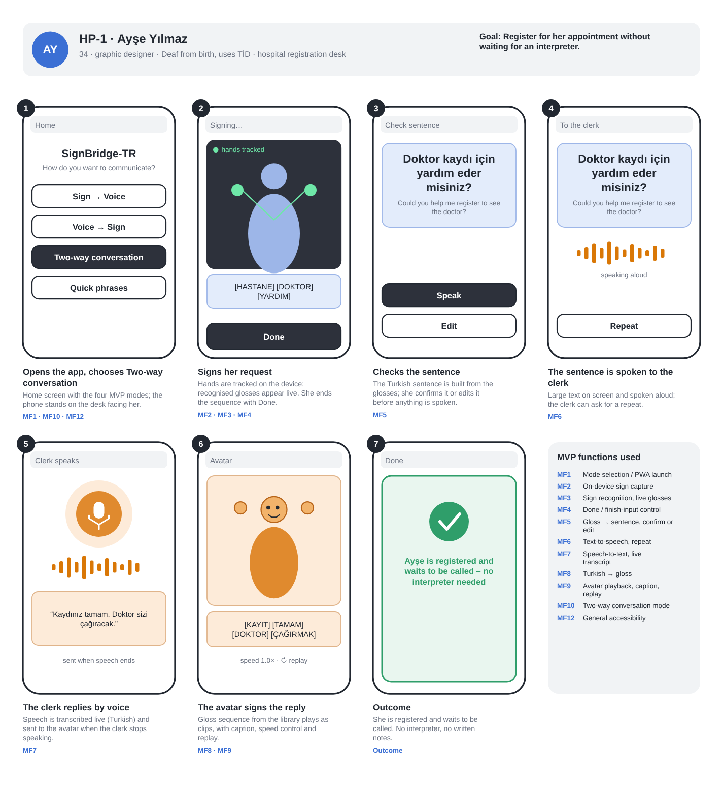
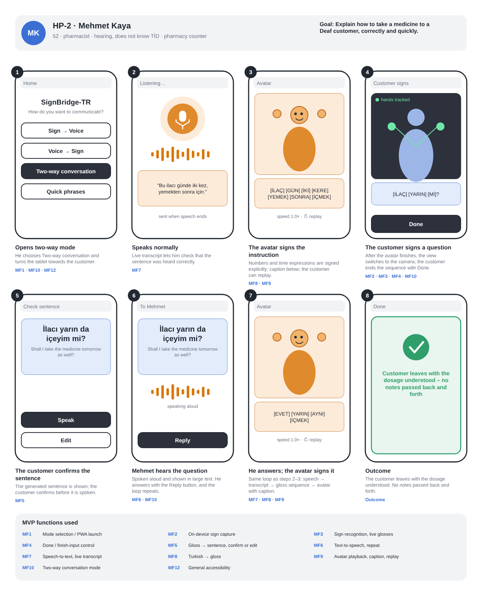
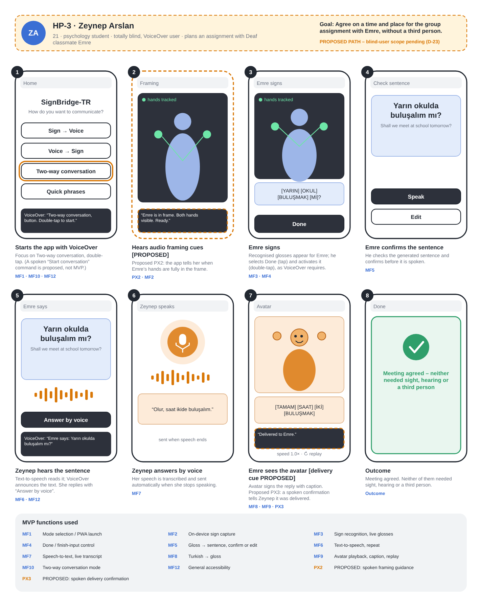
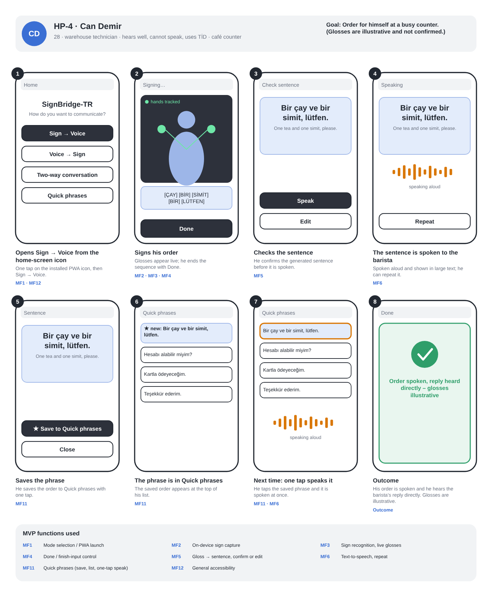

# Statement of Work – Happy Paths of the User Personas

**Project:** SignBridge-TR (İşaret Köprüsü)
**SoW template section:** Happy Paths of the User Personas
**Jira:** [SB-23 — Statement of Work – Happy Paths for User Personas](https://el-dili.atlassian.net/browse/SB-23) (depends on [SB-22](https://el-dili.atlassian.net/browse/SB-22), SoW skeleton)
**Status:** Draft for team review · 24 October 2026 · prepared by Barış Hansu. Not yet reviewed by the team or approved by the advisor. The Statement of Work is due on 13 November 2026.
**Sources:** [Project Proposal v1.1 (PDF)](../SignBridge-TR_Project_Proposal.pdf) · [SB-8 scope companion](../SB-8_Project_Proposal_and_Scope.md) · [Supporting Technical Notes](../SB-18_Supporting_Technical_Notes.md) (Figure 2 wireframes, latency events) · [Instructor Feedback and Team Review Matrix](../SB-18_Instructor_Feedback_Matrix.md) · Sprint 2 Technical Meeting (20 October 2026, Topic 3)

## 1. Purpose

This section turns the four persona scenarios of the proposal into happy paths: one successful, end-to-end scenario per persona, from the persona's goal to the completed task. Each path states its preconditions, a step-by-step flow of user actions and system responses, and its outcome, and is accompanied by a low-fidelity screen sketch. Together the four paths exercise the core functions of the minimum viable product (MVP).

The high-level functionalities that these paths require, their use cases and their measurable acceptance criteria are defined in the next SoW sections ([SB-24](https://el-dili.atlassian.net/browse/SB-24)). This document therefore refers to MVP functions by short IDs (MF1–MF12) so that SB-24 can build on them.

## 2. Ground rules

1. **Only the successful scenario is shown.** Failures (a sign is not recognised, speech is misheard, no network, a word is missing from the avatar library) are handled in the use cases of SB-24, not here.
2. **Only MVP functions are used**, as SB-23 requires (the point was raised in the Sprint 2 Technical Meeting). The functions are listed in the table below, with their source in the proposal. Blind-specific features are not an agreed MVP commitment (open decision D-23). Where a step uses one, it is marked **PROPOSED** and has its own ID (PX1–PX3).
3. **Two controls separate input from output** in every sign-to-speech flow, as the proposal requires (functional requirement 3): the signer ends the sign sequence with an accessible **Done** control (a longer pause is an alternative, Technical Notes §4), and then **confirms or edits** the generated sentence before it is spoken.
4. **Gloss examples are illustrative.** The signed input of HP-1, HP-2 and HP-3 (Direction A) is built mainly from words that a class-name match found in AUTSL: HASTANE, DOKTOR, İLAÇ, YARDIM, YARIN and OKUL (the match also found ECZANE, SAAT and TEŞEKKÜR). A name match does not prove that the Dataset sign is the intended TİD sign, and the other glosses (for example BULUŞMAK and Mİ) and the café order of HP-4 have not been checked. The single *saat* class does not cover numbers or clock times. The avatar side (Direction B) uses the team's own clip library, which is separate from the Dataset vocabulary. The scenario dialogues are fixed only after the coverage audit (before 13 November 2026) and may be shortened.
5. **Labels are in English for readability.** The final interface will be in Turkish. In the flow tables, **S1, S2, …** refer to the numbered screens of that path's storyboard; some steps show their result on the next screen.
6. **Raw camera video is processed on the device and is neither stored nor sent** (objective O8); only recognised glosses and text move on.

### MVP functions used by the happy paths

| ID | MVP function | Source in the proposal / scope companion |
|---|---|---|
| MF1 | Mode selection on the home screen (Sign → Voice, Voice → Sign, Two-way conversation, Quick phrases); launch of the installed PWA from its home-screen icon | Functional requirement 1; Happy Paths text |
| MF2 | On-device camera capture and landmark extraction ("hands tracked") | Functional requirement 2; O8 |
| MF3 | Recognition of isolated signs with automatic segmentation; glosses shown live | Functional requirement 2; O1 |
| MF4 | "Done / finish input" control that ends the sign sequence | Functional requirement 3; Technical Notes §4 |
| MF5 | Turkish sentence built from the glosses; shown in large text; confirm or edit before it is spoken | Functional requirement 3; O2 |
| MF6 | Turkish text-to-speech output, with repeat | Functional requirement 3 |
| MF7 | Turkish speech-to-text with live transcript | Functional requirement 4; O3 |
| MF8 | Turkish sentence → TİD gloss sequence (LLM + rule layer, limited to library glosses) | Functional requirement 4; RQ2 |
| MF9 | Avatar playback of library clips with caption, adjustable speed and replay | Functional requirement 5; O4 |
| MF10 | Two-way conversation mode (alternating sign → voice and voice → sign) | Functional requirement 1 |
| MF11 | Quick phrases: save a sentence, list, speak with one tap | Functional requirement 7 |
| MF12 | General accessibility: all controls operable by keyboard and screen reader, readable large text, captions, results exposed as status messages (WCAG 2.2 AA) | Functional requirement 6 (general accessibility stays in scope); O6 |
| PX1 | **PROPOSED (D-23):** in-app voice commands, with keyboard and touch alternatives | Functional requirement 6 |
| PX2 | **PROPOSED (D-23):** spoken framing guidance | Functional requirement 6 |
| PX3 | **PROPOSED (D-23):** spoken confirmation that the message was delivered; vibration only where supported | Functional requirement 6 |

### Measures from the proposal that apply to the paths

No new targets are set here. The measures below are the existing objectives, and each path states which of them it exercises.

| Measure | Target in the proposal |
|---|---|
| O5-A, signs → speech | Median time from the end of the last sign (pause detection included) to the start of spoken output ≤ 2.0 s; the time a user spends confirming a sentence is excluded and reported separately |
| O5-B, speech → avatar | Median time from the end of speech to the avatar starting to sign ≤ 2.5 s |
| O6, accessibility | WCAG 2.2 AA; all four persona flows completed from start to finish with VoiceOver/TalkBack and with the keyboard only |
| O7, usability | Task completion without researcher assistance ≥ 80% and mean SUS ≥ 70, reported per stage and per user group |
| O8, privacy | Raw camera video never leaves the device |

---

## 3. HP-1 · Ayşe Yılmaz – registration at a hospital desk

**Persona:** Ayşe Yılmaz, 34, graphic designer, Deaf from birth; TİD is her first language and she reads Turkish at a basic level ([Table 3](../SignBridge-TR_Project_Proposal.pdf)).
**Goal:** Register for her appointment at the hospital desk without waiting for an interpreter.
**Mode:** Two-way conversation.

**Preconditions**

- SignBridge-TR is installed or open on Ayşe's phone; camera and microphone permissions are already granted, and the device is online.
- The phone stands on the desk, facing Ayşe, with her hands and upper body in frame and enough light.
- The clerk speaks Turkish. The words of the scenario are in the recognition vocabulary (Direction A) and in the avatar clip library (Direction B).

**Flow**

| # | User action | System response | MVP functions | Sketch |
|---|---|---|---|---|
| 1 | Ayşe opens the app, places the phone on the desk and taps **Two-way conversation**. | Shows the home screen with the four modes, opens two-way mode and starts the camera preview. | MF1, MF10, MF12 | S1 |
| 2 | Ayşe signs her request (*HASTANE, DOKTOR, YARDIM*), pausing briefly between signs. | Extracts landmarks on the device, recognises each isolated sign after its pause and lists the glosses live. | MF2, MF3 | S2 |
| 3 | Ayşe taps **Done**. | Ends the sign sequence, builds the Turkish sentence from the glosses and shows it in large text with **Speak** and **Edit**. | MF4, MF5 | S3 |
| 4 | Ayşe checks the sentence and taps **Speak**. | Reads *"Doktor kaydı için yardım eder misiniz?"* aloud to the clerk and keeps it on screen; **Repeat** is available. | MF5, MF6 | S4 |
| 5 | The clerk answers aloud: *"Kaydınız tamam. Doktor sizi çağıracak."* | Switches to listening, shows a live transcript and, when the speech ends, sends it on. | MF7, MF10 | S5 |
| 6 | Ayşe watches the avatar. | Converts the sentence into a gloss sequence from the library and plays the clips with a caption; Ayşe can replay or change the speed. | MF8, MF9 | S6 |
| 7 | Ayşe takes a seat in the waiting area. | Flow ends. | – | S7 |

**Outcome:** Ayşe is registered and knows that the doctor will call her. No interpreter and no written notes were needed.

**Measures exercised:** O5-A (signing to spoken output), O5-B (clerk's speech to avatar), O6, O7 (Deaf/hard-of-hearing TİD users and hearing non-signers), O8.

---

## 4. HP-2 · Mehmet Kaya – explaining a dosage at a pharmacy counter

**Persona:** Mehmet Kaya, 52, pharmacist with his own neighbourhood pharmacy in Konya; hearing, does not know TİD, moderate technology skills.
**Goal:** Explain how to take a medicine to a Deaf customer, correctly and quickly.
**Mode:** Two-way conversation, starting from the hearing side.

**Preconditions**

- SignBridge-TR is open on the pharmacy tablet; permissions are granted and the device is online.
- A Deaf TİD user stands at the counter and can see the tablet; the tablet can also see the customer's hands when it is turned toward them.
- The glosses for the dosage sentence are in the avatar clip library. Numbers and time expressions ("iki kez", "yemekten sonra") are signed explicitly, not left to the caption.

**Flow**

| # | User action | System response | MVP functions | Sketch |
|---|---|---|---|---|
| 1 | Mehmet opens the app, taps **Two-way conversation** and turns the tablet toward the customer. | Opens two-way mode (as HP-1, step 1). | MF1, MF10, MF12 | S1 |
| 2 | Mehmet says: *"Bu ilacı günde iki kez, yemekten sonra için."* | Transcribes live so that Mehmet can check that he was heard correctly; when the speech ends, sends the transcript on. | MF7 | S2 |
| 3 | The customer watches the avatar. | Converts the sentence into a gloss sequence from the library, with numbers and times as explicit signs, and plays the clips with a caption; the customer can replay or slow down. | MF8, MF9 | S3 |
| 4 | The customer signs a question (*İLAÇ, YARIN, Mİ*) and taps **Done**. | After the avatar finishes, switches to the camera, recognises the signs and lists the glosses; on **Done**, builds the sentence and shows it with **Speak** and **Edit**. | MF2, MF3, MF4, MF5, MF10 | S4–S5 |
| 5 | The customer confirms with **Speak**. | Reads *"İlacı yarın da içeyim mi?"* aloud and shows it in large text, with a **Reply** button. | MF5, MF6 | S5–S6 |
| 6 | Mehmet taps **Reply** and answers by voice: *"Evet, yarın da aynı şekilde için."* | Repeats steps 2–3: transcript, gloss sequence, avatar with caption. | MF7, MF8, MF9, MF10 | S6–S7 |
| 7 | The customer understands the answer and leaves. | Flow ends. | – | S8 |

**Outcome:** The customer leaves with the dosage understood. No notes were passed back and forth, and the risk of a misunderstood "twice a day, after meals" is removed.

**Measures exercised:** O5-A and O5-B, O4 (the signed instruction is understood), O7, O8.

---

## 5. HP-3 · Zeynep Arslan – planning a group assignment with a Deaf classmate

> **PROPOSED PATH.** Blind-specific features are not an agreed MVP commitment; the team preference and the advisor decision are open (D-23). This path is kept because the proposal lists four personas and objective O6 requires all four persona flows to work with VoiceOver/TalkBack. Steps that depend on a proposed feature are marked **PROPOSED**. A fallback variant is given below.

**Persona:** Zeynep Arslan, 21, third-year psychology student, totally blind since childhood, very good with VoiceOver, hearing. Her Deaf classmate Emre is in the same project group.
**Goal:** Agree with Emre on a time and place for the group assignment, without a third person.
**Mode:** Two-way conversation.

**Preconditions**

- SignBridge-TR is open on Zeynep's phone; VoiceOver is on, permissions are granted and the device is online.
- Emre sits opposite Zeynep and the phone is positioned so that the camera sees him (Emre sets it up or the phone stands on a stand). Zeynep cannot check the framing herself.
- The phone is Zeynep's, so VoiceOver stays on while Emre uses the on-screen controls **Done**, **Speak** and **Edit**. With VoiceOver on, a control is selected with one tap (the focus frame is visible) and activated with a double-tap; Zeynep shows Emre this once. Whether the signer's side needs a view that works without VoiceOver gestures is open point 7.

**Flow**

| # | User action | System response | MVP functions | Sketch |
|---|---|---|---|---|
| 1 | Zeynep starts the app with VoiceOver, moves the focus to **Two-way conversation** and double-taps. (**PROPOSED** alternative: she says "Start conversation".) | VoiceOver announces the control; opens two-way mode and starts the camera. | MF1, MF10, MF12 (PX1) | S1 |
| 2 | Zeynep waits. | **PROPOSED:** speaks a cue when Emre's hands are fully in the frame: *"Emre is in frame. Both hands visible. Ready."* | PX2, MF2 | S2 |
| 3 | Emre signs (*YARIN, OKUL, BULUŞMAK, Mİ*) and ends the sequence with **Done** (tap to select, double-tap to activate). | Recognises the signs and lists the glosses for Emre; on **Done**, builds the sentence. | MF3, MF4, MF5 | S3 |
| 4 | Emre checks the sentence and confirms with **Speak** (tap, double-tap). | Reads *"Yarın okulda buluşalım mı?"* aloud and exposes the text to VoiceOver as a status message. | MF5, MF6, MF12 | S4–S5 |
| 5 | Zeynep activates **Answer by voice** (focus and double-tap; **PROPOSED** alternative: voice command) and says: *"Olur, saat ikide buluşalım."* | Transcribes the speech and, when it ends, sends it on. | MF7 (PX1) | S5–S6 |
| 6 | Emre watches the avatar. | Converts the sentence into a gloss sequence and plays the clips with a caption. **PROPOSED:** tells Zeynep by voice *"Delivered to Emre."* | MF8, MF9, PX3 | S7 |
| 7 | Zeynep and Emre have agreed the meeting. | Flow ends. | – | S8 |

**Outcome:** The meeting is agreed. Neither of them needed sight, hearing or a third person.

**Measures exercised:** O6 (VoiceOver and keyboard completion of the whole flow), RQ4 and the blind-user group of O7 (only if D-23 keeps the independent flow).

**Fallback variant, if D-23 narrows the scope to mediated communication** (the blind person communicates through the Deaf user's device): Emre owns and operates the device; Zeynep only speaks and listens. Steps 1, 2 and 5 become Emre's actions as in HP-1; PX1–PX3 are dropped; steps 3, 4 and 6 stay unchanged. The path then no longer demonstrates an independent blind-user flow.

---

## 6. HP-4 · Can Demir – ordering at a busy café

**Persona:** Can Demir, 28, warehouse technician in Bursa; hears well but cannot speak because of a congenital speech disorder; learned TİD at a special-education school.
**Goal:** Order for himself at a busy counter and be understood the first time.
**Mode:** Sign → Voice, then Quick phrases.

**Preconditions**

- SignBridge-TR is installed as a PWA and has an icon on Can's home screen; permissions are granted and the device is online.
- The phone is propped on the counter or held so that Can's hands and upper body are in frame.
- A default speaking voice is set.

**Flow**

| # | User action | System response | MVP functions | Sketch |
|---|---|---|---|---|
| 1 | Can taps the SignBridge-TR icon on his home screen, then **Sign → Voice**. | Launches the PWA, opens Sign → Voice and starts the camera. | MF1, MF12 | S1 |
| 2 | Can signs his order (*ÇAY, BİR, SİMİT, BİR, LÜTFEN*) and taps **Done**. | Recognises the signs, lists the glosses live; on **Done**, builds the sentence. | MF2, MF3, MF4 | S2–S3 |
| 3 | Can checks the sentence and taps **Speak**. | Reads *"Bir çay ve bir simit, lütfen."* aloud and keeps it in large text; **Repeat** is available. | MF5, MF6 | S3–S4 |
| 4 | The barista hears the order and prepares it. Can taps **Repeat** if needed. | Speaks the sentence again. | MF6 | S4 |
| 5 | Can taps **Save to Quick phrases**. | Stores the sentence on the device and shows it at the top of the Quick phrases list. | MF11 | S5–S6 |
| 6 | *Next visit:* Can opens **Quick phrases** and taps the saved phrase. | Speaks the phrase at once, without the camera step. | MF11, MF6 | S7 |

*The glosses of this path are illustrative: no word of the café order has been confirmed by the class-name match (see ground rule 4).*

**Outcome:** Can gets his order right the first time and hears the barista's reply directly. His order is saved for one-tap reuse.

**Measures exercised:** O5-A, O6, O7, O8.

---

## 7. Coverage of MVP functions

| Function | HP-1 Ayşe | HP-2 Mehmet | HP-3 Zeynep (proposed) | HP-4 Can |
|---|:---:|:---:|:---:|:---:|
| MF1 Mode selection / PWA launch | ✓ | ✓ | ✓ | ✓ |
| MF2 On-device sign capture | ✓ | ✓ | ✓ | ✓ |
| MF3 Sign recognition, live glosses | ✓ | ✓ | ✓ | ✓ |
| MF4 Done control | ✓ | ✓ | ✓ | ✓ |
| MF5 Sentence, confirm or edit | ✓ | ✓ | ✓ | ✓ |
| MF6 Text-to-speech | ✓ | ✓ | ✓ | ✓ |
| MF7 Speech-to-text | ✓ | ✓ | ✓ | – |
| MF8 Turkish → gloss | ✓ | ✓ | ✓ | – |
| MF9 Avatar playback | ✓ | ✓ | ✓ | – |
| MF10 Two-way mode | ✓ | ✓ | ✓ | – |
| MF11 Quick phrases | – | – | – | ✓ |
| MF12 General accessibility | ✓ | ✓ | ✓ | ✓ |
| PX1–PX3 (proposed, D-23) | – | – | ✓ | – |

Not shown on any path: the fingerspelling fallback for words that are not in the avatar library (functional requirement 5), and the stand-alone **Voice → Sign** mode, which shares MF7–MF9 with the voice half of the two-way mode (HP-1, HP-2). Both are exceptional or alternative flows for the use cases of SB-24.

## 8. Open points for team review

| # | Point | What this document assumes | Decision needed from |
|---|---|---|---|
| 1 | **Blind-user scope (D-23)** | HP-3 is kept as a proposed path with PX1–PX3 marked; a fallback variant for mediated communication is described. | Team, then advisor |
| 2 | **Confirm before speaking** | Every sign-to-speech flow has Done and confirm/edit (functional requirement 3, Technical Notes §4). Figure 2 (a) and (b) in the Technical Notes show the sentence spoken directly, so those wireframes would need to be updated if the team agrees. | Team |
| 3 | **When speech is sent to the avatar** | Sent automatically when the speech ends. Figure 2 (a) says "Auto-sent" and (b) shows a **Send to avatar** button; the two differ. | Team |
| 4 | **Vocabulary** | Glosses are illustrative. HP-1 to HP-3 use mainly classes found by name match (HASTANE, DOKTOR, YARDIM, İLAÇ, YARIN, OKUL); HP-4 (SİMİT, BİR, ÇAY, LÜTFEN) has none confirmed. If the coverage audit shows that a sign is missing, the scenario sentence is rephrased with covered glosses. | Owner of the coverage audit |
| 5 | **Quick phrases (HP-4)** | Saving is an explicit user action, and phrases are stored on the device only. The proposal says only "saved quick phrases". | Team, together with the privacy decisions (data-flow table) |
| 6 | **Figure 2 (d) items not carried over** | The persona need "a voice he chose" has no matching functional requirement, so a default voice is used. Confirming the sentence by signing TAMAM is not used; confirmation is by tap only. | Team |
| 7 | **VoiceOver on a shared phone (HP-3)** | The signer uses the controls of the blind user's phone with VoiceOver on (tap, then double-tap). If this proves impractical, the signer's side needs a view without VoiceOver gestures, or the path is reduced to the mediated variant. | Team, together with D-23 |

## 9. Traceability

| Item | Where |
|---|---|
| Personas, happy-path summary | Proposal v1.1, Table 3 and "Happy Paths of the User Personas" |
| Original wireframes (Figure 2 a–d) | [Technical Notes, appendix](../SB-18_Supporting_Technical_Notes.md) |
| Functional requirements and objectives O1–O8 | [SB-8 scope companion](../SB-8_Project_Proposal_and_Scope.md) |
| Blind-user scope decision D-23 | [Feedback Matrix](../SB-18_Instructor_Feedback_Matrix.md) |
| Happy paths use MVP functions only | SB-23 description; raised in the Sprint 2 Technical Meeting, Topic 3 (20 October 2026) |
| Next sections that build on these paths | [SB-24](https://el-dili.atlassian.net/browse/SB-24): scope of work, use cases, acceptance criteria |
